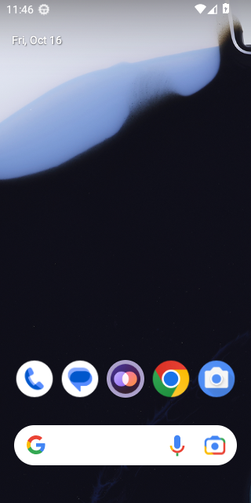
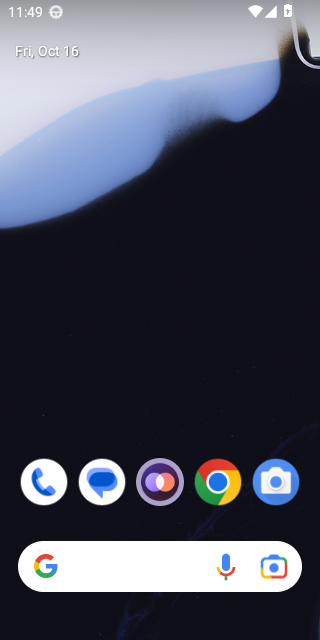

# Calls on Android 13 (API 33)

WebView: com.google.android.webview, 109.0.5414.123

## FAIL - First call while Priya is offline, allowing the microphone

Stopped: `timed out after 20s waiting for Android's microphone question`

- NO  the app is still open - `{"pidBefore":"","pidAfter":""}`

<details><summary>Steps</summary>

- 20.1s tap Call - `"pressed Call"`

</details>

### Crash

```
08  5109  5109 F DEBUG   :       #10 pc 000000000344bcc8  /data/app/~~2xe32SOrxn6vw2t8kFBS7A==/com.google.android.trichromelibrary_541412337-bz2PXEGxHNFTfl5WN-D0Yw==/TrichromeLibrary.apk!libmonochrome_64.so (offset 0x882000) (BuildId: f1d4dbfe493e11c190bf218ac9032baaa9bd1370)
10-16 11:45:50.408  5109  5109 F DEBUG   :       #11 pc 000000000344bb93  /data/app/~~2xe32SOrxn6vw2t8kFBS7A==/com.google.android.trichromelibrary_541412337-bz2PXEGxHNFTfl5WN-D0Yw==/TrichromeLibrary.apk!libmonochrome_64.so (offset 0x882000) (BuildId: f1d4dbfe493e11c190bf218ac9032baaa9bd1370)
10-16 11:45:50.408  5109  5109 F DEBUG   :       #12 pc 000000000001076e  /system/lib64/libutils.so (android::Looper::pollOnce(int, int*, int*, void**)+894) (BuildId: bf3f66fd6f5b7c78306a1c8270331f22)
10-16 11:45:50.408  5109  5109 F DEBUG   :       #13 pc 000000000016caf3  /system/lib64/libandroid_runtime.so (android::android_os_MessageQueue_nativePollOnce(_JNIEnv*, _jobject*, long, int)+35) (BuildId: 2a4aa560a892d0dcd59b0b00821a1dfa)
10-16 11:45:50.408  5109  5109 F DEBUG   :       #14 pc 00000000001b5da4  /system/framework/x86_64/boot-framework.oat (art_jni_trampoline+132) (BuildId: 250f96efbdd22b213d58e391bed71acfa743aa83)
10-16 11:45:50.408  5109  5109 F DEBUG   :       #15 pc 00000000003703fb  /apex/com.android.art/lib64/libart.so (nterp_helper+5643) (BuildId: 83888e21c265ad4f1cc612f8fca2b8fa)
10-16 11:45:50.408  5109  5109 F DEBUG   :       #16 pc 000000000049a5ce  /system/framework/framework.jar (android.os.MessageQueue.next+34)
10-16 11:45:50.408  5109  5109 F DEBUG   :       #17 pc 000000000036fc88  /apex/com.android.art/lib64/libart.so (nterp_helper+3736) (BuildId: 83888e21c265ad4f1cc612f8fca2b8fa)
10-16 11:45:50.408  5109  5109 F DEBUG   :       #18 pc 00000000004995bc  /system/framework/framework.jar (android.os.Looper.loopOnce+12)
10-16 11:45:50.408  5109  5109 F DEBUG   :       #19 pc 000000000036ee28  /apex/com.android.art/lib64/libart.so (nterp_helper+56) (BuildId: 83888e21c265ad4f1cc612f8fca2b8fa)
10-16 11:45:50.408  5109  5109 F DEBUG   :       #20 pc 0000000000499daa  /system/framework/framework.jar (android.os.Looper.loop+162)
10-16 11:45:50.408  5109  5109 F DEBUG   :       #21 pc 000000000036ee28  /apex/com.android.art/lib64/libart.so (nterp_helper+56) (BuildId: 83888e21c265ad4f1cc612f8fca2b8fa)
10-16 11:45:50.408  5109  5109 F DEBUG   :       #22 pc 00000000001bd0de  /system/framework/framework.jar (android.app.ActivityThread.main+202)
10-16 11:45:50.408  5109  5109 F DEBUG   :       #23 pc 0000000000378b26  /apex/com.android.art/lib64/libart.so (art_quick_invoke_static_stub+806) (BuildId: 83888e21c265ad4f1cc612f8fca2b8fa)
10-16 11:45:50.408  5109  5109 F DEBUG   :       #24 pc 00000000003fce09  /apex/com.android.art/lib64/libart.so (art::ArtMethod::Invoke(art::Thread*, unsigned int*, unsigned int, art::JValue*, char const*)+265) (BuildId: 83888e21c265ad4f1cc612f8fca2b8fa)
10-16 11:45:50.408  5109  5109 F DEBUG   :       #25 pc 000000000081eb37  /apex/com.android.art/lib64/libart.so (_jobject* art::InvokeMethod<(art::PointerSize)8>(art::ScopedObjectAccessAlreadyRunnable const&, _jobject*, _jobject*, _jobject*, unsigned long)+1447) (BuildId: 83888e21c265ad4f1cc612f8fca2b8fa)
10-16 11:45:50.408  5109  5109 F DEBUG   :       #26 pc 000000000078e678  /apex/com.android.art/lib64/libart.so (art::Method_invoke(_JNIEnv*, _jobject*, _jobject*, _jobjectArray*)+56) (BuildId: 83888e21c265ad4f1cc612f8fca2b8fa)
10-16 11:45:50.408  5109  5109 F DEBUG   :       #27 pc 000000000009b400  /system/framework/x86_64/boot.oat (art_jni_trampoline+128) (BuildId: 8975dfa0bab8693f1c851576629005f1e7eb5def)
10-16 11:45:50.408  5109  5109 F DEBUG   :       #28 pc 000000000036fced  /apex/com.android.art/lib64/libart.so (nterp_helper+3837) (BuildId: 83888e21c265ad4f1cc612f8fca2b8fa)
10-16 11:45:50.408  5109  5109 F DEBUG   :       #29 pc 00000000004055ba  /system/framework/framework.jar (com.android.internal.os.RuntimeInit$MethodAndArgsCaller.run+22)
10-16 11:45:50.408  5109  5109 F DEBUG   :       #30 pc 000000000082491e  /system/framework/x86_64/boot-framework.oat (com.android.internal.os.ZygoteInit.main+3022) (BuildId: 250f96efbdd22b213d58e391bed71acfa743aa83)
10-16 11:45:50.408  5109  5109 F DEBUG   :       #31 pc 0000000000378b26  /apex/com.android.art/lib64/libart.so (art_quick_invoke_static_stub+806) (BuildId: 83888e21c265ad4f1cc612f8fca2b8fa)
10-16 11:45:50.408  5109  5109 F DEBUG   :       #32 pc 00000000003fce09  /apex/com.android.art/lib64/libart.so (art::ArtMethod::Invoke(art::Thread*, unsigned int*, unsigned int, art::JValue*, char const*)+265) (BuildId: 83888e21c265ad4f1cc612f8fca2b8fa)
10-16 11:45:50.409  5109  5109 F DEBUG   :       #33 pc 000000000081f4ea  /apex/com.android.art/lib64/libart.so (art::JValue art::InvokeWithVarArgs<art::ArtMethod*>(art::ScopedObjectAccessAlreadyRunnable const&, _jobject*, art::ArtMethod*, __va_list_tag*)+474) (BuildId: 83888e21c265ad4f1cc612f8fca2b8fa)
10-16 11:45:50.409  5109  5109 F DEBUG   :       #34 pc 00000000006e48b4  /apex/com.android.art/lib64/libart.so (art::JNI<true>::CallStaticVoidMethodV(_JNIEnv*, _jclass*, _jmethodID*, __va_list_tag*)+676) (BuildId: 83888e21c265ad4f1cc612f8fca2b8fa)
10-16 11:45:50.409  5109  5109 F DEBUG   :       #35 pc 00000000000d5294  /system/lib64/libandroid_runtime.so (_JNIEnv::CallStaticVoidMethod(_jclass*, _jmethodID*, ...)+164) (BuildId: 2a4aa560a892d0dcd59b0b00821a1dfa)
10-16 11:45:50.409  5109  5109 F DEBUG   :       #36 pc 00000000000e1e01  /system/lib64/libandroid_runtime.so (android::AndroidRuntime::start(char const*, android::Vector<android::String8> const&, bool)+897) (BuildId: 2a4aa560a892d0dcd59b0b00821a1dfa)
10-16 11:45:50.409  5109  5109 F DEBUG   :       #37 pc 0000000000002faf  /system/bin/app_process64 (main+1583) (BuildId: a49f9e708801f6a0a629f488a0e449c9)
10-16 11:45:50.409  5109  5109 F DEBUG   :       #38 pc 0000000000050cc9  /apex/com.android.runtime/lib64/bionic/libc.so (__libc_init+89) (BuildId: f090904cc3ac285a6f190f8003c3eb0e)

```

```
ACTIVITY MANAGER PROCESS EXIT INFO (dumpsys activity exit-info)
Last Timestamp of Persistence Into Persistent Storage: 1970-01-01 00:00:00.000
  package: app.two.android
    Historical Process Exit for uid=10174
        ApplicationExitInfo #0:
          timestamp=2026-10-16 11:45:50.583 pid=3749 realUid=99000 packageUid=10174 definingUid=10124 user=0
          process=com.google.android.webview:sandboxed_process0:org.chromium.content.app.SandboxedProcessService0:0 reason=1 (EXIT_SELF) subreason=17 (ISOLATED NOT NEEDED) status=0
          importance=400 pss=0.00 rss=0.00 description=isolated not needed state=empty trace=null
        ApplicationExitInfo #1:
          timestamp=2026-10-16 11:45:50.433 pid=3643 realUid=10174 packageUid=10174 definingUid=10174 user=0
          process=app.two.android reason=5 (APP CRASH(NATIVE)) subreason=0 (UNKNOWN) status=5
          importance=100 pss=85MB rss=230MB description=crash state=empty trace=null

```


Log: [first-call-while-priya-is-offline-allowing-the-mic.log](first-call-while-priya-is-offline-allowing-the-mic.log)

## FAIL - Call while Priya is offline rings out

Stopped: `the app closed while ringing`

- NO  the call service runs in the foreground
- NO  the app is still open - `{"pidBefore":"","pidAfter":""}`

<details><summary>Steps</summary>

- 53.3s tap Call - `"pressed Call"`

</details>

### Crash

```
23  7151  7151 F DEBUG   :       #10 pc 000000000344bcc8  /data/app/~~2xe32SOrxn6vw2t8kFBS7A==/com.google.android.trichromelibrary_541412337-bz2PXEGxHNFTfl5WN-D0Yw==/TrichromeLibrary.apk!libmonochrome_64.so (offset 0x882000) (BuildId: f1d4dbfe493e11c190bf218ac9032baaa9bd1370)
10-16 11:46:23.023  7151  7151 F DEBUG   :       #11 pc 000000000344bb93  /data/app/~~2xe32SOrxn6vw2t8kFBS7A==/com.google.android.trichromelibrary_541412337-bz2PXEGxHNFTfl5WN-D0Yw==/TrichromeLibrary.apk!libmonochrome_64.so (offset 0x882000) (BuildId: f1d4dbfe493e11c190bf218ac9032baaa9bd1370)
10-16 11:46:23.023  7151  7151 F DEBUG   :       #12 pc 000000000001076e  /system/lib64/libutils.so (android::Looper::pollOnce(int, int*, int*, void**)+894) (BuildId: bf3f66fd6f5b7c78306a1c8270331f22)
10-16 11:46:23.023  7151  7151 F DEBUG   :       #13 pc 000000000016caf3  /system/lib64/libandroid_runtime.so (android::android_os_MessageQueue_nativePollOnce(_JNIEnv*, _jobject*, long, int)+35) (BuildId: 2a4aa560a892d0dcd59b0b00821a1dfa)
10-16 11:46:23.024  7151  7151 F DEBUG   :       #14 pc 00000000001b5da4  /system/framework/x86_64/boot-framework.oat (art_jni_trampoline+132) (BuildId: 250f96efbdd22b213d58e391bed71acfa743aa83)
10-16 11:46:23.024  7151  7151 F DEBUG   :       #15 pc 00000000003703fb  /apex/com.android.art/lib64/libart.so (nterp_helper+5643) (BuildId: 83888e21c265ad4f1cc612f8fca2b8fa)
10-16 11:46:23.024  7151  7151 F DEBUG   :       #16 pc 000000000049a5ce  /system/framework/framework.jar (android.os.MessageQueue.next+34)
10-16 11:46:23.024  7151  7151 F DEBUG   :       #17 pc 000000000036fc88  /apex/com.android.art/lib64/libart.so (nterp_helper+3736) (BuildId: 83888e21c265ad4f1cc612f8fca2b8fa)
10-16 11:46:23.024  7151  7151 F DEBUG   :       #18 pc 00000000004995bc  /system/framework/framework.jar (android.os.Looper.loopOnce+12)
10-16 11:46:23.024  7151  7151 F DEBUG   :       #19 pc 000000000036ee28  /apex/com.android.art/lib64/libart.so (nterp_helper+56) (BuildId: 83888e21c265ad4f1cc612f8fca2b8fa)
10-16 11:46:23.024  7151  7151 F DEBUG   :       #20 pc 0000000000499daa  /system/framework/framework.jar (android.os.Looper.loop+162)
10-16 11:46:23.024  7151  7151 F DEBUG   :       #21 pc 000000000036ee28  /apex/com.android.art/lib64/libart.so (nterp_helper+56) (BuildId: 83888e21c265ad4f1cc612f8fca2b8fa)
10-16 11:46:23.024  7151  7151 F DEBUG   :       #22 pc 00000000001bd0de  /system/framework/framework.jar (android.app.ActivityThread.main+202)
10-16 11:46:23.024  7151  7151 F DEBUG   :       #23 pc 0000000000378b26  /apex/com.android.art/lib64/libart.so (art_quick_invoke_static_stub+806) (BuildId: 83888e21c265ad4f1cc612f8fca2b8fa)
10-16 11:46:23.024  7151  7151 F DEBUG   :       #24 pc 00000000003fce09  /apex/com.android.art/lib64/libart.so (art::ArtMethod::Invoke(art::Thread*, unsigned int*, unsigned int, art::JValue*, char const*)+265) (BuildId: 83888e21c265ad4f1cc612f8fca2b8fa)
10-16 11:46:23.024  7151  7151 F DEBUG   :       #25 pc 000000000081eb37  /apex/com.android.art/lib64/libart.so (_jobject* art::InvokeMethod<(art::PointerSize)8>(art::ScopedObjectAccessAlreadyRunnable const&, _jobject*, _jobject*, _jobject*, unsigned long)+1447) (BuildId: 83888e21c265ad4f1cc612f8fca2b8fa)
10-16 11:46:23.024  7151  7151 F DEBUG   :       #26 pc 000000000078e678  /apex/com.android.art/lib64/libart.so (art::Method_invoke(_JNIEnv*, _jobject*, _jobject*, _jobjectArray*)+56) (BuildId: 83888e21c265ad4f1cc612f8fca2b8fa)
10-16 11:46:23.024  7151  7151 F DEBUG   :       #27 pc 000000000009b400  /system/framework/x86_64/boot.oat (art_jni_trampoline+128) (BuildId: 8975dfa0bab8693f1c851576629005f1e7eb5def)
10-16 11:46:23.024  7151  7151 F DEBUG   :       #28 pc 000000000036fced  /apex/com.android.art/lib64/libart.so (nterp_helper+3837) (BuildId: 83888e21c265ad4f1cc612f8fca2b8fa)
10-16 11:46:23.024  7151  7151 F DEBUG   :       #29 pc 00000000004055ba  /system/framework/framework.jar (com.android.internal.os.RuntimeInit$MethodAndArgsCaller.run+22)
10-16 11:46:23.024  7151  7151 F DEBUG   :       #30 pc 000000000082491e  /system/framework/x86_64/boot-framework.oat (com.android.internal.os.ZygoteInit.main+3022) (BuildId: 250f96efbdd22b213d58e391bed71acfa743aa83)
10-16 11:46:23.024  7151  7151 F DEBUG   :       #31 pc 0000000000378b26  /apex/com.android.art/lib64/libart.so (art_quick_invoke_static_stub+806) (BuildId: 83888e21c265ad4f1cc612f8fca2b8fa)
10-16 11:46:23.024  7151  7151 F DEBUG   :       #32 pc 00000000003fce09  /apex/com.android.art/lib64/libart.so (art::ArtMethod::Invoke(art::Thread*, unsigned int*, unsigned int, art::JValue*, char const*)+265) (BuildId: 83888e21c265ad4f1cc612f8fca2b8fa)
10-16 11:46:23.024  7151  7151 F DEBUG   :       #33 pc 000000000081f4ea  /apex/com.android.art/lib64/libart.so (art::JValue art::InvokeWithVarArgs<art::ArtMethod*>(art::ScopedObjectAccessAlreadyRunnable const&, _jobject*, art::ArtMethod*, __va_list_tag*)+474) (BuildId: 83888e21c265ad4f1cc612f8fca2b8fa)
10-16 11:46:23.024  7151  7151 F DEBUG   :       #34 pc 00000000006e48b4  /apex/com.android.art/lib64/libart.so (art::JNI<true>::CallStaticVoidMethodV(_JNIEnv*, _jclass*, _jmethodID*, __va_list_tag*)+676) (BuildId: 83888e21c265ad4f1cc612f8fca2b8fa)
10-16 11:46:23.024  7151  7151 F DEBUG   :       #35 pc 00000000000d5294  /system/lib64/libandroid_runtime.so (_JNIEnv::CallStaticVoidMethod(_jclass*, _jmethodID*, ...)+164) (BuildId: 2a4aa560a892d0dcd59b0b00821a1dfa)
10-16 11:46:23.024  7151  7151 F DEBUG   :       #36 pc 00000000000e1e01  /system/lib64/libandroid_runtime.so (android::AndroidRuntime::start(char const*, android::Vector<android::String8> const&, bool)+897) (BuildId: 2a4aa560a892d0dcd59b0b00821a1dfa)
10-16 11:46:23.024  7151  7151 F DEBUG   :       #37 pc 0000000000002faf  /system/bin/app_process64 (main+1583) (BuildId: a49f9e708801f6a0a629f488a0e449c9)
10-16 11:46:23.024  7151  7151 F DEBUG   :       #38 pc 0000000000050cc9  /apex/com.android.runtime/lib64/bionic/libc.so (__libc_init+89) (BuildId: f090904cc3ac285a6f190f8003c3eb0e)

```

```
ACTIVITY MANAGER PROCESS EXIT INFO (dumpsys activity exit-info)
Last Timestamp of Persistence Into Persistent Storage: 1970-01-01 00:00:00.000
  package: app.two.android
    Historical Process Exit for uid=10174
        ApplicationExitInfo #0:
          timestamp=2026-10-16 11:46:23.031 pid=6911 realUid=10174 packageUid=10174 definingUid=10174 user=0
          process=app.two.android reason=5 (APP CRASH(NATIVE)) subreason=0 (UNKNOWN) status=5
          importance=100 pss=89MB rss=247MB description=crash state=empty trace=null
        ApplicationExitInfo #1:
          timestamp=2026-10-16 11:45:50.583 pid=3749 realUid=99000 packageUid=10174 definingUid=10124 user=0
          process=com.google.android.webview:sandboxed_process0:org.chromium.content.app.SandboxedProcessService0:0 reason=1 (EXIT_SELF) subreason=17 (ISOLATED NOT NEEDED) status=0
          importance=400 pss=0.00 rss=0.00 description=isolated not needed state=empty trace=null
        ApplicationExitInfo #2:
          timestamp=2026-10-16 11:45:50.433 pid=3643 realUid=10174 packageUid=10174 definingUid=10174 user=0
          process=app.two.android reason=5 (APP CRASH(NATIVE)) subreason=0 (UNKNOWN) status=5
          importance=100 pss=85MB rss=230MB description=crash state=empty trace=null
    Historical Process Exit for uid=99001
        ApplicationExitInfo #0:
          timestamp=2026-10-16 11:46:23.178 pid=6949 realUid=99001 packageUid=10174 definingUid=10124 user=0
          process=com.google.android.webview:sandboxed_process0:org.chromium.content.app.SandboxedProcessService0:0 reason=1 (EXIT_SELF) subreason=0 (UNKNOWN) status=0
          importance=100 pss=0.00 rss=0.00 description=null state=empty trace=null

```

 

Log: [call-while-priya-is-offline-rings-out.log](call-while-priya-is-offline-rings-out.log)

## FAIL - Call cancelled straight away, ten times

Stopped: `the app closed (Cancel after 0 ms)`

- NO  the app is still open - `{"pidBefore":"","pidAfter":""}`

<details><summary>Steps</summary>

- 68.3s Call, then Cancel after 0 ms - `true`

</details>

### Crash

```
98  7354  7354 F DEBUG   :       #10 pc 000000000344bcc8  /data/app/~~2xe32SOrxn6vw2t8kFBS7A==/com.google.android.trichromelibrary_541412337-bz2PXEGxHNFTfl5WN-D0Yw==/TrichromeLibrary.apk!libmonochrome_64.so (offset 0x882000) (BuildId: f1d4dbfe493e11c190bf218ac9032baaa9bd1370)
10-16 11:46:37.898  7354  7354 F DEBUG   :       #11 pc 000000000344bb93  /data/app/~~2xe32SOrxn6vw2t8kFBS7A==/com.google.android.trichromelibrary_541412337-bz2PXEGxHNFTfl5WN-D0Yw==/TrichromeLibrary.apk!libmonochrome_64.so (offset 0x882000) (BuildId: f1d4dbfe493e11c190bf218ac9032baaa9bd1370)
10-16 11:46:37.898  7354  7354 F DEBUG   :       #12 pc 000000000001076e  /system/lib64/libutils.so (android::Looper::pollOnce(int, int*, int*, void**)+894) (BuildId: bf3f66fd6f5b7c78306a1c8270331f22)
10-16 11:46:37.898  7354  7354 F DEBUG   :       #13 pc 000000000016caf3  /system/lib64/libandroid_runtime.so (android::android_os_MessageQueue_nativePollOnce(_JNIEnv*, _jobject*, long, int)+35) (BuildId: 2a4aa560a892d0dcd59b0b00821a1dfa)
10-16 11:46:37.898  7354  7354 F DEBUG   :       #14 pc 00000000001b5da4  /system/framework/x86_64/boot-framework.oat (art_jni_trampoline+132) (BuildId: 250f96efbdd22b213d58e391bed71acfa743aa83)
10-16 11:46:37.898  7354  7354 F DEBUG   :       #15 pc 00000000003703fb  /apex/com.android.art/lib64/libart.so (nterp_helper+5643) (BuildId: 83888e21c265ad4f1cc612f8fca2b8fa)
10-16 11:46:37.898  7354  7354 F DEBUG   :       #16 pc 000000000049a5ce  /system/framework/framework.jar (android.os.MessageQueue.next+34)
10-16 11:46:37.898  7354  7354 F DEBUG   :       #17 pc 000000000036fc88  /apex/com.android.art/lib64/libart.so (nterp_helper+3736) (BuildId: 83888e21c265ad4f1cc612f8fca2b8fa)
10-16 11:46:37.898  7354  7354 F DEBUG   :       #18 pc 00000000004995bc  /system/framework/framework.jar (android.os.Looper.loopOnce+12)
10-16 11:46:37.898  7354  7354 F DEBUG   :       #19 pc 000000000036ee28  /apex/com.android.art/lib64/libart.so (nterp_helper+56) (BuildId: 83888e21c265ad4f1cc612f8fca2b8fa)
10-16 11:46:37.898  7354  7354 F DEBUG   :       #20 pc 0000000000499daa  /system/framework/framework.jar (android.os.Looper.loop+162)
10-16 11:46:37.898  7354  7354 F DEBUG   :       #21 pc 000000000036ee28  /apex/com.android.art/lib64/libart.so (nterp_helper+56) (BuildId: 83888e21c265ad4f1cc612f8fca2b8fa)
10-16 11:46:37.898  7354  7354 F DEBUG   :       #22 pc 00000000001bd0de  /system/framework/framework.jar (android.app.ActivityThread.main+202)
10-16 11:46:37.898  7354  7354 F DEBUG   :       #23 pc 0000000000378b26  /apex/com.android.art/lib64/libart.so (art_quick_invoke_static_stub+806) (BuildId: 83888e21c265ad4f1cc612f8fca2b8fa)
10-16 11:46:37.898  7354  7354 F DEBUG   :       #24 pc 00000000003fce09  /apex/com.android.art/lib64/libart.so (art::ArtMethod::Invoke(art::Thread*, unsigned int*, unsigned int, art::JValue*, char const*)+265) (BuildId: 83888e21c265ad4f1cc612f8fca2b8fa)
10-16 11:46:37.898  7354  7354 F DEBUG   :       #25 pc 000000000081eb37  /apex/com.android.art/lib64/libart.so (_jobject* art::InvokeMethod<(art::PointerSize)8>(art::ScopedObjectAccessAlreadyRunnable const&, _jobject*, _jobject*, _jobject*, unsigned long)+1447) (BuildId: 83888e21c265ad4f1cc612f8fca2b8fa)
10-16 11:46:37.898  7354  7354 F DEBUG   :       #26 pc 000000000078e678  /apex/com.android.art/lib64/libart.so (art::Method_invoke(_JNIEnv*, _jobject*, _jobject*, _jobjectArray*)+56) (BuildId: 83888e21c265ad4f1cc612f8fca2b8fa)
10-16 11:46:37.898  7354  7354 F DEBUG   :       #27 pc 000000000009b400  /system/framework/x86_64/boot.oat (art_jni_trampoline+128) (BuildId: 8975dfa0bab8693f1c851576629005f1e7eb5def)
10-16 11:46:37.898  7354  7354 F DEBUG   :       #28 pc 000000000036fced  /apex/com.android.art/lib64/libart.so (nterp_helper+3837) (BuildId: 83888e21c265ad4f1cc612f8fca2b8fa)
10-16 11:46:37.898  7354  7354 F DEBUG   :       #29 pc 00000000004055ba  /system/framework/framework.jar (com.android.internal.os.RuntimeInit$MethodAndArgsCaller.run+22)
10-16 11:46:37.898  7354  7354 F DEBUG   :       #30 pc 000000000082491e  /system/framework/x86_64/boot-framework.oat (com.android.internal.os.ZygoteInit.main+3022) (BuildId: 250f96efbdd22b213d58e391bed71acfa743aa83)
10-16 11:46:37.898  7354  7354 F DEBUG   :       #31 pc 0000000000378b26  /apex/com.android.art/lib64/libart.so (art_quick_invoke_static_stub+806) (BuildId: 83888e21c265ad4f1cc612f8fca2b8fa)
10-16 11:46:37.898  7354  7354 F DEBUG   :       #32 pc 00000000003fce09  /apex/com.android.art/lib64/libart.so (art::ArtMethod::Invoke(art::Thread*, unsigned int*, unsigned int, art::JValue*, char const*)+265) (BuildId: 83888e21c265ad4f1cc612f8fca2b8fa)
10-16 11:46:37.898  7354  7354 F DEBUG   :       #33 pc 000000000081f4ea  /apex/com.android.art/lib64/libart.so (art::JValue art::InvokeWithVarArgs<art::ArtMethod*>(art::ScopedObjectAccessAlreadyRunnable const&, _jobject*, art::ArtMethod*, __va_list_tag*)+474) (BuildId: 83888e21c265ad4f1cc612f8fca2b8fa)
10-16 11:46:37.898  7354  7354 F DEBUG   :       #34 pc 00000000006e48b4  /apex/com.android.art/lib64/libart.so (art::JNI<true>::CallStaticVoidMethodV(_JNIEnv*, _jclass*, _jmethodID*, __va_list_tag*)+676) (BuildId: 83888e21c265ad4f1cc612f8fca2b8fa)
10-16 11:46:37.898  7354  7354 F DEBUG   :       #35 pc 00000000000d5294  /system/lib64/libandroid_runtime.so (_JNIEnv::CallStaticVoidMethod(_jclass*, _jmethodID*, ...)+164) (BuildId: 2a4aa560a892d0dcd59b0b00821a1dfa)
10-16 11:46:37.898  7354  7354 F DEBUG   :       #36 pc 00000000000e1e01  /system/lib64/libandroid_runtime.so (android::AndroidRuntime::start(char const*, android::Vector<android::String8> const&, bool)+897) (BuildId: 2a4aa560a892d0dcd59b0b00821a1dfa)
10-16 11:46:37.898  7354  7354 F DEBUG   :       #37 pc 0000000000002faf  /system/bin/app_process64 (main+1583) (BuildId: a49f9e708801f6a0a629f488a0e449c9)
10-16 11:46:37.898  7354  7354 F DEBUG   :       #38 pc 0000000000050cc9  /apex/com.android.runtime/lib64/bionic/libc.so (__libc_init+89) (BuildId: f090904cc3ac285a6f190f8003c3eb0e)

```

```
ACTIVITY MANAGER PROCESS EXIT INFO (dumpsys activity exit-info)
Last Timestamp of Persistence Into Persistent Storage: 1970-01-01 00:00:00.000
  package: app.two.android
    Historical Process Exit for uid=10174
        ApplicationExitInfo #0:
          timestamp=2026-10-16 11:46:38.009 pid=7255 realUid=99002 packageUid=10174 definingUid=10124 user=0
          process=com.google.android.webview:sandboxed_process0:org.chromium.content.app.SandboxedProcessService0:0 reason=1 (EXIT_SELF) subreason=17 (ISOLATED NOT NEEDED) status=0
          importance=400 pss=0.00 rss=0.00 description=isolated not needed state=empty trace=null
        ApplicationExitInfo #1:
          timestamp=2026-10-16 11:46:37.909 pid=7219 realUid=10174 packageUid=10174 definingUid=10174 user=0
          process=app.two.android reason=5 (APP CRASH(NATIVE)) subreason=0 (UNKNOWN) status=5
          importance=100 pss=0.00 rss=0.00 description=crash state=empty trace=null
        ApplicationExitInfo #2:
          timestamp=2026-10-16 11:46:23.031 pid=6911 realUid=10174 packageUid=10174 definingUid=10174 user=0
          process=app.two.android reason=5 (APP CRASH(NATIVE)) subreason=0 (UNKNOWN) status=5
          importance=100 pss=89MB rss=247MB description=crash state=empty trace=null
        ApplicationExitInfo #3:
          timestamp=2026-10-16 11:45:50.583 pid=3749 realUid=99000 packageUid=10174 definingUid=10124 user=0
          process=com.google.android.webview:sandboxed_process0:org.chromium.content.app.SandboxedProcessService0:0 reason=1 (EXIT_SELF) subreason=17 (ISOLATED NOT NEEDED) status=0
          importance=400 pss=0.00 rss=0.00 description=isolated not needed state=empty trace=null
        ApplicationExitInfo #4:
          timestamp=2026-10-16 11:45:50.433 pid=3643 realUid=10174 packageUid=10174 definingUid=10174 user=0
          process=app.two.android reason=5 (APP CRASH(NATIVE)) subreason=0 (UNKNOWN) status=5
          importance=100 pss=85MB rss=230MB description=crash state=empty trace=null
    Historical Process Exit for uid=99001
        ApplicationExitInfo #0:
          timestamp=2026-10-16 11:46:23.178 pid=6949 realUid=99001 packageUid=10174 definingUid=10124 user=0
          process=com.google.android.webview:sandboxed_process0:org.chromium.content.app.SandboxedProcessService0:0 reason=1 (EXIT_SELF) subreason=0 (UNKNOWN) status=0
          importance=100 pss=0.00 rss=0.00 description=null state=empty trace=null

```


Log: [call-cancelled-straight-away-ten-times.log](call-cancelled-straight-away-ten-times.log)

## FAIL - Call that Priya answers, with the speaker on and off

Stopped: `timed out after 20s waiting for Priya's phone to ring`

- NO  the app is still open - `{"pidBefore":"","pidAfter":""}`

<details><summary>Steps</summary>

- 93.6s tap Call - `"pressed Call"`

</details>

### Crash

```
86  7615  7615 F DEBUG   :       #10 pc 000000000344bcc8  /data/app/~~2xe32SOrxn6vw2t8kFBS7A==/com.google.android.trichromelibrary_541412337-bz2PXEGxHNFTfl5WN-D0Yw==/TrichromeLibrary.apk!libmonochrome_64.so (offset 0x882000) (BuildId: f1d4dbfe493e11c190bf218ac9032baaa9bd1370)
10-16 11:47:03.186  7615  7615 F DEBUG   :       #11 pc 000000000344bb93  /data/app/~~2xe32SOrxn6vw2t8kFBS7A==/com.google.android.trichromelibrary_541412337-bz2PXEGxHNFTfl5WN-D0Yw==/TrichromeLibrary.apk!libmonochrome_64.so (offset 0x882000) (BuildId: f1d4dbfe493e11c190bf218ac9032baaa9bd1370)
10-16 11:47:03.186  7615  7615 F DEBUG   :       #12 pc 000000000001076e  /system/lib64/libutils.so (android::Looper::pollOnce(int, int*, int*, void**)+894) (BuildId: bf3f66fd6f5b7c78306a1c8270331f22)
10-16 11:47:03.186  7615  7615 F DEBUG   :       #13 pc 000000000016caf3  /system/lib64/libandroid_runtime.so (android::android_os_MessageQueue_nativePollOnce(_JNIEnv*, _jobject*, long, int)+35) (BuildId: 2a4aa560a892d0dcd59b0b00821a1dfa)
10-16 11:47:03.186  7615  7615 F DEBUG   :       #14 pc 00000000001b5da4  /system/framework/x86_64/boot-framework.oat (art_jni_trampoline+132) (BuildId: 250f96efbdd22b213d58e391bed71acfa743aa83)
10-16 11:47:03.186  7615  7615 F DEBUG   :       #15 pc 00000000003703fb  /apex/com.android.art/lib64/libart.so (nterp_helper+5643) (BuildId: 83888e21c265ad4f1cc612f8fca2b8fa)
10-16 11:47:03.186  7615  7615 F DEBUG   :       #16 pc 000000000049a5ce  /system/framework/framework.jar (android.os.MessageQueue.next+34)
10-16 11:47:03.186  7615  7615 F DEBUG   :       #17 pc 000000000036fc88  /apex/com.android.art/lib64/libart.so (nterp_helper+3736) (BuildId: 83888e21c265ad4f1cc612f8fca2b8fa)
10-16 11:47:03.186  7615  7615 F DEBUG   :       #18 pc 00000000004995bc  /system/framework/framework.jar (android.os.Looper.loopOnce+12)
10-16 11:47:03.186  7615  7615 F DEBUG   :       #19 pc 000000000036ee28  /apex/com.android.art/lib64/libart.so (nterp_helper+56) (BuildId: 83888e21c265ad4f1cc612f8fca2b8fa)
10-16 11:47:03.186  7615  7615 F DEBUG   :       #20 pc 0000000000499daa  /system/framework/framework.jar (android.os.Looper.loop+162)
10-16 11:47:03.186  7615  7615 F DEBUG   :       #21 pc 000000000036ee28  /apex/com.android.art/lib64/libart.so (nterp_helper+56) (BuildId: 83888e21c265ad4f1cc612f8fca2b8fa)
10-16 11:47:03.186  7615  7615 F DEBUG   :       #22 pc 00000000001bd0de  /system/framework/framework.jar (android.app.ActivityThread.main+202)
10-16 11:47:03.186  7615  7615 F DEBUG   :       #23 pc 0000000000378b26  /apex/com.android.art/lib64/libart.so (art_quick_invoke_static_stub+806) (BuildId: 83888e21c265ad4f1cc612f8fca2b8fa)
10-16 11:47:03.186  7615  7615 F DEBUG   :       #24 pc 00000000003fce09  /apex/com.android.art/lib64/libart.so (art::ArtMethod::Invoke(art::Thread*, unsigned int*, unsigned int, art::JValue*, char const*)+265) (BuildId: 83888e21c265ad4f1cc612f8fca2b8fa)
10-16 11:47:03.186  7615  7615 F DEBUG   :       #25 pc 000000000081eb37  /apex/com.android.art/lib64/libart.so (_jobject* art::InvokeMethod<(art::PointerSize)8>(art::ScopedObjectAccessAlreadyRunnable const&, _jobject*, _jobject*, _jobject*, unsigned long)+1447) (BuildId: 83888e21c265ad4f1cc612f8fca2b8fa)
10-16 11:47:03.187  7615  7615 F DEBUG   :       #26 pc 000000000078e678  /apex/com.android.art/lib64/libart.so (art::Method_invoke(_JNIEnv*, _jobject*, _jobject*, _jobjectArray*)+56) (BuildId: 83888e21c265ad4f1cc612f8fca2b8fa)
10-16 11:47:03.187  7615  7615 F DEBUG   :       #27 pc 000000000009b400  /system/framework/x86_64/boot.oat (art_jni_trampoline+128) (BuildId: 8975dfa0bab8693f1c851576629005f1e7eb5def)
10-16 11:47:03.187  7615  7615 F DEBUG   :       #28 pc 000000000036fced  /apex/com.android.art/lib64/libart.so (nterp_helper+3837) (BuildId: 83888e21c265ad4f1cc612f8fca2b8fa)
10-16 11:47:03.187  7615  7615 F DEBUG   :       #29 pc 00000000004055ba  /system/framework/framework.jar (com.android.internal.os.RuntimeInit$MethodAndArgsCaller.run+22)
10-16 11:47:03.187  7615  7615 F DEBUG   :       #30 pc 000000000082491e  /system/framework/x86_64/boot-framework.oat (com.android.internal.os.ZygoteInit.main+3022) (BuildId: 250f96efbdd22b213d58e391bed71acfa743aa83)
10-16 11:47:03.187  7615  7615 F DEBUG   :       #31 pc 0000000000378b26  /apex/com.android.art/lib64/libart.so (art_quick_invoke_static_stub+806) (BuildId: 83888e21c265ad4f1cc612f8fca2b8fa)
10-16 11:47:03.187  7615  7615 F DEBUG   :       #32 pc 00000000003fce09  /apex/com.android.art/lib64/libart.so (art::ArtMethod::Invoke(art::Thread*, unsigned int*, unsigned int, art::JValue*, char const*)+265) (BuildId: 83888e21c265ad4f1cc612f8fca2b8fa)
10-16 11:47:03.187  7615  7615 F DEBUG   :       #33 pc 000000000081f4ea  /apex/com.android.art/lib64/libart.so (art::JValue art::InvokeWithVarArgs<art::ArtMethod*>(art::ScopedObjectAccessAlreadyRunnable const&, _jobject*, art::ArtMethod*, __va_list_tag*)+474) (BuildId: 83888e21c265ad4f1cc612f8fca2b8fa)
10-16 11:47:03.187  7615  7615 F DEBUG   :       #34 pc 00000000006e48b4  /apex/com.android.art/lib64/libart.so (art::JNI<true>::CallStaticVoidMethodV(_JNIEnv*, _jclass*, _jmethodID*, __va_list_tag*)+676) (BuildId: 83888e21c265ad4f1cc612f8fca2b8fa)
10-16 11:47:03.187  7615  7615 F DEBUG   :       #35 pc 00000000000d5294  /system/lib64/libandroid_runtime.so (_JNIEnv::CallStaticVoidMethod(_jclass*, _jmethodID*, ...)+164) (BuildId: 2a4aa560a892d0dcd59b0b00821a1dfa)
10-16 11:47:03.187  7615  7615 F DEBUG   :       #36 pc 00000000000e1e01  /system/lib64/libandroid_runtime.so (android::AndroidRuntime::start(char const*, android::Vector<android::String8> const&, bool)+897) (BuildId: 2a4aa560a892d0dcd59b0b00821a1dfa)
10-16 11:47:03.187  7615  7615 F DEBUG   :       #37 pc 0000000000002faf  /system/bin/app_process64 (main+1583) (BuildId: a49f9e708801f6a0a629f488a0e449c9)
10-16 11:47:03.187  7615  7615 F DEBUG   :       #38 pc 0000000000050cc9  /apex/com.android.runtime/lib64/bionic/libc.so (__libc_init+89) (BuildId: f090904cc3ac285a6f190f8003c3eb0e)

```

```
ACTIVITY MANAGER PROCESS EXIT INFO (dumpsys activity exit-info)
Last Timestamp of Persistence Into Persistent Storage: 1970-01-01 00:00:00.000
  package: app.two.android
    Historical Process Exit for uid=10174
        ApplicationExitInfo #0:
          timestamp=2026-10-16 11:47:03.227 pid=7537 realUid=99003 packageUid=10174 definingUid=10124 user=0
          process=com.google.android.webview:sandboxed_process0:org.chromium.content.app.SandboxedProcessService0:0 reason=1 (EXIT_SELF) subreason=17 (ISOLATED NOT NEEDED) status=0
          importance=300 pss=0.00 rss=0.00 description=isolated not needed state=empty trace=null
        ApplicationExitInfo #1:
          timestamp=2026-10-16 11:47:03.201 pid=7501 realUid=10174 packageUid=10174 definingUid=10174 user=0
          process=app.two.android reason=5 (APP CRASH(NATIVE)) subreason=0 (UNKNOWN) status=5
          importance=100 pss=0.00 rss=0.00 description=crash state=empty trace=null
        ApplicationExitInfo #2:
          timestamp=2026-10-16 11:46:38.009 pid=7255 realUid=99002 packageUid=10174 definingUid=10124 user=0
          process=com.google.android.webview:sandboxed_process0:org.chromium.content.app.SandboxedProcessService0:0 reason=1 (EXIT_SELF) subreason=17 (ISOLATED NOT NEEDED) status=0
          importance=400 pss=0.00 rss=0.00 description=isolated not needed state=empty trace=null
        ApplicationExitInfo #3:
          timestamp=2026-10-16 11:46:37.909 pid=7219 realUid=10174 packageUid=10174 definingUid=10174 user=0
          process=app.two.android reason=5 (APP CRASH(NATIVE)) subreason=0 (UNKNOWN) status=5
          importance=100 pss=0.00 rss=0.00 description=crash state=empty trace=null
        ApplicationExitInfo #4:
          timestamp=2026-10-16 11:46:23.031 pid=6911 realUid=10174 packageUid=10174 definingUid=10174 user=0
          process=app.two.android reason=5 (APP CRASH(NATIVE)) subreason=0 (UNKNOWN) status=5
          importance=100 pss=89MB rss=247MB description=crash state=empty trace=null
        ApplicationExitInfo #5:
          timestamp=2026-10-16 11:45:50.583 pid=3749 realUid=99000 packageUid=10174 definingUid=10124 user=0
          process=com.google.android.webview:sandboxed_process0:org.chromium.content.app.SandboxedProcessService0:0 reason=1 (EXIT_SELF) subreason=17 (ISOLATED NOT NEEDED) status=0
          importance=400 pss=0.00 rss=0.00 description=isolated not needed state=empty trace=null
        ApplicationExitInfo #6:
          timestamp=2026-10-16 11:45:50.433 pid=3643 realUid=10174 packageUid=10174 definingUid=10174 user=0
          process=app.two.android reason=5 (APP CRASH(NATIVE)) subreason=0 (UNKNOWN) status=5
          importance=100 pss=85MB rss=230MB description=crash state=empty trace=null
    Historical Process Exit for uid=99001
        ApplicationExitInfo #0:
          timestamp=2026-10-16 11:46:23.178 pid=6949 realUid=99001 packageUid=10174 definingUid=10124 user=0
          process=com.google.android.webview:sandboxed_process0:org.chromium.content.app.SandboxedProcessService0:0 reason=1 (EXIT_SELF) subreason=0 (UNKNOWN) status=0
          importance=100 pss=0.00 rss=0.00 description=null state=empty trace=null

```


Log: [call-that-priya-answers-with-the-speaker-on-and-of.log](call-that-priya-answers-with-the-speaker-on-and-of.log)

## FAIL - Priya calls and you answer

Stopped: `timed out after 30s waiting for the call to connect (page went away)`

- ok  your phone rings - `"P Priya is calling you Decline Accept"`
- NO  the app is still open - `{"pidBefore":"","pidAfter":""}`

<details><summary>Steps</summary>

- 126.7s Priya taps Call - `"pressed Call"`
- 127.3s tap Accept - `"pressed Accept"`

</details>

### Crash

```
02  7845  7845 F DEBUG   :       #10 pc 000000000344bcc8  /data/app/~~2xe32SOrxn6vw2t8kFBS7A==/com.google.android.trichromelibrary_541412337-bz2PXEGxHNFTfl5WN-D0Yw==/TrichromeLibrary.apk!libmonochrome_64.so (offset 0x882000) (BuildId: f1d4dbfe493e11c190bf218ac9032baaa9bd1370)
10-16 11:47:36.802  7845  7845 F DEBUG   :       #11 pc 000000000344bb93  /data/app/~~2xe32SOrxn6vw2t8kFBS7A==/com.google.android.trichromelibrary_541412337-bz2PXEGxHNFTfl5WN-D0Yw==/TrichromeLibrary.apk!libmonochrome_64.so (offset 0x882000) (BuildId: f1d4dbfe493e11c190bf218ac9032baaa9bd1370)
10-16 11:47:36.802  7845  7845 F DEBUG   :       #12 pc 000000000001076e  /system/lib64/libutils.so (android::Looper::pollOnce(int, int*, int*, void**)+894) (BuildId: bf3f66fd6f5b7c78306a1c8270331f22)
10-16 11:47:36.802  7845  7845 F DEBUG   :       #13 pc 000000000016caf3  /system/lib64/libandroid_runtime.so (android::android_os_MessageQueue_nativePollOnce(_JNIEnv*, _jobject*, long, int)+35) (BuildId: 2a4aa560a892d0dcd59b0b00821a1dfa)
10-16 11:47:36.802  7845  7845 F DEBUG   :       #14 pc 00000000001b5da4  /system/framework/x86_64/boot-framework.oat (art_jni_trampoline+132) (BuildId: 250f96efbdd22b213d58e391bed71acfa743aa83)
10-16 11:47:36.802  7845  7845 F DEBUG   :       #15 pc 00000000003703fb  /apex/com.android.art/lib64/libart.so (nterp_helper+5643) (BuildId: 83888e21c265ad4f1cc612f8fca2b8fa)
10-16 11:47:36.802  7845  7845 F DEBUG   :       #16 pc 000000000049a5ce  /system/framework/framework.jar (android.os.MessageQueue.next+34)
10-16 11:47:36.802  7845  7845 F DEBUG   :       #17 pc 000000000036fc88  /apex/com.android.art/lib64/libart.so (nterp_helper+3736) (BuildId: 83888e21c265ad4f1cc612f8fca2b8fa)
10-16 11:47:36.802  7845  7845 F DEBUG   :       #18 pc 00000000004995bc  /system/framework/framework.jar (android.os.Looper.loopOnce+12)
10-16 11:47:36.802  7845  7845 F DEBUG   :       #19 pc 000000000036ee28  /apex/com.android.art/lib64/libart.so (nterp_helper+56) (BuildId: 83888e21c265ad4f1cc612f8fca2b8fa)
10-16 11:47:36.802  7845  7845 F DEBUG   :       #20 pc 0000000000499daa  /system/framework/framework.jar (android.os.Looper.loop+162)
10-16 11:47:36.803  7845  7845 F DEBUG   :       #21 pc 000000000036ee28  /apex/com.android.art/lib64/libart.so (nterp_helper+56) (BuildId: 83888e21c265ad4f1cc612f8fca2b8fa)
10-16 11:47:36.803  7845  7845 F DEBUG   :       #22 pc 00000000001bd0de  /system/framework/framework.jar (android.app.ActivityThread.main+202)
10-16 11:47:36.803  7845  7845 F DEBUG   :       #23 pc 0000000000378b26  /apex/com.android.art/lib64/libart.so (art_quick_invoke_static_stub+806) (BuildId: 83888e21c265ad4f1cc612f8fca2b8fa)
10-16 11:47:36.803  7845  7845 F DEBUG   :       #24 pc 00000000003fce09  /apex/com.android.art/lib64/libart.so (art::ArtMethod::Invoke(art::Thread*, unsigned int*, unsigned int, art::JValue*, char const*)+265) (BuildId: 83888e21c265ad4f1cc612f8fca2b8fa)
10-16 11:47:36.803  7845  7845 F DEBUG   :       #25 pc 000000000081eb37  /apex/com.android.art/lib64/libart.so (_jobject* art::InvokeMethod<(art::PointerSize)8>(art::ScopedObjectAccessAlreadyRunnable const&, _jobject*, _jobject*, _jobject*, unsigned long)+1447) (BuildId: 83888e21c265ad4f1cc612f8fca2b8fa)
10-16 11:47:36.803  7845  7845 F DEBUG   :       #26 pc 000000000078e678  /apex/com.android.art/lib64/libart.so (art::Method_invoke(_JNIEnv*, _jobject*, _jobject*, _jobjectArray*)+56) (BuildId: 83888e21c265ad4f1cc612f8fca2b8fa)
10-16 11:47:36.803  7845  7845 F DEBUG   :       #27 pc 000000000009b400  /system/framework/x86_64/boot.oat (art_jni_trampoline+128) (BuildId: 8975dfa0bab8693f1c851576629005f1e7eb5def)
10-16 11:47:36.803  7845  7845 F DEBUG   :       #28 pc 000000000036fced  /apex/com.android.art/lib64/libart.so (nterp_helper+3837) (BuildId: 83888e21c265ad4f1cc612f8fca2b8fa)
10-16 11:47:36.803  7845  7845 F DEBUG   :       #29 pc 00000000004055ba  /system/framework/framework.jar (com.android.internal.os.RuntimeInit$MethodAndArgsCaller.run+22)
10-16 11:47:36.803  7845  7845 F DEBUG   :       #30 pc 000000000082491e  /system/framework/x86_64/boot-framework.oat (com.android.internal.os.ZygoteInit.main+3022) (BuildId: 250f96efbdd22b213d58e391bed71acfa743aa83)
10-16 11:47:36.803  7845  7845 F DEBUG   :       #31 pc 0000000000378b26  /apex/com.android.art/lib64/libart.so (art_quick_invoke_static_stub+806) (BuildId: 83888e21c265ad4f1cc612f8fca2b8fa)
10-16 11:47:36.803  7845  7845 F DEBUG   :       #32 pc 00000000003fce09  /apex/com.android.art/lib64/libart.so (art::ArtMethod::Invoke(art::Thread*, unsigned int*, unsigned int, art::JValue*, char const*)+265) (BuildId: 83888e21c265ad4f1cc612f8fca2b8fa)
10-16 11:47:36.803  7845  7845 F DEBUG   :       #33 pc 000000000081f4ea  /apex/com.android.art/lib64/libart.so (art::JValue art::InvokeWithVarArgs<art::ArtMethod*>(art::ScopedObjectAccessAlreadyRunnable const&, _jobject*, art::ArtMethod*, __va_list_tag*)+474) (BuildId: 83888e21c265ad4f1cc612f8fca2b8fa)
10-16 11:47:36.803  7845  7845 F DEBUG   :       #34 pc 00000000006e48b4  /apex/com.android.art/lib64/libart.so (art::JNI<true>::CallStaticVoidMethodV(_JNIEnv*, _jclass*, _jmethodID*, __va_list_tag*)+676) (BuildId: 83888e21c265ad4f1cc612f8fca2b8fa)
10-16 11:47:36.803  7845  7845 F DEBUG   :       #35 pc 00000000000d5294  /system/lib64/libandroid_runtime.so (_JNIEnv::CallStaticVoidMethod(_jclass*, _jmethodID*, ...)+164) (BuildId: 2a4aa560a892d0dcd59b0b00821a1dfa)
10-16 11:47:36.803  7845  7845 F DEBUG   :       #36 pc 00000000000e1e01  /system/lib64/libandroid_runtime.so (android::AndroidRuntime::start(char const*, android::Vector<android::String8> const&, bool)+897) (BuildId: 2a4aa560a892d0dcd59b0b00821a1dfa)
10-16 11:47:36.803  7845  7845 F DEBUG   :       #37 pc 0000000000002faf  /system/bin/app_process64 (main+1583) (BuildId: a49f9e708801f6a0a629f488a0e449c9)
10-16 11:47:36.803  7845  7845 F DEBUG   :       #38 pc 0000000000050cc9  /apex/com.android.runtime/lib64/bionic/libc.so (__libc_init+89) (BuildId: f090904cc3ac285a6f190f8003c3eb0e)

```

```
ACTIVITY MANAGER PROCESS EXIT INFO (dumpsys activity exit-info)
Last Timestamp of Persistence Into Persistent Storage: 1970-01-01 00:00:00.000
  package: app.two.android
    Historical Process Exit for uid=10174
        ApplicationExitInfo #0:
          timestamp=2026-10-16 11:47:36.842 pid=7757 realUid=99004 packageUid=10174 definingUid=10124 user=0
          process=com.google.android.webview:sandboxed_process0:org.chromium.content.app.SandboxedProcessService0:0 reason=1 (EXIT_SELF) subreason=17 (ISOLATED NOT NEEDED) status=0
          importance=300 pss=0.00 rss=0.00 description=isolated not needed state=empty trace=null
        ApplicationExitInfo #1:
          timestamp=2026-10-16 11:47:36.810 pid=7722 realUid=10174 packageUid=10174 definingUid=10174 user=0
          process=app.two.android reason=5 (APP CRASH(NATIVE)) subreason=0 (UNKNOWN) status=5
          importance=100 pss=82MB rss=227MB description=crash state=empty trace=null
        ApplicationExitInfo #2:
          timestamp=2026-10-16 11:47:03.227 pid=7537 realUid=99003 packageUid=10174 definingUid=10124 user=0
          process=com.google.android.webview:sandboxed_process0:org.chromium.content.app.SandboxedProcessService0:0 reason=1 (EXIT_SELF) subreason=17 (ISOLATED NOT NEEDED) status=0
          importance=300 pss=0.00 rss=0.00 description=isolated not needed state=empty trace=null
        ApplicationExitInfo #3:
          timestamp=2026-10-16 11:47:03.201 pid=7501 realUid=10174 packageUid=10174 definingUid=10174 user=0
          process=app.two.android reason=5 (APP CRASH(NATIVE)) subreason=0 (UNKNOWN) status=5
          importance=100 pss=0.00 rss=0.00 description=crash state=empty trace=null
        ApplicationExitInfo #4:
          timestamp=2026-10-16 11:46:38.009 pid=7255 realUid=99002 packageUid=10174 definingUid=10124 user=0
          process=com.google.android.webview:sandboxed_process0:org.chromium.content.app.SandboxedProcessService0:0 reason=1 (EXIT_SELF) subreason=17 (ISOLATED NOT NEEDED) status=0
          importance=400 pss=0.00 rss=0.00 description=isolated not needed state=empty trace=null
        ApplicationExitInfo #5:
          timestamp=2026-10-16 11:46:37.909 pid=7219 realUid=10174 packageUid=10174 definingUid=10174 user=0
          process=app.two.android reason=5 (APP CRASH(NATIVE)) subreason=0 (UNKNOWN) status=5
          importance=100 pss=0.00 rss=0.00 description=crash state=empty trace=null
        ApplicationExitInfo #6:
          timestamp=2026-10-16 11:46:23.031 pid=6911 realUid=10174 packageUid=10174 definingUid=10174 user=0
          process=app.two.android reason=5 (APP CRASH(NATIVE)) subreason=0 (UNKNOWN) status=5
          importance=100 pss=89MB rss=247MB description=crash state=empty trace=null
        ApplicationExitInfo #7:
          timestamp=2026-10-16 11:45:50.583 pid=3749 realUid=99000 packageUid=10174 definingUid=10124 user=0
          process=com.google.android.webview:sandboxed_process0:org.chromium.content.app.SandboxedProcessService0:0 reason=1 (EXIT_SELF) subreason=17 (ISOLATED NOT NEEDED) status=0
          importance=400 pss=0.00 rss=0.00 description=isolated not needed state=empty trace=null
        ApplicationExitInfo #8:
          timestamp=2026-10-16 11:45:50.433 pid=3643 realUid=10174 packageUid=10174 definingUid=10174 user=0
          process=app.two.android reason=5 (APP CRASH(NATIVE)) subreason=0 (UNKNOWN) status=5
          importance=100 pss=85MB rss=230MB description=crash state=empty trace=null
    Historical Process Exit for uid=99001
        ApplicationExitInfo #0:
          timestamp=2026-10-16 11:46:23.178 pid=6949 realUid=99001 packageUid=10174 definingUid=10124 user=0
          process=com.google.android.webview:sandboxed_process0:org.chromium.content.app.SandboxedProcessService0:0 reason=1 (EXIT_SELF) subreason=0 (UNKNOWN) status=0
          importance=100 pss=0.00 rss=0.00 description=null state=empty trace=null

```


Log: [priya-calls-and-you-answer.log](priya-calls-and-you-answer.log)

## FAIL - Screen turned off in the middle of a call

Stopped: `timed out after 20s waiting for Priya's phone to ring`

- NO  the app is still open - `{"pidBefore":"","pidAfter":""}`

<details><summary>Steps</summary>

- 169.0s tap Call - `"pressed Call"`

</details>

### Crash

```
93  8063  8063 F DEBUG   :       #10 pc 000000000344bcc8  /data/app/~~2xe32SOrxn6vw2t8kFBS7A==/com.google.android.trichromelibrary_541412337-bz2PXEGxHNFTfl5WN-D0Yw==/TrichromeLibrary.apk!libmonochrome_64.so (offset 0x882000) (BuildId: f1d4dbfe493e11c190bf218ac9032baaa9bd1370)
10-16 11:48:18.594  8063  8063 F DEBUG   :       #11 pc 000000000344bb93  /data/app/~~2xe32SOrxn6vw2t8kFBS7A==/com.google.android.trichromelibrary_541412337-bz2PXEGxHNFTfl5WN-D0Yw==/TrichromeLibrary.apk!libmonochrome_64.so (offset 0x882000) (BuildId: f1d4dbfe493e11c190bf218ac9032baaa9bd1370)
10-16 11:48:18.594  8063  8063 F DEBUG   :       #12 pc 000000000001076e  /system/lib64/libutils.so (android::Looper::pollOnce(int, int*, int*, void**)+894) (BuildId: bf3f66fd6f5b7c78306a1c8270331f22)
10-16 11:48:18.594  8063  8063 F DEBUG   :       #13 pc 000000000016caf3  /system/lib64/libandroid_runtime.so (android::android_os_MessageQueue_nativePollOnce(_JNIEnv*, _jobject*, long, int)+35) (BuildId: 2a4aa560a892d0dcd59b0b00821a1dfa)
10-16 11:48:18.594  8063  8063 F DEBUG   :       #14 pc 00000000001b5da4  /system/framework/x86_64/boot-framework.oat (art_jni_trampoline+132) (BuildId: 250f96efbdd22b213d58e391bed71acfa743aa83)
10-16 11:48:18.594  8063  8063 F DEBUG   :       #15 pc 00000000003703fb  /apex/com.android.art/lib64/libart.so (nterp_helper+5643) (BuildId: 83888e21c265ad4f1cc612f8fca2b8fa)
10-16 11:48:18.594  8063  8063 F DEBUG   :       #16 pc 000000000049a5ce  /system/framework/framework.jar (android.os.MessageQueue.next+34)
10-16 11:48:18.594  8063  8063 F DEBUG   :       #17 pc 000000000036fc88  /apex/com.android.art/lib64/libart.so (nterp_helper+3736) (BuildId: 83888e21c265ad4f1cc612f8fca2b8fa)
10-16 11:48:18.594  8063  8063 F DEBUG   :       #18 pc 00000000004995bc  /system/framework/framework.jar (android.os.Looper.loopOnce+12)
10-16 11:48:18.594  8063  8063 F DEBUG   :       #19 pc 000000000036ee28  /apex/com.android.art/lib64/libart.so (nterp_helper+56) (BuildId: 83888e21c265ad4f1cc612f8fca2b8fa)
10-16 11:48:18.594  8063  8063 F DEBUG   :       #20 pc 0000000000499daa  /system/framework/framework.jar (android.os.Looper.loop+162)
10-16 11:48:18.594  8063  8063 F DEBUG   :       #21 pc 000000000036ee28  /apex/com.android.art/lib64/libart.so (nterp_helper+56) (BuildId: 83888e21c265ad4f1cc612f8fca2b8fa)
10-16 11:48:18.594  8063  8063 F DEBUG   :       #22 pc 00000000001bd0de  /system/framework/framework.jar (android.app.ActivityThread.main+202)
10-16 11:48:18.594  8063  8063 F DEBUG   :       #23 pc 0000000000378b26  /apex/com.android.art/lib64/libart.so (art_quick_invoke_static_stub+806) (BuildId: 83888e21c265ad4f1cc612f8fca2b8fa)
10-16 11:48:18.594  8063  8063 F DEBUG   :       #24 pc 00000000003fce09  /apex/com.android.art/lib64/libart.so (art::ArtMethod::Invoke(art::Thread*, unsigned int*, unsigned int, art::JValue*, char const*)+265) (BuildId: 83888e21c265ad4f1cc612f8fca2b8fa)
10-16 11:48:18.594  8063  8063 F DEBUG   :       #25 pc 000000000081eb37  /apex/com.android.art/lib64/libart.so (_jobject* art::InvokeMethod<(art::PointerSize)8>(art::ScopedObjectAccessAlreadyRunnable const&, _jobject*, _jobject*, _jobject*, unsigned long)+1447) (BuildId: 83888e21c265ad4f1cc612f8fca2b8fa)
10-16 11:48:18.594  8063  8063 F DEBUG   :       #26 pc 000000000078e678  /apex/com.android.art/lib64/libart.so (art::Method_invoke(_JNIEnv*, _jobject*, _jobject*, _jobjectArray*)+56) (BuildId: 83888e21c265ad4f1cc612f8fca2b8fa)
10-16 11:48:18.594  8063  8063 F DEBUG   :       #27 pc 000000000009b400  /system/framework/x86_64/boot.oat (art_jni_trampoline+128) (BuildId: 8975dfa0bab8693f1c851576629005f1e7eb5def)
10-16 11:48:18.594  8063  8063 F DEBUG   :       #28 pc 000000000036fced  /apex/com.android.art/lib64/libart.so (nterp_helper+3837) (BuildId: 83888e21c265ad4f1cc612f8fca2b8fa)
10-16 11:48:18.594  8063  8063 F DEBUG   :       #29 pc 00000000004055ba  /system/framework/framework.jar (com.android.internal.os.RuntimeInit$MethodAndArgsCaller.run+22)
10-16 11:48:18.594  8063  8063 F DEBUG   :       #30 pc 000000000082491e  /system/framework/x86_64/boot-framework.oat (com.android.internal.os.ZygoteInit.main+3022) (BuildId: 250f96efbdd22b213d58e391bed71acfa743aa83)
10-16 11:48:18.594  8063  8063 F DEBUG   :       #31 pc 0000000000378b26  /apex/com.android.art/lib64/libart.so (art_quick_invoke_static_stub+806) (BuildId: 83888e21c265ad4f1cc612f8fca2b8fa)
10-16 11:48:18.594  8063  8063 F DEBUG   :       #32 pc 00000000003fce09  /apex/com.android.art/lib64/libart.so (art::ArtMethod::Invoke(art::Thread*, unsigned int*, unsigned int, art::JValue*, char const*)+265) (BuildId: 83888e21c265ad4f1cc612f8fca2b8fa)
10-16 11:48:18.594  8063  8063 F DEBUG   :       #33 pc 000000000081f4ea  /apex/com.android.art/lib64/libart.so (art::JValue art::InvokeWithVarArgs<art::ArtMethod*>(art::ScopedObjectAccessAlreadyRunnable const&, _jobject*, art::ArtMethod*, __va_list_tag*)+474) (BuildId: 83888e21c265ad4f1cc612f8fca2b8fa)
10-16 11:48:18.594  8063  8063 F DEBUG   :       #34 pc 00000000006e48b4  /apex/com.android.art/lib64/libart.so (art::JNI<true>::CallStaticVoidMethodV(_JNIEnv*, _jclass*, _jmethodID*, __va_list_tag*)+676) (BuildId: 83888e21c265ad4f1cc612f8fca2b8fa)
10-16 11:48:18.594  8063  8063 F DEBUG   :       #35 pc 00000000000d5294  /system/lib64/libandroid_runtime.so (_JNIEnv::CallStaticVoidMethod(_jclass*, _jmethodID*, ...)+164) (BuildId: 2a4aa560a892d0dcd59b0b00821a1dfa)
10-16 11:48:18.594  8063  8063 F DEBUG   :       #36 pc 00000000000e1e01  /system/lib64/libandroid_runtime.so (android::AndroidRuntime::start(char const*, android::Vector<android::String8> const&, bool)+897) (BuildId: 2a4aa560a892d0dcd59b0b00821a1dfa)
10-16 11:48:18.594  8063  8063 F DEBUG   :       #37 pc 0000000000002faf  /system/bin/app_process64 (main+1583) (BuildId: a49f9e708801f6a0a629f488a0e449c9)
10-16 11:48:18.594  8063  8063 F DEBUG   :       #38 pc 0000000000050cc9  /apex/com.android.runtime/lib64/bionic/libc.so (__libc_init+89) (BuildId: f090904cc3ac285a6f190f8003c3eb0e)

```

```
ACTIVITY MANAGER PROCESS EXIT INFO (dumpsys activity exit-info)
Last Timestamp of Persistence Into Persistent Storage: 1970-01-01 00:00:00.000
  package: app.two.android
    Historical Process Exit for uid=10174
        ApplicationExitInfo #0:
          timestamp=2026-10-16 11:48:18.619 pid=7986 realUid=99005 packageUid=10174 definingUid=10124 user=0
          process=com.google.android.webview:sandboxed_process0:org.chromium.content.app.SandboxedProcessService0:0 reason=1 (EXIT_SELF) subreason=17 (ISOLATED NOT NEEDED) status=0
          importance=300 pss=0.00 rss=0.00 description=isolated not needed state=empty trace=null
        ApplicationExitInfo #1:
          timestamp=2026-10-16 11:48:18.602 pid=7949 realUid=10174 packageUid=10174 definingUid=10174 user=0
          process=app.two.android reason=5 (APP CRASH(NATIVE)) subreason=0 (UNKNOWN) status=5
          importance=100 pss=0.00 rss=0.00 description=crash state=empty trace=null
        ApplicationExitInfo #2:
          timestamp=2026-10-16 11:47:36.842 pid=7757 realUid=99004 packageUid=10174 definingUid=10124 user=0
          process=com.google.android.webview:sandboxed_process0:org.chromium.content.app.SandboxedProcessService0:0 reason=1 (EXIT_SELF) subreason=17 (ISOLATED NOT NEEDED) status=0
          importance=300 pss=0.00 rss=0.00 description=isolated not needed state=empty trace=null
        ApplicationExitInfo #3:
          timestamp=2026-10-16 11:47:36.810 pid=7722 realUid=10174 packageUid=10174 definingUid=10174 user=0
          process=app.two.android reason=5 (APP CRASH(NATIVE)) subreason=0 (UNKNOWN) status=5
          importance=100 pss=82MB rss=227MB description=crash state=empty trace=null
        ApplicationExitInfo #4:
          timestamp=2026-10-16 11:47:03.227 pid=7537 realUid=99003 packageUid=10174 definingUid=10124 user=0
          process=com.google.android.webview:sandboxed_process0:org.chromium.content.app.SandboxedProcessService0:0 reason=1 (EXIT_SELF) subreason=17 (ISOLATED NOT NEEDED) status=0
          importance=300 pss=0.00 rss=0.00 description=isolated not needed state=empty trace=null
        ApplicationExitInfo #5:
          timestamp=2026-10-16 11:47:03.201 pid=7501 realUid=10174 packageUid=10174 definingUid=10174 user=0
          process=app.two.android reason=5 (APP CRASH(NATIVE)) subreason=0 (UNKNOWN) status=5
          importance=100 pss=0.00 rss=0.00 description=crash state=empty trace=null
        ApplicationExitInfo #6:
          timestamp=2026-10-16 11:46:38.009 pid=7255 realUid=99002 packageUid=10174 definingUid=10124 user=0
          process=com.google.android.webview:sandboxed_process0:org.chromium.content.app.SandboxedProcessService0:0 reason=1 (EXIT_SELF) subreason=17 (ISOLATED NOT NEEDED) status=0
          importance=400 pss=0.00 rss=0.00 description=isolated not needed state=empty trace=null
        ApplicationExitInfo #7:
          timestamp=2026-10-16 11:46:37.909 pid=7219 realUid=10174 packageUid=10174 definingUid=10174 user=0
          process=app.two.android reason=5 (APP CRASH(NATIVE)) subreason=0 (UNKNOWN) status=5
          importance=100 pss=0.00 rss=0.00 description=crash state=empty trace=null
        ApplicationExitInfo #8:
          timestamp=2026-10-16 11:46:23.031 pid=6911 realUid=10174 packageUid=10174 definingUid=10174 user=0
          process=app.two.android reason=5 (APP CRASH(NATIVE)) subreason=0 (UNKNOWN) status=5
          importance=100 pss=89MB rss=247MB description=crash state=empty trace=null
        ApplicationExitInfo #9:
          timestamp=2026-10-16 11:45:50.583 pid=3749 realUid=99000 packageUid=10174 definingUid=10124 user=0
          process=com.google.android.webview:sandboxed_process0:org.chromium.content.app.SandboxedProcessService0:0 reason=1 (EXIT_SELF) subreason=17 (ISOLATED NOT NEEDED) status=0
          importance=400 pss=0.00 rss=0.00 description=isolated not needed state=empty trace=null
        ApplicationExitInfo #10:
          timestamp=2026-10-16 11:45:50.433 pid=3643 realUid=10174 packageUid=10174 definingUid=10174 user=0
          process=app.two.android reason=5 (APP CRASH(NATIVE)) subreason=0 (UNKNOWN) status=5
          importance=100 pss=85MB rss=230MB description=crash state=empty trace=null
    Historical Process Exit for uid=99001
        ApplicationExitInfo #0:
          timestamp=2026-10-16 11:46:23.178 pid=6949 realUid=99001 packageUid=10174 definingUid=10124 user=0
          process=com.google.android.webview:sandboxed_process0:org.chromium.content.app.SandboxedProcessService0:0 reason=1 (EXIT_SELF) subreason=0 (UNKNOWN) status=0
          importance=100 pss=0.00 rss=0.00 description=null state=empty trace=null

```


Log: [screen-turned-off-in-the-middle-of-a-call.log](screen-turned-off-in-the-middle-of-a-call.log)

## FAIL - Call when you don't allow the microphone

Stopped: `timed out after 20s waiting for Android's microphone question`

- NO  the app is still open - `{"pidBefore":"","pidAfter":""}`

<details><summary>Steps</summary>

- 199.9s tap Call - `"pressed Call"`

</details>

### Crash

```
97  8256  8256 F DEBUG   :       #10 pc 000000000344bcc8  /data/app/~~2xe32SOrxn6vw2t8kFBS7A==/com.google.android.trichromelibrary_541412337-bz2PXEGxHNFTfl5WN-D0Yw==/TrichromeLibrary.apk!libmonochrome_64.so (offset 0x882000) (BuildId: f1d4dbfe493e11c190bf218ac9032baaa9bd1370)
10-16 11:48:49.497  8256  8256 F DEBUG   :       #11 pc 000000000344bb93  /data/app/~~2xe32SOrxn6vw2t8kFBS7A==/com.google.android.trichromelibrary_541412337-bz2PXEGxHNFTfl5WN-D0Yw==/TrichromeLibrary.apk!libmonochrome_64.so (offset 0x882000) (BuildId: f1d4dbfe493e11c190bf218ac9032baaa9bd1370)
10-16 11:48:49.497  8256  8256 F DEBUG   :       #12 pc 000000000001076e  /system/lib64/libutils.so (android::Looper::pollOnce(int, int*, int*, void**)+894) (BuildId: bf3f66fd6f5b7c78306a1c8270331f22)
10-16 11:48:49.497  8256  8256 F DEBUG   :       #13 pc 000000000016caf3  /system/lib64/libandroid_runtime.so (android::android_os_MessageQueue_nativePollOnce(_JNIEnv*, _jobject*, long, int)+35) (BuildId: 2a4aa560a892d0dcd59b0b00821a1dfa)
10-16 11:48:49.497  8256  8256 F DEBUG   :       #14 pc 00000000001b5da4  /system/framework/x86_64/boot-framework.oat (art_jni_trampoline+132) (BuildId: 250f96efbdd22b213d58e391bed71acfa743aa83)
10-16 11:48:49.497  8256  8256 F DEBUG   :       #15 pc 00000000003703fb  /apex/com.android.art/lib64/libart.so (nterp_helper+5643) (BuildId: 83888e21c265ad4f1cc612f8fca2b8fa)
10-16 11:48:49.497  8256  8256 F DEBUG   :       #16 pc 000000000049a5ce  /system/framework/framework.jar (android.os.MessageQueue.next+34)
10-16 11:48:49.497  8256  8256 F DEBUG   :       #17 pc 000000000036fc88  /apex/com.android.art/lib64/libart.so (nterp_helper+3736) (BuildId: 83888e21c265ad4f1cc612f8fca2b8fa)
10-16 11:48:49.497  8256  8256 F DEBUG   :       #18 pc 00000000004995bc  /system/framework/framework.jar (android.os.Looper.loopOnce+12)
10-16 11:48:49.497  8256  8256 F DEBUG   :       #19 pc 000000000036ee28  /apex/com.android.art/lib64/libart.so (nterp_helper+56) (BuildId: 83888e21c265ad4f1cc612f8fca2b8fa)
10-16 11:48:49.497  8256  8256 F DEBUG   :       #20 pc 0000000000499daa  /system/framework/framework.jar (android.os.Looper.loop+162)
10-16 11:48:49.497  8256  8256 F DEBUG   :       #21 pc 000000000036ee28  /apex/com.android.art/lib64/libart.so (nterp_helper+56) (BuildId: 83888e21c265ad4f1cc612f8fca2b8fa)
10-16 11:48:49.497  8256  8256 F DEBUG   :       #22 pc 00000000001bd0de  /system/framework/framework.jar (android.app.ActivityThread.main+202)
10-16 11:48:49.497  8256  8256 F DEBUG   :       #23 pc 0000000000378b26  /apex/com.android.art/lib64/libart.so (art_quick_invoke_static_stub+806) (BuildId: 83888e21c265ad4f1cc612f8fca2b8fa)
10-16 11:48:49.497  8256  8256 F DEBUG   :       #24 pc 00000000003fce09  /apex/com.android.art/lib64/libart.so (art::ArtMethod::Invoke(art::Thread*, unsigned int*, unsigned int, art::JValue*, char const*)+265) (BuildId: 83888e21c265ad4f1cc612f8fca2b8fa)
10-16 11:48:49.497  8256  8256 F DEBUG   :       #25 pc 000000000081eb37  /apex/com.android.art/lib64/libart.so (_jobject* art::InvokeMethod<(art::PointerSize)8>(art::ScopedObjectAccessAlreadyRunnable const&, _jobject*, _jobject*, _jobject*, unsigned long)+1447) (BuildId: 83888e21c265ad4f1cc612f8fca2b8fa)
10-16 11:48:49.497  8256  8256 F DEBUG   :       #26 pc 000000000078e678  /apex/com.android.art/lib64/libart.so (art::Method_invoke(_JNIEnv*, _jobject*, _jobject*, _jobjectArray*)+56) (BuildId: 83888e21c265ad4f1cc612f8fca2b8fa)
10-16 11:48:49.497  8256  8256 F DEBUG   :       #27 pc 000000000009b400  /system/framework/x86_64/boot.oat (art_jni_trampoline+128) (BuildId: 8975dfa0bab8693f1c851576629005f1e7eb5def)
10-16 11:48:49.497  8256  8256 F DEBUG   :       #28 pc 000000000036fced  /apex/com.android.art/lib64/libart.so (nterp_helper+3837) (BuildId: 83888e21c265ad4f1cc612f8fca2b8fa)
10-16 11:48:49.497  8256  8256 F DEBUG   :       #29 pc 00000000004055ba  /system/framework/framework.jar (com.android.internal.os.RuntimeInit$MethodAndArgsCaller.run+22)
10-16 11:48:49.497  8256  8256 F DEBUG   :       #30 pc 000000000082491e  /system/framework/x86_64/boot-framework.oat (com.android.internal.os.ZygoteInit.main+3022) (BuildId: 250f96efbdd22b213d58e391bed71acfa743aa83)
10-16 11:48:49.497  8256  8256 F DEBUG   :       #31 pc 0000000000378b26  /apex/com.android.art/lib64/libart.so (art_quick_invoke_static_stub+806) (BuildId: 83888e21c265ad4f1cc612f8fca2b8fa)
10-16 11:48:49.497  8256  8256 F DEBUG   :       #32 pc 00000000003fce09  /apex/com.android.art/lib64/libart.so (art::ArtMethod::Invoke(art::Thread*, unsigned int*, unsigned int, art::JValue*, char const*)+265) (BuildId: 83888e21c265ad4f1cc612f8fca2b8fa)
10-16 11:48:49.497  8256  8256 F DEBUG   :       #33 pc 000000000081f4ea  /apex/com.android.art/lib64/libart.so (art::JValue art::InvokeWithVarArgs<art::ArtMethod*>(art::ScopedObjectAccessAlreadyRunnable const&, _jobject*, art::ArtMethod*, __va_list_tag*)+474) (BuildId: 83888e21c265ad4f1cc612f8fca2b8fa)
10-16 11:48:49.497  8256  8256 F DEBUG   :       #34 pc 00000000006e48b4  /apex/com.android.art/lib64/libart.so (art::JNI<true>::CallStaticVoidMethodV(_JNIEnv*, _jclass*, _jmethodID*, __va_list_tag*)+676) (BuildId: 83888e21c265ad4f1cc612f8fca2b8fa)
10-16 11:48:49.497  8256  8256 F DEBUG   :       #35 pc 00000000000d5294  /system/lib64/libandroid_runtime.so (_JNIEnv::CallStaticVoidMethod(_jclass*, _jmethodID*, ...)+164) (BuildId: 2a4aa560a892d0dcd59b0b00821a1dfa)
10-16 11:48:49.497  8256  8256 F DEBUG   :       #36 pc 00000000000e1e01  /system/lib64/libandroid_runtime.so (android::AndroidRuntime::start(char const*, android::Vector<android::String8> const&, bool)+897) (BuildId: 2a4aa560a892d0dcd59b0b00821a1dfa)
10-16 11:48:49.497  8256  8256 F DEBUG   :       #37 pc 0000000000002faf  /system/bin/app_process64 (main+1583) (BuildId: a49f9e708801f6a0a629f488a0e449c9)
10-16 11:48:49.497  8256  8256 F DEBUG   :       #38 pc 0000000000050cc9  /apex/com.android.runtime/lib64/bionic/libc.so (__libc_init+89) (BuildId: f090904cc3ac285a6f190f8003c3eb0e)

```

```
ACTIVITY MANAGER PROCESS EXIT INFO (dumpsys activity exit-info)
Last Timestamp of Persistence Into Persistent Storage: 1970-01-01 00:00:00.000
  package: app.two.android
    Historical Process Exit for uid=10174
        ApplicationExitInfo #0:
          timestamp=2026-10-16 11:48:49.537 pid=8154 realUid=99006 packageUid=10174 definingUid=10124 user=0
          process=com.google.android.webview:sandboxed_process0:org.chromium.content.app.SandboxedProcessService0:0 reason=13 (OTHER KILLS BY SYSTEM) subreason=17 (ISOLATED NOT NEEDED) status=0
          importance=300 pss=0.00 rss=0.00 description=isolated not needed state=empty trace=null
        ApplicationExitInfo #1:
          timestamp=2026-10-16 11:48:49.504 pid=8118 realUid=10174 packageUid=10174 definingUid=10174 user=0
          process=app.two.android reason=5 (APP CRASH(NATIVE)) subreason=0 (UNKNOWN) status=5
          importance=100 pss=0.00 rss=0.00 description=crash state=empty trace=null
        ApplicationExitInfo #2:
          timestamp=2026-10-16 11:48:18.619 pid=7986 realUid=99005 packageUid=10174 definingUid=10124 user=0
          process=com.google.android.webview:sandboxed_process0:org.chromium.content.app.SandboxedProcessService0:0 reason=1 (EXIT_SELF) subreason=17 (ISOLATED NOT NEEDED) status=0
          importance=300 pss=0.00 rss=0.00 description=isolated not needed state=empty trace=null
        ApplicationExitInfo #3:
          timestamp=2026-10-16 11:48:18.602 pid=7949 realUid=10174 packageUid=10174 definingUid=10174 user=0
          process=app.two.android reason=5 (APP CRASH(NATIVE)) subreason=0 (UNKNOWN) status=5
          importance=100 pss=0.00 rss=0.00 description=crash state=empty trace=null
        ApplicationExitInfo #4:
          timestamp=2026-10-16 11:47:36.842 pid=7757 realUid=99004 packageUid=10174 definingUid=10124 user=0
          process=com.google.android.webview:sandboxed_process0:org.chromium.content.app.SandboxedProcessService0:0 reason=1 (EXIT_SELF) subreason=17 (ISOLATED NOT NEEDED) status=0
          importance=300 pss=0.00 rss=0.00 description=isolated not needed state=empty trace=null
        ApplicationExitInfo #5:
          timestamp=2026-10-16 11:47:36.810 pid=7722 realUid=10174 packageUid=10174 definingUid=10174 user=0
          process=app.two.android reason=5 (APP CRASH(NATIVE)) subreason=0 (UNKNOWN) status=5
          importance=100 pss=82MB rss=227MB description=crash state=empty trace=null
        ApplicationExitInfo #6:
          timestamp=2026-10-16 11:47:03.227 pid=7537 realUid=99003 packageUid=10174 definingUid=10124 user=0
          process=com.google.android.webview:sandboxed_process0:org.chromium.content.app.SandboxedProcessService0:0 reason=1 (EXIT_SELF) subreason=17 (ISOLATED NOT NEEDED) status=0
          importance=300 pss=0.00 rss=0.00 description=isolated not needed state=empty trace=null
        ApplicationExitInfo #7:
          timestamp=2026-10-16 11:47:03.201 pid=7501 realUid=10174 packageUid=10174 definingUid=10174 user=0
          process=app.two.android reason=5 (APP CRASH(NATIVE)) subreason=0 (UNKNOWN) status=5
          importance=100 pss=0.00 rss=0.00 description=crash state=empty trace=null
        ApplicationExitInfo #8:
          timestamp=2026-10-16 11:46:38.009 pid=7255 realUid=99002 packageUid=10174 definingUid=10124 user=0
          process=com.google.android.webview:sandboxed_process0:org.chromium.content.app.SandboxedProcessService0:0 reason=1 (EXIT_SELF) subreason=17 (ISOLATED NOT NEEDED) status=0
          importance=400 pss=0.00 rss=0.00 description=isolated not needed state=empty trace=null
        ApplicationExitInfo #9:
          timestamp=2026-10-16 11:46:37.909 pid=7219 realUid=10174 packageUid=10174 definingUid=10174 user=0
          process=app.two.android reason=5 (APP CRASH(NATIVE)) subreason=0 (UNKNOWN) status=5
          importance=100 pss=0.00 rss=0.00 description=crash state=empty trace=null
        ApplicationExitInfo #10:
          timestamp=2026-10-16 11:46:23.031 pid=6911 realUid=10174 packageUid=10174 definingUid=10174 user=0
          process=app.two.android reason=5 (APP CRASH(NATIVE)) subreason=0 (UNKNOWN) status=5
          importance=100 pss=89MB rss=247MB description=crash state=empty trace=null
        ApplicationExitInfo #11:
          timestamp=2026-10-16 11:45:50.583 pid=3749 realUid=99000 packageUid=10174 definingUid=10124 user=0
          process=com.google.android.webview:sandboxed_process0:org.chromium.content.app.SandboxedProcessService0:0 reason=1 (EXIT_SELF) subreason=17 (ISOLATED NOT NEEDED) status=0
          importance=400 pss=0.00 rss=0.00 description=isolated not needed state=empty trace=null
        ApplicationExitInfo #12:
          timestamp=2026-10-16 11:45:50.433 pid=3643 realUid=10174 packageUid=10174 definingUid=10174 user=0
          process=app.two.android reason=5 (APP CRASH(NATIVE)) subreason=0 (UNKNOWN) status=5
          importance=100 pss=85MB rss=230MB description=crash state=empty trace=null
    Historical Process Exit for uid=99001
        ApplicationExitInfo #0:
          timestamp=2026-10-16 11:46:23.178 pid=6949 realUid=99001 packageUid=10174 definingUid=10124 user=0
          process=com.google.android.webview:sandboxed_process0:org.chromium.content.app.SandboxedProcessService0:0 reason=1 (EXIT_SELF) subreason=0 (UNKNOWN) status=0
          importance=100 pss=0.00 rss=0.00 description=null state=empty trace=null

```



Log: [call-when-you-don-t-allow-the-microphone.log](call-when-you-don-t-allow-the-microphone.log)
