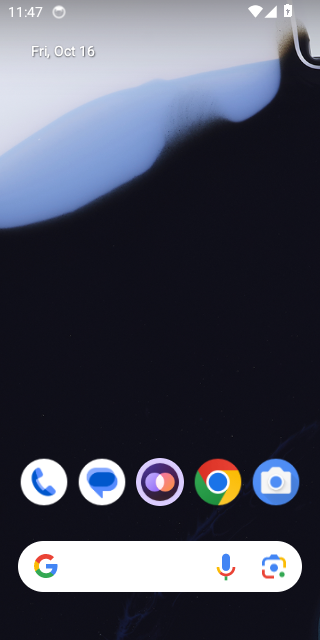

# Calls on Android 14 (API 34)

WebView: com.google.android.webview, 113.0.5672.136

## FAIL - First call while Priya is offline, allowing the microphone

Stopped: `timed out after 20s waiting for Android's microphone question`

- NO  the app is still open - `{"pidBefore":"","pidAfter":""}`

<details><summary>Steps</summary>

- 21.9s tap Call - `"pressed Call"`

</details>

### Crash

```
DEBUG   :       #40 pc 0000000000566017  /apex/com.android.art/lib64/libart.so (art::interpreter::Execute(art::Thread*, art::CodeItemDataAccessor const&, art::ShadowFrame&, art::JValue, bool, bool) (.__uniq.112435418011751916792819755956732575238)+647) (BuildId: b6dc79e02101ea00827a35a55ab6597a)
10-16 11:45:11.745  5051  5051 F DEBUG   :       #41 pc 000000000091f056  /apex/com.android.art/lib64/libart.so (artQuickToInterpreterBridge+902) (BuildId: b6dc79e02101ea00827a35a55ab6597a)
10-16 11:45:11.745  5051  5051 F DEBUG   :       #42 pc 0000000000391bdc  /apex/com.android.art/lib64/libart.so (art_quick_to_interpreter_bridge+140) (BuildId: b6dc79e02101ea00827a35a55ab6597a)
10-16 11:45:11.745  5051  5051 F DEBUG   :       #43 pc 0000000000378826  /apex/com.android.art/lib64/libart.so (art_quick_invoke_static_stub+806) (BuildId: b6dc79e02101ea00827a35a55ab6597a)
10-16 11:45:11.745  5051  5051 F DEBUG   :       #44 pc 00000000003c538f  /apex/com.android.art/lib64/libart.so (art::ArtMethod::Invoke(art::Thread*, unsigned int*, unsigned int, art::JValue*, char const*)+255) (BuildId: b6dc79e02101ea00827a35a55ab6597a)
10-16 11:45:11.745  5051  5051 F DEBUG   :       #45 pc 00000000007f07f4  /apex/com.android.art/lib64/libart.so (_jobject* art::InvokeMethod<(art::PointerSize)8>(art::ScopedObjectAccessAlreadyRunnable const&, _jobject*, _jobject*, _jobject*, unsigned long)+1476) (BuildId: b6dc79e02101ea00827a35a55ab6597a)
10-16 11:45:11.745  5051  5051 F DEBUG   :       #46 pc 000000000075a387  /apex/com.android.art/lib64/libart.so (art::Method_invoke(_JNIEnv*, _jobject*, _jobject*, _jobjectArray*) (.__uniq.165753521025965369065708152063621506277)+39) (BuildId: b6dc79e02101ea00827a35a55ab6597a)
10-16 11:45:11.745  5051  5051 F DEBUG   :       #47 pc 0000000000391a4b  /apex/com.android.art/lib64/libart.so (art_quick_generic_jni_trampoline+219) (BuildId: b6dc79e02101ea00827a35a55ab6597a)
10-16 11:45:11.745  5051  5051 F DEBUG   :       #48 pc 00000000003784c4  /apex/com.android.art/lib64/libart.so (art_quick_invoke_stub+756) (BuildId: b6dc79e02101ea00827a35a55ab6597a)
10-16 11:45:11.745  5051  5051 F DEBUG   :       #49 pc 00000000003c535c  /apex/com.android.art/lib64/libart.so (art::ArtMethod::Invoke(art::Thread*, unsigned int*, unsigned int, art::JValue*, char const*)+204) (BuildId: b6dc79e02101ea00827a35a55ab6597a)
10-16 11:45:11.745  5051  5051 F DEBUG   :       #50 pc 000000000056ddd0  /apex/com.android.art/lib64/libart.so (bool art::interpreter::DoCall<false>(art::ArtMethod*, art::Thread*, art::ShadowFrame&, art::Instruction const*, unsigned short, bool, art::JValue*)+2080) (BuildId: b6dc79e02101ea00827a35a55ab6597a)
10-16 11:45:11.745  5051  5051 F DEBUG   :       #51 pc 000000000039ae32  /apex/com.android.art/lib64/libart.so (void art::interpreter::ExecuteSwitchImplCpp<false>(art::interpreter::SwitchImplContext*)+16546) (BuildId: b6dc79e02101ea00827a35a55ab6597a)
10-16 11:45:11.745  5051  5051 F DEBUG   :       #52 pc 00000000003937a5  /apex/com.android.art/lib64/libart.so (ExecuteSwitchImplAsm+5) (BuildId: b6dc79e02101ea00827a35a55ab6597a)
10-16 11:45:11.745  5051  5051 F DEBUG   :       #53 pc 000000000050cd00  /system/framework/framework.jar (com.android.internal.os.RuntimeInit$MethodAndArgsCaller.run+0)
10-16 11:45:11.745  5051  5051 F DEBUG   :       #54 pc 0000000000566017  /apex/com.android.art/lib64/libart.so (art::interpreter::Execute(art::Thread*, art::CodeItemDataAccessor const&, art::ShadowFrame&, art::JValue, bool, bool) (.__uniq.112435418011751916792819755956732575238)+647) (BuildId: b6dc79e02101ea00827a35a55ab6597a)
10-16 11:45:11.745  5051  5051 F DEBUG   :       #55 pc 000000000091f056  /apex/com.android.art/lib64/libart.so (artQuickToInterpreterBridge+902) (BuildId: b6dc79e02101ea00827a35a55ab6597a)
10-16 11:45:11.745  5051  5051 F DEBUG   :       #56 pc 0000000000391bdc  /apex/com.android.art/lib64/libart.so (art_quick_to_interpreter_bridge+140) (BuildId: b6dc79e02101ea00827a35a55ab6597a)
10-16 11:45:11.746  5051  5051 F DEBUG   :       #57 pc 00000000007f0848  /system/framework/x86_64/boot-framework.oat (com.android.internal.os.ZygoteInit.main+2872) (BuildId: e4c2202f7e80276bcdbfa046249d896342205aa9)
10-16 11:45:11.746  5051  5051 F DEBUG   :       #58 pc 0000000000378826  /apex/com.android.art/lib64/libart.so (art_quick_invoke_static_stub+806) (BuildId: b6dc79e02101ea00827a35a55ab6597a)
10-16 11:45:11.746  5051  5051 F DEBUG   :       #59 pc 00000000003c538f  /apex/com.android.art/lib64/libart.so (art::ArtMethod::Invoke(art::Thread*, unsigned int*, unsigned int, art::JValue*, char const*)+255) (BuildId: b6dc79e02101ea00827a35a55ab6597a)
10-16 11:45:11.746  5051  5051 F DEBUG   :       #60 pc 00000000007f129f  /apex/com.android.art/lib64/libart.so (art::JValue art::InvokeWithVarArgs<art::ArtMethod*>(art::ScopedObjectAccessAlreadyRunnable const&, _jobject*, art::ArtMethod*, __va_list_tag*)+399) (BuildId: b6dc79e02101ea00827a35a55ab6597a)
10-16 11:45:11.746  5051  5051 F DEBUG   :       #61 pc 00000000006a7edc  /apex/com.android.art/lib64/libart.so (art::JNI<true>::CallStaticVoidMethodV(_JNIEnv*, _jclass*, _jmethodID*, __va_list_tag*)+668) (BuildId: b6dc79e02101ea00827a35a55ab6597a)
10-16 11:45:11.746  5051  5051 F DEBUG   :       #62 pc 00000000000df088  /system/lib64/libandroid_runtime.so (_JNIEnv::CallStaticVoidMethod(_jclass*, _jmethodID*, ...)+136) (BuildId: 58f47cb2665b829aa74415f458f1922a)
10-16 11:45:11.746  5051  5051 F DEBUG   :       #63 pc 00000000000ebb30  /system/lib64/libandroid_runtime.so (android::AndroidRuntime::start(char const*, android::Vector<android::String8> const&, bool)+896) (BuildId: 58f47cb2665b829aa74415f458f1922a)
10-16 11:45:11.746  5051  5051 F DEBUG   :       #64 pc 0000000000002fa6  /system/bin/app_process64 (main+1622) (BuildId: f11cda2b6bb6bff1e502077a2f3e6cf7)
10-16 11:45:11.746  5051  5051 F DEBUG   :       #65 pc 00000000000529ef  /apex/com.android.runtime/lib64/bionic/libc.so (__libc_init+95) (BuildId: fa337969c798946280caa45e2d71a2e7)

```

```
ACTIVITY MANAGER PROCESS EXIT INFO (dumpsys activity exit-info)
Last Timestamp of Persistence Into Persistent Storage: 1970-01-01 00:00:00.000
  package: app.two.android
    Historical Process Exit for uid=10192
        ApplicationExitInfo #0:
          timestamp=2026-10-16 11:45:11.807 pid=3824 realUid=99000 packageUid=10192 definingUid=10134 user=0
          process=com.google.android.webview:sandboxed_process0:org.chromium.content.app.SandboxedProcessService0:0 reason=1 (EXIT_SELF) subreason=17 (ISOLATED NOT NEEDED) status=0
          importance=400 pss=0.00 rss=0.00 description=isolated not needed state=empty trace=null
        ApplicationExitInfo #1:
          timestamp=2026-10-16 11:45:11.763 pid=3629 realUid=10192 packageUid=10192 definingUid=10192 user=0
          process=app.two.android reason=5 (APP CRASH(NATIVE)) subreason=0 (UNKNOWN) status=5
          importance=100 pss=84MB rss=235MB description=crash state=empty trace=null

```


Log: [first-call-while-priya-is-offline-allowing-the-mic.log](first-call-while-priya-is-offline-allowing-the-mic.log)

## FAIL - Call while Priya is offline rings out

Stopped: `the app closed while ringing`

- NO  the call service runs in the foreground
- NO  the app is still open - `{"pidBefore":"","pidAfter":""}`

<details><summary>Steps</summary>

- 54.8s tap Call - `"pressed Call"`

</details>

### Crash

```
DEBUG   :       #40 pc 0000000000566017  /apex/com.android.art/lib64/libart.so (art::interpreter::Execute(art::Thread*, art::CodeItemDataAccessor const&, art::ShadowFrame&, art::JValue, bool, bool) (.__uniq.112435418011751916792819755956732575238)+647) (BuildId: b6dc79e02101ea00827a35a55ab6597a)
10-16 11:45:44.599  6372  6372 F DEBUG   :       #41 pc 000000000091f056  /apex/com.android.art/lib64/libart.so (artQuickToInterpreterBridge+902) (BuildId: b6dc79e02101ea00827a35a55ab6597a)
10-16 11:45:44.599  6372  6372 F DEBUG   :       #42 pc 0000000000391bdc  /apex/com.android.art/lib64/libart.so (art_quick_to_interpreter_bridge+140) (BuildId: b6dc79e02101ea00827a35a55ab6597a)
10-16 11:45:44.599  6372  6372 F DEBUG   :       #43 pc 0000000000378826  /apex/com.android.art/lib64/libart.so (art_quick_invoke_static_stub+806) (BuildId: b6dc79e02101ea00827a35a55ab6597a)
10-16 11:45:44.599  6372  6372 F DEBUG   :       #44 pc 00000000003c538f  /apex/com.android.art/lib64/libart.so (art::ArtMethod::Invoke(art::Thread*, unsigned int*, unsigned int, art::JValue*, char const*)+255) (BuildId: b6dc79e02101ea00827a35a55ab6597a)
10-16 11:45:44.599  6372  6372 F DEBUG   :       #45 pc 00000000007f07f4  /apex/com.android.art/lib64/libart.so (_jobject* art::InvokeMethod<(art::PointerSize)8>(art::ScopedObjectAccessAlreadyRunnable const&, _jobject*, _jobject*, _jobject*, unsigned long)+1476) (BuildId: b6dc79e02101ea00827a35a55ab6597a)
10-16 11:45:44.599  6372  6372 F DEBUG   :       #46 pc 000000000075a387  /apex/com.android.art/lib64/libart.so (art::Method_invoke(_JNIEnv*, _jobject*, _jobject*, _jobjectArray*) (.__uniq.165753521025965369065708152063621506277)+39) (BuildId: b6dc79e02101ea00827a35a55ab6597a)
10-16 11:45:44.599  6372  6372 F DEBUG   :       #47 pc 0000000000391a4b  /apex/com.android.art/lib64/libart.so (art_quick_generic_jni_trampoline+219) (BuildId: b6dc79e02101ea00827a35a55ab6597a)
10-16 11:45:44.599  6372  6372 F DEBUG   :       #48 pc 00000000003784c4  /apex/com.android.art/lib64/libart.so (art_quick_invoke_stub+756) (BuildId: b6dc79e02101ea00827a35a55ab6597a)
10-16 11:45:44.599  6372  6372 F DEBUG   :       #49 pc 00000000003c535c  /apex/com.android.art/lib64/libart.so (art::ArtMethod::Invoke(art::Thread*, unsigned int*, unsigned int, art::JValue*, char const*)+204) (BuildId: b6dc79e02101ea00827a35a55ab6597a)
10-16 11:45:44.599  6372  6372 F DEBUG   :       #50 pc 000000000056ddd0  /apex/com.android.art/lib64/libart.so (bool art::interpreter::DoCall<false>(art::ArtMethod*, art::Thread*, art::ShadowFrame&, art::Instruction const*, unsigned short, bool, art::JValue*)+2080) (BuildId: b6dc79e02101ea00827a35a55ab6597a)
10-16 11:45:44.599  6372  6372 F DEBUG   :       #51 pc 000000000039ae32  /apex/com.android.art/lib64/libart.so (void art::interpreter::ExecuteSwitchImplCpp<false>(art::interpreter::SwitchImplContext*)+16546) (BuildId: b6dc79e02101ea00827a35a55ab6597a)
10-16 11:45:44.599  6372  6372 F DEBUG   :       #52 pc 00000000003937a5  /apex/com.android.art/lib64/libart.so (ExecuteSwitchImplAsm+5) (BuildId: b6dc79e02101ea00827a35a55ab6597a)
10-16 11:45:44.599  6372  6372 F DEBUG   :       #53 pc 000000000050cd00  /system/framework/framework.jar (com.android.internal.os.RuntimeInit$MethodAndArgsCaller.run+0)
10-16 11:45:44.599  6372  6372 F DEBUG   :       #54 pc 0000000000566017  /apex/com.android.art/lib64/libart.so (art::interpreter::Execute(art::Thread*, art::CodeItemDataAccessor const&, art::ShadowFrame&, art::JValue, bool, bool) (.__uniq.112435418011751916792819755956732575238)+647) (BuildId: b6dc79e02101ea00827a35a55ab6597a)
10-16 11:45:44.599  6372  6372 F DEBUG   :       #55 pc 000000000091f056  /apex/com.android.art/lib64/libart.so (artQuickToInterpreterBridge+902) (BuildId: b6dc79e02101ea00827a35a55ab6597a)
10-16 11:45:44.599  6372  6372 F DEBUG   :       #56 pc 0000000000391bdc  /apex/com.android.art/lib64/libart.so (art_quick_to_interpreter_bridge+140) (BuildId: b6dc79e02101ea00827a35a55ab6597a)
10-16 11:45:44.599  6372  6372 F DEBUG   :       #57 pc 00000000007f0848  /system/framework/x86_64/boot-framework.oat (com.android.internal.os.ZygoteInit.main+2872) (BuildId: e4c2202f7e80276bcdbfa046249d896342205aa9)
10-16 11:45:44.599  6372  6372 F DEBUG   :       #58 pc 0000000000378826  /apex/com.android.art/lib64/libart.so (art_quick_invoke_static_stub+806) (BuildId: b6dc79e02101ea00827a35a55ab6597a)
10-16 11:45:44.599  6372  6372 F DEBUG   :       #59 pc 00000000003c538f  /apex/com.android.art/lib64/libart.so (art::ArtMethod::Invoke(art::Thread*, unsigned int*, unsigned int, art::JValue*, char const*)+255) (BuildId: b6dc79e02101ea00827a35a55ab6597a)
10-16 11:45:44.599  6372  6372 F DEBUG   :       #60 pc 00000000007f129f  /apex/com.android.art/lib64/libart.so (art::JValue art::InvokeWithVarArgs<art::ArtMethod*>(art::ScopedObjectAccessAlreadyRunnable const&, _jobject*, art::ArtMethod*, __va_list_tag*)+399) (BuildId: b6dc79e02101ea00827a35a55ab6597a)
10-16 11:45:44.599  6372  6372 F DEBUG   :       #61 pc 00000000006a7edc  /apex/com.android.art/lib64/libart.so (art::JNI<true>::CallStaticVoidMethodV(_JNIEnv*, _jclass*, _jmethodID*, __va_list_tag*)+668) (BuildId: b6dc79e02101ea00827a35a55ab6597a)
10-16 11:45:44.599  6372  6372 F DEBUG   :       #62 pc 00000000000df088  /system/lib64/libandroid_runtime.so (_JNIEnv::CallStaticVoidMethod(_jclass*, _jmethodID*, ...)+136) (BuildId: 58f47cb2665b829aa74415f458f1922a)
10-16 11:45:44.599  6372  6372 F DEBUG   :       #63 pc 00000000000ebb30  /system/lib64/libandroid_runtime.so (android::AndroidRuntime::start(char const*, android::Vector<android::String8> const&, bool)+896) (BuildId: 58f47cb2665b829aa74415f458f1922a)
10-16 11:45:44.599  6372  6372 F DEBUG   :       #64 pc 0000000000002fa6  /system/bin/app_process64 (main+1622) (BuildId: f11cda2b6bb6bff1e502077a2f3e6cf7)
10-16 11:45:44.599  6372  6372 F DEBUG   :       #65 pc 00000000000529ef  /apex/com.android.runtime/lib64/bionic/libc.so (__libc_init+95) (BuildId: fa337969c798946280caa45e2d71a2e7)

```

```
ACTIVITY MANAGER PROCESS EXIT INFO (dumpsys activity exit-info)
Last Timestamp of Persistence Into Persistent Storage: 1970-01-01 00:00:00.000
  package: app.two.android
    Historical Process Exit for uid=10192
        ApplicationExitInfo #0:
          timestamp=2026-10-16 11:45:44.640 pid=6260 realUid=99001 packageUid=10192 definingUid=10134 user=0
          process=com.google.android.webview:sandboxed_process0:org.chromium.content.app.SandboxedProcessService0:0 reason=13 (OTHER KILLS BY SYSTEM) subreason=17 (ISOLATED NOT NEEDED) status=0
          importance=300 pss=0.00 rss=0.00 description=isolated not needed state=empty trace=null
        ApplicationExitInfo #1:
          timestamp=2026-10-16 11:45:44.615 pid=6215 realUid=10192 packageUid=10192 definingUid=10192 user=0
          process=app.two.android reason=5 (APP CRASH(NATIVE)) subreason=0 (UNKNOWN) status=5
          importance=100 pss=0.00 rss=0.00 description=crash state=empty trace=null
        ApplicationExitInfo #2:
          timestamp=2026-10-16 11:45:11.807 pid=3824 realUid=99000 packageUid=10192 definingUid=10134 user=0
          process=com.google.android.webview:sandboxed_process0:org.chromium.content.app.SandboxedProcessService0:0 reason=1 (EXIT_SELF) subreason=17 (ISOLATED NOT NEEDED) status=0
          importance=400 pss=0.00 rss=0.00 description=isolated not needed state=empty trace=null
        ApplicationExitInfo #3:
          timestamp=2026-10-16 11:45:11.763 pid=3629 realUid=10192 packageUid=10192 definingUid=10192 user=0
          process=app.two.android reason=5 (APP CRASH(NATIVE)) subreason=0 (UNKNOWN) status=5
          importance=100 pss=84MB rss=235MB description=crash state=empty trace=null

```

 

Log: [call-while-priya-is-offline-rings-out.log](call-while-priya-is-offline-rings-out.log)

## FAIL - Call cancelled straight away, ten times

Stopped: `the app closed (Cancel after 0 ms)`

- NO  the app is still open - `{"pidBefore":"","pidAfter":""}`

<details><summary>Steps</summary>

- 69.9s Call, then Cancel after 0 ms - `true`

</details>

### Crash

```
DEBUG   :       #40 pc 0000000000566017  /apex/com.android.art/lib64/libart.so (art::interpreter::Execute(art::Thread*, art::CodeItemDataAccessor const&, art::ShadowFrame&, art::JValue, bool, bool) (.__uniq.112435418011751916792819755956732575238)+647) (BuildId: b6dc79e02101ea00827a35a55ab6597a)
10-16 11:45:59.906  6566  6566 F DEBUG   :       #41 pc 000000000091f056  /apex/com.android.art/lib64/libart.so (artQuickToInterpreterBridge+902) (BuildId: b6dc79e02101ea00827a35a55ab6597a)
10-16 11:45:59.906  6566  6566 F DEBUG   :       #42 pc 0000000000391bdc  /apex/com.android.art/lib64/libart.so (art_quick_to_interpreter_bridge+140) (BuildId: b6dc79e02101ea00827a35a55ab6597a)
10-16 11:45:59.906  6566  6566 F DEBUG   :       #43 pc 0000000000378826  /apex/com.android.art/lib64/libart.so (art_quick_invoke_static_stub+806) (BuildId: b6dc79e02101ea00827a35a55ab6597a)
10-16 11:45:59.906  6566  6566 F DEBUG   :       #44 pc 00000000003c538f  /apex/com.android.art/lib64/libart.so (art::ArtMethod::Invoke(art::Thread*, unsigned int*, unsigned int, art::JValue*, char const*)+255) (BuildId: b6dc79e02101ea00827a35a55ab6597a)
10-16 11:45:59.906  6566  6566 F DEBUG   :       #45 pc 00000000007f07f4  /apex/com.android.art/lib64/libart.so (_jobject* art::InvokeMethod<(art::PointerSize)8>(art::ScopedObjectAccessAlreadyRunnable const&, _jobject*, _jobject*, _jobject*, unsigned long)+1476) (BuildId: b6dc79e02101ea00827a35a55ab6597a)
10-16 11:45:59.906  6566  6566 F DEBUG   :       #46 pc 000000000075a387  /apex/com.android.art/lib64/libart.so (art::Method_invoke(_JNIEnv*, _jobject*, _jobject*, _jobjectArray*) (.__uniq.165753521025965369065708152063621506277)+39) (BuildId: b6dc79e02101ea00827a35a55ab6597a)
10-16 11:45:59.906  6566  6566 F DEBUG   :       #47 pc 0000000000391a4b  /apex/com.android.art/lib64/libart.so (art_quick_generic_jni_trampoline+219) (BuildId: b6dc79e02101ea00827a35a55ab6597a)
10-16 11:45:59.906  6566  6566 F DEBUG   :       #48 pc 00000000003784c4  /apex/com.android.art/lib64/libart.so (art_quick_invoke_stub+756) (BuildId: b6dc79e02101ea00827a35a55ab6597a)
10-16 11:45:59.907  6566  6566 F DEBUG   :       #49 pc 00000000003c535c  /apex/com.android.art/lib64/libart.so (art::ArtMethod::Invoke(art::Thread*, unsigned int*, unsigned int, art::JValue*, char const*)+204) (BuildId: b6dc79e02101ea00827a35a55ab6597a)
10-16 11:45:59.907  6566  6566 F DEBUG   :       #50 pc 000000000056ddd0  /apex/com.android.art/lib64/libart.so (bool art::interpreter::DoCall<false>(art::ArtMethod*, art::Thread*, art::ShadowFrame&, art::Instruction const*, unsigned short, bool, art::JValue*)+2080) (BuildId: b6dc79e02101ea00827a35a55ab6597a)
10-16 11:45:59.907  6566  6566 F DEBUG   :       #51 pc 000000000039ae32  /apex/com.android.art/lib64/libart.so (void art::interpreter::ExecuteSwitchImplCpp<false>(art::interpreter::SwitchImplContext*)+16546) (BuildId: b6dc79e02101ea00827a35a55ab6597a)
10-16 11:45:59.907  6566  6566 F DEBUG   :       #52 pc 00000000003937a5  /apex/com.android.art/lib64/libart.so (ExecuteSwitchImplAsm+5) (BuildId: b6dc79e02101ea00827a35a55ab6597a)
10-16 11:45:59.907  6566  6566 F DEBUG   :       #53 pc 000000000050cd00  /system/framework/framework.jar (com.android.internal.os.RuntimeInit$MethodAndArgsCaller.run+0)
10-16 11:45:59.907  6566  6566 F DEBUG   :       #54 pc 0000000000566017  /apex/com.android.art/lib64/libart.so (art::interpreter::Execute(art::Thread*, art::CodeItemDataAccessor const&, art::ShadowFrame&, art::JValue, bool, bool) (.__uniq.112435418011751916792819755956732575238)+647) (BuildId: b6dc79e02101ea00827a35a55ab6597a)
10-16 11:45:59.907  6566  6566 F DEBUG   :       #55 pc 000000000091f056  /apex/com.android.art/lib64/libart.so (artQuickToInterpreterBridge+902) (BuildId: b6dc79e02101ea00827a35a55ab6597a)
10-16 11:45:59.907  6566  6566 F DEBUG   :       #56 pc 0000000000391bdc  /apex/com.android.art/lib64/libart.so (art_quick_to_interpreter_bridge+140) (BuildId: b6dc79e02101ea00827a35a55ab6597a)
10-16 11:45:59.907  6566  6566 F DEBUG   :       #57 pc 00000000007f0848  /system/framework/x86_64/boot-framework.oat (com.android.internal.os.ZygoteInit.main+2872) (BuildId: e4c2202f7e80276bcdbfa046249d896342205aa9)
10-16 11:45:59.907  6566  6566 F DEBUG   :       #58 pc 0000000000378826  /apex/com.android.art/lib64/libart.so (art_quick_invoke_static_stub+806) (BuildId: b6dc79e02101ea00827a35a55ab6597a)
10-16 11:45:59.907  6566  6566 F DEBUG   :       #59 pc 00000000003c538f  /apex/com.android.art/lib64/libart.so (art::ArtMethod::Invoke(art::Thread*, unsigned int*, unsigned int, art::JValue*, char const*)+255) (BuildId: b6dc79e02101ea00827a35a55ab6597a)
10-16 11:45:59.907  6566  6566 F DEBUG   :       #60 pc 00000000007f129f  /apex/com.android.art/lib64/libart.so (art::JValue art::InvokeWithVarArgs<art::ArtMethod*>(art::ScopedObjectAccessAlreadyRunnable const&, _jobject*, art::ArtMethod*, __va_list_tag*)+399) (BuildId: b6dc79e02101ea00827a35a55ab6597a)
10-16 11:45:59.907  6566  6566 F DEBUG   :       #61 pc 00000000006a7edc  /apex/com.android.art/lib64/libart.so (art::JNI<true>::CallStaticVoidMethodV(_JNIEnv*, _jclass*, _jmethodID*, __va_list_tag*)+668) (BuildId: b6dc79e02101ea00827a35a55ab6597a)
10-16 11:45:59.907  6566  6566 F DEBUG   :       #62 pc 00000000000df088  /system/lib64/libandroid_runtime.so (_JNIEnv::CallStaticVoidMethod(_jclass*, _jmethodID*, ...)+136) (BuildId: 58f47cb2665b829aa74415f458f1922a)
10-16 11:45:59.907  6566  6566 F DEBUG   :       #63 pc 00000000000ebb30  /system/lib64/libandroid_runtime.so (android::AndroidRuntime::start(char const*, android::Vector<android::String8> const&, bool)+896) (BuildId: 58f47cb2665b829aa74415f458f1922a)
10-16 11:45:59.907  6566  6566 F DEBUG   :       #64 pc 0000000000002fa6  /system/bin/app_process64 (main+1622) (BuildId: f11cda2b6bb6bff1e502077a2f3e6cf7)
10-16 11:45:59.907  6566  6566 F DEBUG   :       #65 pc 00000000000529ef  /apex/com.android.runtime/lib64/bionic/libc.so (__libc_init+95) (BuildId: fa337969c798946280caa45e2d71a2e7)

```

```
ACTIVITY MANAGER PROCESS EXIT INFO (dumpsys activity exit-info)
Last Timestamp of Persistence Into Persistent Storage: 1970-01-01 00:00:00.000
  package: app.two.android
    Historical Process Exit for uid=10192
        ApplicationExitInfo #0:
          timestamp=2026-10-16 11:45:59.938 pid=6487 realUid=99002 packageUid=10192 definingUid=10134 user=0
          process=com.google.android.webview:sandboxed_process0:org.chromium.content.app.SandboxedProcessService0:0 reason=13 (OTHER KILLS BY SYSTEM) subreason=17 (ISOLATED NOT NEEDED) status=0
          importance=300 pss=0.00 rss=0.00 description=isolated not needed state=empty trace=null
        ApplicationExitInfo #1:
          timestamp=2026-10-16 11:45:59.920 pid=6451 realUid=10192 packageUid=10192 definingUid=10192 user=0
          process=app.two.android reason=5 (APP CRASH(NATIVE)) subreason=0 (UNKNOWN) status=5
          importance=100 pss=0.00 rss=0.00 description=crash state=empty trace=null
        ApplicationExitInfo #2:
          timestamp=2026-10-16 11:45:44.640 pid=6260 realUid=99001 packageUid=10192 definingUid=10134 user=0
          process=com.google.android.webview:sandboxed_process0:org.chromium.content.app.SandboxedProcessService0:0 reason=13 (OTHER KILLS BY SYSTEM) subreason=17 (ISOLATED NOT NEEDED) status=0
          importance=300 pss=0.00 rss=0.00 description=isolated not needed state=empty trace=null
        ApplicationExitInfo #3:
          timestamp=2026-10-16 11:45:44.615 pid=6215 realUid=10192 packageUid=10192 definingUid=10192 user=0
          process=app.two.android reason=5 (APP CRASH(NATIVE)) subreason=0 (UNKNOWN) status=5
          importance=100 pss=0.00 rss=0.00 description=crash state=empty trace=null
        ApplicationExitInfo #4:
          timestamp=2026-10-16 11:45:11.807 pid=3824 realUid=99000 packageUid=10192 definingUid=10134 user=0
          process=com.google.android.webview:sandboxed_process0:org.chromium.content.app.SandboxedProcessService0:0 reason=1 (EXIT_SELF) subreason=17 (ISOLATED NOT NEEDED) status=0
          importance=400 pss=0.00 rss=0.00 description=isolated not needed state=empty trace=null
        ApplicationExitInfo #5:
          timestamp=2026-10-16 11:45:11.763 pid=3629 realUid=10192 packageUid=10192 definingUid=10192 user=0
          process=app.two.android reason=5 (APP CRASH(NATIVE)) subreason=0 (UNKNOWN) status=5
          importance=100 pss=84MB rss=235MB description=crash state=empty trace=null

```


Log: [call-cancelled-straight-away-ten-times.log](call-cancelled-straight-away-ten-times.log)

## FAIL - Call that Priya answers, with the speaker on and off

Stopped: `timed out after 20s waiting for Priya's phone to ring`

- NO  the app is still open - `{"pidBefore":"","pidAfter":""}`

<details><summary>Steps</summary>

- 94.4s tap Call - `"pressed Call"`

</details>

### Crash

```
DEBUG   :       #40 pc 0000000000566017  /apex/com.android.art/lib64/libart.so (art::interpreter::Execute(art::Thread*, art::CodeItemDataAccessor const&, art::ShadowFrame&, art::JValue, bool, bool) (.__uniq.112435418011751916792819755956732575238)+647) (BuildId: b6dc79e02101ea00827a35a55ab6597a)
10-16 11:46:23.994  6797  6797 F DEBUG   :       #41 pc 000000000091f056  /apex/com.android.art/lib64/libart.so (artQuickToInterpreterBridge+902) (BuildId: b6dc79e02101ea00827a35a55ab6597a)
10-16 11:46:23.994  6797  6797 F DEBUG   :       #42 pc 0000000000391bdc  /apex/com.android.art/lib64/libart.so (art_quick_to_interpreter_bridge+140) (BuildId: b6dc79e02101ea00827a35a55ab6597a)
10-16 11:46:23.994  6797  6797 F DEBUG   :       #43 pc 0000000000378826  /apex/com.android.art/lib64/libart.so (art_quick_invoke_static_stub+806) (BuildId: b6dc79e02101ea00827a35a55ab6597a)
10-16 11:46:23.994  6797  6797 F DEBUG   :       #44 pc 00000000003c538f  /apex/com.android.art/lib64/libart.so (art::ArtMethod::Invoke(art::Thread*, unsigned int*, unsigned int, art::JValue*, char const*)+255) (BuildId: b6dc79e02101ea00827a35a55ab6597a)
10-16 11:46:23.994  6797  6797 F DEBUG   :       #45 pc 00000000007f07f4  /apex/com.android.art/lib64/libart.so (_jobject* art::InvokeMethod<(art::PointerSize)8>(art::ScopedObjectAccessAlreadyRunnable const&, _jobject*, _jobject*, _jobject*, unsigned long)+1476) (BuildId: b6dc79e02101ea00827a35a55ab6597a)
10-16 11:46:23.994  6797  6797 F DEBUG   :       #46 pc 000000000075a387  /apex/com.android.art/lib64/libart.so (art::Method_invoke(_JNIEnv*, _jobject*, _jobject*, _jobjectArray*) (.__uniq.165753521025965369065708152063621506277)+39) (BuildId: b6dc79e02101ea00827a35a55ab6597a)
10-16 11:46:23.994  6797  6797 F DEBUG   :       #47 pc 0000000000391a4b  /apex/com.android.art/lib64/libart.so (art_quick_generic_jni_trampoline+219) (BuildId: b6dc79e02101ea00827a35a55ab6597a)
10-16 11:46:23.994  6797  6797 F DEBUG   :       #48 pc 00000000003784c4  /apex/com.android.art/lib64/libart.so (art_quick_invoke_stub+756) (BuildId: b6dc79e02101ea00827a35a55ab6597a)
10-16 11:46:23.994  6797  6797 F DEBUG   :       #49 pc 00000000003c535c  /apex/com.android.art/lib64/libart.so (art::ArtMethod::Invoke(art::Thread*, unsigned int*, unsigned int, art::JValue*, char const*)+204) (BuildId: b6dc79e02101ea00827a35a55ab6597a)
10-16 11:46:23.994  6797  6797 F DEBUG   :       #50 pc 000000000056ddd0  /apex/com.android.art/lib64/libart.so (bool art::interpreter::DoCall<false>(art::ArtMethod*, art::Thread*, art::ShadowFrame&, art::Instruction const*, unsigned short, bool, art::JValue*)+2080) (BuildId: b6dc79e02101ea00827a35a55ab6597a)
10-16 11:46:23.994  6797  6797 F DEBUG   :       #51 pc 000000000039ae32  /apex/com.android.art/lib64/libart.so (void art::interpreter::ExecuteSwitchImplCpp<false>(art::interpreter::SwitchImplContext*)+16546) (BuildId: b6dc79e02101ea00827a35a55ab6597a)
10-16 11:46:23.994  6797  6797 F DEBUG   :       #52 pc 00000000003937a5  /apex/com.android.art/lib64/libart.so (ExecuteSwitchImplAsm+5) (BuildId: b6dc79e02101ea00827a35a55ab6597a)
10-16 11:46:23.994  6797  6797 F DEBUG   :       #53 pc 000000000050cd00  /system/framework/framework.jar (com.android.internal.os.RuntimeInit$MethodAndArgsCaller.run+0)
10-16 11:46:23.994  6797  6797 F DEBUG   :       #54 pc 0000000000566017  /apex/com.android.art/lib64/libart.so (art::interpreter::Execute(art::Thread*, art::CodeItemDataAccessor const&, art::ShadowFrame&, art::JValue, bool, bool) (.__uniq.112435418011751916792819755956732575238)+647) (BuildId: b6dc79e02101ea00827a35a55ab6597a)
10-16 11:46:23.994  6797  6797 F DEBUG   :       #55 pc 000000000091f056  /apex/com.android.art/lib64/libart.so (artQuickToInterpreterBridge+902) (BuildId: b6dc79e02101ea00827a35a55ab6597a)
10-16 11:46:23.994  6797  6797 F DEBUG   :       #56 pc 0000000000391bdc  /apex/com.android.art/lib64/libart.so (art_quick_to_interpreter_bridge+140) (BuildId: b6dc79e02101ea00827a35a55ab6597a)
10-16 11:46:23.994  6797  6797 F DEBUG   :       #57 pc 00000000007f0848  /system/framework/x86_64/boot-framework.oat (com.android.internal.os.ZygoteInit.main+2872) (BuildId: e4c2202f7e80276bcdbfa046249d896342205aa9)
10-16 11:46:23.994  6797  6797 F DEBUG   :       #58 pc 0000000000378826  /apex/com.android.art/lib64/libart.so (art_quick_invoke_static_stub+806) (BuildId: b6dc79e02101ea00827a35a55ab6597a)
10-16 11:46:23.994  6797  6797 F DEBUG   :       #59 pc 00000000003c538f  /apex/com.android.art/lib64/libart.so (art::ArtMethod::Invoke(art::Thread*, unsigned int*, unsigned int, art::JValue*, char const*)+255) (BuildId: b6dc79e02101ea00827a35a55ab6597a)
10-16 11:46:23.994  6797  6797 F DEBUG   :       #60 pc 00000000007f129f  /apex/com.android.art/lib64/libart.so (art::JValue art::InvokeWithVarArgs<art::ArtMethod*>(art::ScopedObjectAccessAlreadyRunnable const&, _jobject*, art::ArtMethod*, __va_list_tag*)+399) (BuildId: b6dc79e02101ea00827a35a55ab6597a)
10-16 11:46:23.994  6797  6797 F DEBUG   :       #61 pc 00000000006a7edc  /apex/com.android.art/lib64/libart.so (art::JNI<true>::CallStaticVoidMethodV(_JNIEnv*, _jclass*, _jmethodID*, __va_list_tag*)+668) (BuildId: b6dc79e02101ea00827a35a55ab6597a)
10-16 11:46:23.994  6797  6797 F DEBUG   :       #62 pc 00000000000df088  /system/lib64/libandroid_runtime.so (_JNIEnv::CallStaticVoidMethod(_jclass*, _jmethodID*, ...)+136) (BuildId: 58f47cb2665b829aa74415f458f1922a)
10-16 11:46:23.994  6797  6797 F DEBUG   :       #63 pc 00000000000ebb30  /system/lib64/libandroid_runtime.so (android::AndroidRuntime::start(char const*, android::Vector<android::String8> const&, bool)+896) (BuildId: 58f47cb2665b829aa74415f458f1922a)
10-16 11:46:23.994  6797  6797 F DEBUG   :       #64 pc 0000000000002fa6  /system/bin/app_process64 (main+1622) (BuildId: f11cda2b6bb6bff1e502077a2f3e6cf7)
10-16 11:46:23.994  6797  6797 F DEBUG   :       #65 pc 00000000000529ef  /apex/com.android.runtime/lib64/bionic/libc.so (__libc_init+95) (BuildId: fa337969c798946280caa45e2d71a2e7)

```

```
ACTIVITY MANAGER PROCESS EXIT INFO (dumpsys activity exit-info)
Last Timestamp of Persistence Into Persistent Storage: 1970-01-01 00:00:00.000
  package: app.two.android
    Historical Process Exit for uid=10192
        ApplicationExitInfo #0:
          timestamp=2026-10-16 11:46:24.042 pid=6716 realUid=99003 packageUid=10192 definingUid=10134 user=0
          process=com.google.android.webview:sandboxed_process0:org.chromium.content.app.SandboxedProcessService0:0 reason=13 (OTHER KILLS BY SYSTEM) subreason=17 (ISOLATED NOT NEEDED) status=0
          importance=300 pss=0.00 rss=0.00 description=isolated not needed state=empty trace=null
        ApplicationExitInfo #1:
          timestamp=2026-10-16 11:46:24.007 pid=6680 realUid=10192 packageUid=10192 definingUid=10192 user=0
          process=app.two.android reason=5 (APP CRASH(NATIVE)) subreason=0 (UNKNOWN) status=5
          importance=100 pss=0.00 rss=0.00 description=crash state=empty trace=null
        ApplicationExitInfo #2:
          timestamp=2026-10-16 11:45:59.938 pid=6487 realUid=99002 packageUid=10192 definingUid=10134 user=0
          process=com.google.android.webview:sandboxed_process0:org.chromium.content.app.SandboxedProcessService0:0 reason=13 (OTHER KILLS BY SYSTEM) subreason=17 (ISOLATED NOT NEEDED) status=0
          importance=300 pss=0.00 rss=0.00 description=isolated not needed state=empty trace=null
        ApplicationExitInfo #3:
          timestamp=2026-10-16 11:45:59.920 pid=6451 realUid=10192 packageUid=10192 definingUid=10192 user=0
          process=app.two.android reason=5 (APP CRASH(NATIVE)) subreason=0 (UNKNOWN) status=5
          importance=100 pss=0.00 rss=0.00 description=crash state=empty trace=null
        ApplicationExitInfo #4:
          timestamp=2026-10-16 11:45:44.640 pid=6260 realUid=99001 packageUid=10192 definingUid=10134 user=0
          process=com.google.android.webview:sandboxed_process0:org.chromium.content.app.SandboxedProcessService0:0 reason=13 (OTHER KILLS BY SYSTEM) subreason=17 (ISOLATED NOT NEEDED) status=0
          importance=300 pss=0.00 rss=0.00 description=isolated not needed state=empty trace=null
        ApplicationExitInfo #5:
          timestamp=2026-10-16 11:45:44.615 pid=6215 realUid=10192 packageUid=10192 definingUid=10192 user=0
          process=app.two.android reason=5 (APP CRASH(NATIVE)) subreason=0 (UNKNOWN) status=5
          importance=100 pss=0.00 rss=0.00 description=crash state=empty trace=null
        ApplicationExitInfo #6:
          timestamp=2026-10-16 11:45:11.807 pid=3824 realUid=99000 packageUid=10192 definingUid=10134 user=0
          process=com.google.android.webview:sandboxed_process0:org.chromium.content.app.SandboxedProcessService0:0 reason=1 (EXIT_SELF) subreason=17 (ISOLATED NOT NEEDED) status=0
          importance=400 pss=0.00 rss=0.00 description=isolated not needed state=empty trace=null
        ApplicationExitInfo #7:
          timestamp=2026-10-16 11:45:11.763 pid=3629 realUid=10192 packageUid=10192 definingUid=10192 user=0
          process=app.two.android reason=5 (APP CRASH(NATIVE)) subreason=0 (UNKNOWN) status=5
          importance=100 pss=84MB rss=235MB description=crash state=empty trace=null

```


Log: [call-that-priya-answers-with-the-speaker-on-and-of.log](call-that-priya-answers-with-the-speaker-on-and-of.log)

## FAIL - Priya calls and you answer

Stopped: `timed out after 30s waiting for the call to connect (page went away)`

- ok  your phone rings - `"P Priya is calling you Decline Accept"`
- NO  the app is still open - `{"pidBefore":"","pidAfter":""}`

<details><summary>Steps</summary>

- 128.9s Priya taps Call - `"pressed Call"`
- 129.5s tap Accept - `"pressed Accept"`

</details>

### Crash

```
DEBUG   :       #40 pc 0000000000566017  /apex/com.android.art/lib64/libart.so (art::interpreter::Execute(art::Thread*, art::CodeItemDataAccessor const&, art::ShadowFrame&, art::JValue, bool, bool) (.__uniq.112435418011751916792819755956732575238)+647) (BuildId: b6dc79e02101ea00827a35a55ab6597a)
10-16 11:46:59.023  7055  7055 F DEBUG   :       #41 pc 000000000091f056  /apex/com.android.art/lib64/libart.so (artQuickToInterpreterBridge+902) (BuildId: b6dc79e02101ea00827a35a55ab6597a)
10-16 11:46:59.023  7055  7055 F DEBUG   :       #42 pc 0000000000391bdc  /apex/com.android.art/lib64/libart.so (art_quick_to_interpreter_bridge+140) (BuildId: b6dc79e02101ea00827a35a55ab6597a)
10-16 11:46:59.023  7055  7055 F DEBUG   :       #43 pc 0000000000378826  /apex/com.android.art/lib64/libart.so (art_quick_invoke_static_stub+806) (BuildId: b6dc79e02101ea00827a35a55ab6597a)
10-16 11:46:59.023  7055  7055 F DEBUG   :       #44 pc 00000000003c538f  /apex/com.android.art/lib64/libart.so (art::ArtMethod::Invoke(art::Thread*, unsigned int*, unsigned int, art::JValue*, char const*)+255) (BuildId: b6dc79e02101ea00827a35a55ab6597a)
10-16 11:46:59.023  7055  7055 F DEBUG   :       #45 pc 00000000007f07f4  /apex/com.android.art/lib64/libart.so (_jobject* art::InvokeMethod<(art::PointerSize)8>(art::ScopedObjectAccessAlreadyRunnable const&, _jobject*, _jobject*, _jobject*, unsigned long)+1476) (BuildId: b6dc79e02101ea00827a35a55ab6597a)
10-16 11:46:59.023  7055  7055 F DEBUG   :       #46 pc 000000000075a387  /apex/com.android.art/lib64/libart.so (art::Method_invoke(_JNIEnv*, _jobject*, _jobject*, _jobjectArray*) (.__uniq.165753521025965369065708152063621506277)+39) (BuildId: b6dc79e02101ea00827a35a55ab6597a)
10-16 11:46:59.023  7055  7055 F DEBUG   :       #47 pc 0000000000391a4b  /apex/com.android.art/lib64/libart.so (art_quick_generic_jni_trampoline+219) (BuildId: b6dc79e02101ea00827a35a55ab6597a)
10-16 11:46:59.023  7055  7055 F DEBUG   :       #48 pc 00000000003784c4  /apex/com.android.art/lib64/libart.so (art_quick_invoke_stub+756) (BuildId: b6dc79e02101ea00827a35a55ab6597a)
10-16 11:46:59.023  7055  7055 F DEBUG   :       #49 pc 00000000003c535c  /apex/com.android.art/lib64/libart.so (art::ArtMethod::Invoke(art::Thread*, unsigned int*, unsigned int, art::JValue*, char const*)+204) (BuildId: b6dc79e02101ea00827a35a55ab6597a)
10-16 11:46:59.023  7055  7055 F DEBUG   :       #50 pc 000000000056ddd0  /apex/com.android.art/lib64/libart.so (bool art::interpreter::DoCall<false>(art::ArtMethod*, art::Thread*, art::ShadowFrame&, art::Instruction const*, unsigned short, bool, art::JValue*)+2080) (BuildId: b6dc79e02101ea00827a35a55ab6597a)
10-16 11:46:59.023  7055  7055 F DEBUG   :       #51 pc 000000000039ae32  /apex/com.android.art/lib64/libart.so (void art::interpreter::ExecuteSwitchImplCpp<false>(art::interpreter::SwitchImplContext*)+16546) (BuildId: b6dc79e02101ea00827a35a55ab6597a)
10-16 11:46:59.023  7055  7055 F DEBUG   :       #52 pc 00000000003937a5  /apex/com.android.art/lib64/libart.so (ExecuteSwitchImplAsm+5) (BuildId: b6dc79e02101ea00827a35a55ab6597a)
10-16 11:46:59.023  7055  7055 F DEBUG   :       #53 pc 000000000050cd00  /system/framework/framework.jar (com.android.internal.os.RuntimeInit$MethodAndArgsCaller.run+0)
10-16 11:46:59.023  7055  7055 F DEBUG   :       #54 pc 0000000000566017  /apex/com.android.art/lib64/libart.so (art::interpreter::Execute(art::Thread*, art::CodeItemDataAccessor const&, art::ShadowFrame&, art::JValue, bool, bool) (.__uniq.112435418011751916792819755956732575238)+647) (BuildId: b6dc79e02101ea00827a35a55ab6597a)
10-16 11:46:59.023  7055  7055 F DEBUG   :       #55 pc 000000000091f056  /apex/com.android.art/lib64/libart.so (artQuickToInterpreterBridge+902) (BuildId: b6dc79e02101ea00827a35a55ab6597a)
10-16 11:46:59.023  7055  7055 F DEBUG   :       #56 pc 0000000000391bdc  /apex/com.android.art/lib64/libart.so (art_quick_to_interpreter_bridge+140) (BuildId: b6dc79e02101ea00827a35a55ab6597a)
10-16 11:46:59.023  7055  7055 F DEBUG   :       #57 pc 00000000007f0848  /system/framework/x86_64/boot-framework.oat (com.android.internal.os.ZygoteInit.main+2872) (BuildId: e4c2202f7e80276bcdbfa046249d896342205aa9)
10-16 11:46:59.023  7055  7055 F DEBUG   :       #58 pc 0000000000378826  /apex/com.android.art/lib64/libart.so (art_quick_invoke_static_stub+806) (BuildId: b6dc79e02101ea00827a35a55ab6597a)
10-16 11:46:59.023  7055  7055 F DEBUG   :       #59 pc 00000000003c538f  /apex/com.android.art/lib64/libart.so (art::ArtMethod::Invoke(art::Thread*, unsigned int*, unsigned int, art::JValue*, char const*)+255) (BuildId: b6dc79e02101ea00827a35a55ab6597a)
10-16 11:46:59.023  7055  7055 F DEBUG   :       #60 pc 00000000007f129f  /apex/com.android.art/lib64/libart.so (art::JValue art::InvokeWithVarArgs<art::ArtMethod*>(art::ScopedObjectAccessAlreadyRunnable const&, _jobject*, art::ArtMethod*, __va_list_tag*)+399) (BuildId: b6dc79e02101ea00827a35a55ab6597a)
10-16 11:46:59.023  7055  7055 F DEBUG   :       #61 pc 00000000006a7edc  /apex/com.android.art/lib64/libart.so (art::JNI<true>::CallStaticVoidMethodV(_JNIEnv*, _jclass*, _jmethodID*, __va_list_tag*)+668) (BuildId: b6dc79e02101ea00827a35a55ab6597a)
10-16 11:46:59.023  7055  7055 F DEBUG   :       #62 pc 00000000000df088  /system/lib64/libandroid_runtime.so (_JNIEnv::CallStaticVoidMethod(_jclass*, _jmethodID*, ...)+136) (BuildId: 58f47cb2665b829aa74415f458f1922a)
10-16 11:46:59.023  7055  7055 F DEBUG   :       #63 pc 00000000000ebb30  /system/lib64/libandroid_runtime.so (android::AndroidRuntime::start(char const*, android::Vector<android::String8> const&, bool)+896) (BuildId: 58f47cb2665b829aa74415f458f1922a)
10-16 11:46:59.023  7055  7055 F DEBUG   :       #64 pc 0000000000002fa6  /system/bin/app_process64 (main+1622) (BuildId: f11cda2b6bb6bff1e502077a2f3e6cf7)
10-16 11:46:59.023  7055  7055 F DEBUG   :       #65 pc 00000000000529ef  /apex/com.android.runtime/lib64/bionic/libc.so (__libc_init+95) (BuildId: fa337969c798946280caa45e2d71a2e7)

```

```
ACTIVITY MANAGER PROCESS EXIT INFO (dumpsys activity exit-info)
Last Timestamp of Persistence Into Persistent Storage: 1970-01-01 00:00:00.000
  package: app.two.android
    Historical Process Exit for uid=10192
        ApplicationExitInfo #0:
          timestamp=2026-10-16 11:46:59.061 pid=6953 realUid=99004 packageUid=10192 definingUid=10134 user=0
          process=com.google.android.webview:sandboxed_process0:org.chromium.content.app.SandboxedProcessService0:0 reason=13 (OTHER KILLS BY SYSTEM) subreason=17 (ISOLATED NOT NEEDED) status=0
          importance=300 pss=0.00 rss=0.00 description=isolated not needed state=empty trace=null
        ApplicationExitInfo #1:
          timestamp=2026-10-16 11:46:59.035 pid=6918 realUid=10192 packageUid=10192 definingUid=10192 user=0
          process=app.two.android reason=5 (APP CRASH(NATIVE)) subreason=0 (UNKNOWN) status=5
          importance=100 pss=83MB rss=234MB description=crash state=empty trace=null
        ApplicationExitInfo #2:
          timestamp=2026-10-16 11:46:24.042 pid=6716 realUid=99003 packageUid=10192 definingUid=10134 user=0
          process=com.google.android.webview:sandboxed_process0:org.chromium.content.app.SandboxedProcessService0:0 reason=13 (OTHER KILLS BY SYSTEM) subreason=17 (ISOLATED NOT NEEDED) status=0
          importance=300 pss=0.00 rss=0.00 description=isolated not needed state=empty trace=null
        ApplicationExitInfo #3:
          timestamp=2026-10-16 11:46:24.007 pid=6680 realUid=10192 packageUid=10192 definingUid=10192 user=0
          process=app.two.android reason=5 (APP CRASH(NATIVE)) subreason=0 (UNKNOWN) status=5
          importance=100 pss=0.00 rss=0.00 description=crash state=empty trace=null
        ApplicationExitInfo #4:
          timestamp=2026-10-16 11:45:59.938 pid=6487 realUid=99002 packageUid=10192 definingUid=10134 user=0
          process=com.google.android.webview:sandboxed_process0:org.chromium.content.app.SandboxedProcessService0:0 reason=13 (OTHER KILLS BY SYSTEM) subreason=17 (ISOLATED NOT NEEDED) status=0
          importance=300 pss=0.00 rss=0.00 description=isolated not needed state=empty trace=null
        ApplicationExitInfo #5:
          timestamp=2026-10-16 11:45:59.920 pid=6451 realUid=10192 packageUid=10192 definingUid=10192 user=0
          process=app.two.android reason=5 (APP CRASH(NATIVE)) subreason=0 (UNKNOWN) status=5
          importance=100 pss=0.00 rss=0.00 description=crash state=empty trace=null
        ApplicationExitInfo #6:
          timestamp=2026-10-16 11:45:44.640 pid=6260 realUid=99001 packageUid=10192 definingUid=10134 user=0
          process=com.google.android.webview:sandboxed_process0:org.chromium.content.app.SandboxedProcessService0:0 reason=13 (OTHER KILLS BY SYSTEM) subreason=17 (ISOLATED NOT NEEDED) status=0
          importance=300 pss=0.00 rss=0.00 description=isolated not needed state=empty trace=null
        ApplicationExitInfo #7:
          timestamp=2026-10-16 11:45:44.615 pid=6215 realUid=10192 packageUid=10192 definingUid=10192 user=0
          process=app.two.android reason=5 (APP CRASH(NATIVE)) subreason=0 (UNKNOWN) status=5
          importance=100 pss=0.00 rss=0.00 description=crash state=empty trace=null
        ApplicationExitInfo #8:
          timestamp=2026-10-16 11:45:11.807 pid=3824 realUid=99000 packageUid=10192 definingUid=10134 user=0
          process=com.google.android.webview:sandboxed_process0:org.chromium.content.app.SandboxedProcessService0:0 reason=1 (EXIT_SELF) subreason=17 (ISOLATED NOT NEEDED) status=0
          importance=400 pss=0.00 rss=0.00 description=isolated not needed state=empty trace=null
        ApplicationExitInfo #9:
          timestamp=2026-10-16 11:45:11.763 pid=3629 realUid=10192 packageUid=10192 definingUid=10192 user=0
          process=app.two.android reason=5 (APP CRASH(NATIVE)) subreason=0 (UNKNOWN) status=5
          importance=100 pss=84MB rss=235MB description=crash state=empty trace=null

```



Log: [priya-calls-and-you-answer.log](priya-calls-and-you-answer.log)

## FAIL - Screen turned off in the middle of a call

Stopped: `timed out after 20s waiting for Priya's phone to ring`

- NO  the app is still open - `{"pidBefore":"","pidAfter":""}`

<details><summary>Steps</summary>

- 170.2s tap Call - `"pressed Call"`

</details>

### Crash

```
DEBUG   :       #40 pc 0000000000566017  /apex/com.android.art/lib64/libart.so (art::interpreter::Execute(art::Thread*, art::CodeItemDataAccessor const&, art::ShadowFrame&, art::JValue, bool, bool) (.__uniq.112435418011751916792819755956732575238)+647) (BuildId: b6dc79e02101ea00827a35a55ab6597a)
10-16 11:47:39.736  7272  7272 F DEBUG   :       #41 pc 000000000091f056  /apex/com.android.art/lib64/libart.so (artQuickToInterpreterBridge+902) (BuildId: b6dc79e02101ea00827a35a55ab6597a)
10-16 11:47:39.736  7272  7272 F DEBUG   :       #42 pc 0000000000391bdc  /apex/com.android.art/lib64/libart.so (art_quick_to_interpreter_bridge+140) (BuildId: b6dc79e02101ea00827a35a55ab6597a)
10-16 11:47:39.736  7272  7272 F DEBUG   :       #43 pc 0000000000378826  /apex/com.android.art/lib64/libart.so (art_quick_invoke_static_stub+806) (BuildId: b6dc79e02101ea00827a35a55ab6597a)
10-16 11:47:39.736  7272  7272 F DEBUG   :       #44 pc 00000000003c538f  /apex/com.android.art/lib64/libart.so (art::ArtMethod::Invoke(art::Thread*, unsigned int*, unsigned int, art::JValue*, char const*)+255) (BuildId: b6dc79e02101ea00827a35a55ab6597a)
10-16 11:47:39.736  7272  7272 F DEBUG   :       #45 pc 00000000007f07f4  /apex/com.android.art/lib64/libart.so (_jobject* art::InvokeMethod<(art::PointerSize)8>(art::ScopedObjectAccessAlreadyRunnable const&, _jobject*, _jobject*, _jobject*, unsigned long)+1476) (BuildId: b6dc79e02101ea00827a35a55ab6597a)
10-16 11:47:39.736  7272  7272 F DEBUG   :       #46 pc 000000000075a387  /apex/com.android.art/lib64/libart.so (art::Method_invoke(_JNIEnv*, _jobject*, _jobject*, _jobjectArray*) (.__uniq.165753521025965369065708152063621506277)+39) (BuildId: b6dc79e02101ea00827a35a55ab6597a)
10-16 11:47:39.736  7272  7272 F DEBUG   :       #47 pc 0000000000391a4b  /apex/com.android.art/lib64/libart.so (art_quick_generic_jni_trampoline+219) (BuildId: b6dc79e02101ea00827a35a55ab6597a)
10-16 11:47:39.736  7272  7272 F DEBUG   :       #48 pc 00000000003784c4  /apex/com.android.art/lib64/libart.so (art_quick_invoke_stub+756) (BuildId: b6dc79e02101ea00827a35a55ab6597a)
10-16 11:47:39.736  7272  7272 F DEBUG   :       #49 pc 00000000003c535c  /apex/com.android.art/lib64/libart.so (art::ArtMethod::Invoke(art::Thread*, unsigned int*, unsigned int, art::JValue*, char const*)+204) (BuildId: b6dc79e02101ea00827a35a55ab6597a)
10-16 11:47:39.736  7272  7272 F DEBUG   :       #50 pc 000000000056ddd0  /apex/com.android.art/lib64/libart.so (bool art::interpreter::DoCall<false>(art::ArtMethod*, art::Thread*, art::ShadowFrame&, art::Instruction const*, unsigned short, bool, art::JValue*)+2080) (BuildId: b6dc79e02101ea00827a35a55ab6597a)
10-16 11:47:39.736  7272  7272 F DEBUG   :       #51 pc 000000000039ae32  /apex/com.android.art/lib64/libart.so (void art::interpreter::ExecuteSwitchImplCpp<false>(art::interpreter::SwitchImplContext*)+16546) (BuildId: b6dc79e02101ea00827a35a55ab6597a)
10-16 11:47:39.736  7272  7272 F DEBUG   :       #52 pc 00000000003937a5  /apex/com.android.art/lib64/libart.so (ExecuteSwitchImplAsm+5) (BuildId: b6dc79e02101ea00827a35a55ab6597a)
10-16 11:47:39.736  7272  7272 F DEBUG   :       #53 pc 000000000050cd00  /system/framework/framework.jar (com.android.internal.os.RuntimeInit$MethodAndArgsCaller.run+0)
10-16 11:47:39.736  7272  7272 F DEBUG   :       #54 pc 0000000000566017  /apex/com.android.art/lib64/libart.so (art::interpreter::Execute(art::Thread*, art::CodeItemDataAccessor const&, art::ShadowFrame&, art::JValue, bool, bool) (.__uniq.112435418011751916792819755956732575238)+647) (BuildId: b6dc79e02101ea00827a35a55ab6597a)
10-16 11:47:39.736  7272  7272 F DEBUG   :       #55 pc 000000000091f056  /apex/com.android.art/lib64/libart.so (artQuickToInterpreterBridge+902) (BuildId: b6dc79e02101ea00827a35a55ab6597a)
10-16 11:47:39.736  7272  7272 F DEBUG   :       #56 pc 0000000000391bdc  /apex/com.android.art/lib64/libart.so (art_quick_to_interpreter_bridge+140) (BuildId: b6dc79e02101ea00827a35a55ab6597a)
10-16 11:47:39.736  7272  7272 F DEBUG   :       #57 pc 00000000007f0848  /system/framework/x86_64/boot-framework.oat (com.android.internal.os.ZygoteInit.main+2872) (BuildId: e4c2202f7e80276bcdbfa046249d896342205aa9)
10-16 11:47:39.736  7272  7272 F DEBUG   :       #58 pc 0000000000378826  /apex/com.android.art/lib64/libart.so (art_quick_invoke_static_stub+806) (BuildId: b6dc79e02101ea00827a35a55ab6597a)
10-16 11:47:39.736  7272  7272 F DEBUG   :       #59 pc 00000000003c538f  /apex/com.android.art/lib64/libart.so (art::ArtMethod::Invoke(art::Thread*, unsigned int*, unsigned int, art::JValue*, char const*)+255) (BuildId: b6dc79e02101ea00827a35a55ab6597a)
10-16 11:47:39.737  7272  7272 F DEBUG   :       #60 pc 00000000007f129f  /apex/com.android.art/lib64/libart.so (art::JValue art::InvokeWithVarArgs<art::ArtMethod*>(art::ScopedObjectAccessAlreadyRunnable const&, _jobject*, art::ArtMethod*, __va_list_tag*)+399) (BuildId: b6dc79e02101ea00827a35a55ab6597a)
10-16 11:47:39.737  7272  7272 F DEBUG   :       #61 pc 00000000006a7edc  /apex/com.android.art/lib64/libart.so (art::JNI<true>::CallStaticVoidMethodV(_JNIEnv*, _jclass*, _jmethodID*, __va_list_tag*)+668) (BuildId: b6dc79e02101ea00827a35a55ab6597a)
10-16 11:47:39.737  7272  7272 F DEBUG   :       #62 pc 00000000000df088  /system/lib64/libandroid_runtime.so (_JNIEnv::CallStaticVoidMethod(_jclass*, _jmethodID*, ...)+136) (BuildId: 58f47cb2665b829aa74415f458f1922a)
10-16 11:47:39.737  7272  7272 F DEBUG   :       #63 pc 00000000000ebb30  /system/lib64/libandroid_runtime.so (android::AndroidRuntime::start(char const*, android::Vector<android::String8> const&, bool)+896) (BuildId: 58f47cb2665b829aa74415f458f1922a)
10-16 11:47:39.737  7272  7272 F DEBUG   :       #64 pc 0000000000002fa6  /system/bin/app_process64 (main+1622) (BuildId: f11cda2b6bb6bff1e502077a2f3e6cf7)
10-16 11:47:39.737  7272  7272 F DEBUG   :       #65 pc 00000000000529ef  /apex/com.android.runtime/lib64/bionic/libc.so (__libc_init+95) (BuildId: fa337969c798946280caa45e2d71a2e7)

```

```
ACTIVITY MANAGER PROCESS EXIT INFO (dumpsys activity exit-info)
Last Timestamp of Persistence Into Persistent Storage: 1970-01-01 00:00:00.000
  package: app.two.android
    Historical Process Exit for uid=10192
        ApplicationExitInfo #0:
          timestamp=2026-10-16 11:47:39.764 pid=7181 realUid=99005 packageUid=10192 definingUid=10134 user=0
          process=com.google.android.webview:sandboxed_process0:org.chromium.content.app.SandboxedProcessService0:0 reason=13 (OTHER KILLS BY SYSTEM) subreason=17 (ISOLATED NOT NEEDED) status=0
          importance=300 pss=0.00 rss=0.00 description=isolated not needed state=empty trace=null
        ApplicationExitInfo #1:
          timestamp=2026-10-16 11:47:39.747 pid=7147 realUid=10192 packageUid=10192 definingUid=10192 user=0
          process=app.two.android reason=5 (APP CRASH(NATIVE)) subreason=0 (UNKNOWN) status=5
          importance=100 pss=0.00 rss=0.00 description=crash state=empty trace=null
        ApplicationExitInfo #2:
          timestamp=2026-10-16 11:46:59.061 pid=6953 realUid=99004 packageUid=10192 definingUid=10134 user=0
          process=com.google.android.webview:sandboxed_process0:org.chromium.content.app.SandboxedProcessService0:0 reason=13 (OTHER KILLS BY SYSTEM) subreason=17 (ISOLATED NOT NEEDED) status=0
          importance=300 pss=0.00 rss=0.00 description=isolated not needed state=empty trace=null
        ApplicationExitInfo #3:
          timestamp=2026-10-16 11:46:59.035 pid=6918 realUid=10192 packageUid=10192 definingUid=10192 user=0
          process=app.two.android reason=5 (APP CRASH(NATIVE)) subreason=0 (UNKNOWN) status=5
          importance=100 pss=83MB rss=234MB description=crash state=empty trace=null
        ApplicationExitInfo #4:
          timestamp=2026-10-16 11:46:24.042 pid=6716 realUid=99003 packageUid=10192 definingUid=10134 user=0
          process=com.google.android.webview:sandboxed_process0:org.chromium.content.app.SandboxedProcessService0:0 reason=13 (OTHER KILLS BY SYSTEM) subreason=17 (ISOLATED NOT NEEDED) status=0
          importance=300 pss=0.00 rss=0.00 description=isolated not needed state=empty trace=null
        ApplicationExitInfo #5:
          timestamp=2026-10-16 11:46:24.007 pid=6680 realUid=10192 packageUid=10192 definingUid=10192 user=0
          process=app.two.android reason=5 (APP CRASH(NATIVE)) subreason=0 (UNKNOWN) status=5
          importance=100 pss=0.00 rss=0.00 description=crash state=empty trace=null
        ApplicationExitInfo #6:
          timestamp=2026-10-16 11:45:59.938 pid=6487 realUid=99002 packageUid=10192 definingUid=10134 user=0
          process=com.google.android.webview:sandboxed_process0:org.chromium.content.app.SandboxedProcessService0:0 reason=13 (OTHER KILLS BY SYSTEM) subreason=17 (ISOLATED NOT NEEDED) status=0
          importance=300 pss=0.00 rss=0.00 description=isolated not needed state=empty trace=null
        ApplicationExitInfo #7:
          timestamp=2026-10-16 11:45:59.920 pid=6451 realUid=10192 packageUid=10192 definingUid=10192 user=0
          process=app.two.android reason=5 (APP CRASH(NATIVE)) subreason=0 (UNKNOWN) status=5
          importance=100 pss=0.00 rss=0.00 description=crash state=empty trace=null
        ApplicationExitInfo #8:
          timestamp=2026-10-16 11:45:44.640 pid=6260 realUid=99001 packageUid=10192 definingUid=10134 user=0
          process=com.google.android.webview:sandboxed_process0:org.chromium.content.app.SandboxedProcessService0:0 reason=13 (OTHER KILLS BY SYSTEM) subreason=17 (ISOLATED NOT NEEDED) status=0
          importance=300 pss=0.00 rss=0.00 description=isolated not needed state=empty trace=null
        ApplicationExitInfo #9:
          timestamp=2026-10-16 11:45:44.615 pid=6215 realUid=10192 packageUid=10192 definingUid=10192 user=0
          process=app.two.android reason=5 (APP CRASH(NATIVE)) subreason=0 (UNKNOWN) status=5
          importance=100 pss=0.00 rss=0.00 description=crash state=empty trace=null
        ApplicationExitInfo #10:
          timestamp=2026-10-16 11:45:11.807 pid=3824 realUid=99000 packageUid=10192 definingUid=10134 user=0
          process=com.google.android.webview:sandboxed_process0:org.chromium.content.app.SandboxedProcessService0:0 reason=1 (EXIT_SELF) subreason=17 (ISOLATED NOT NEEDED) status=0
          importance=400 pss=0.00 rss=0.00 description=isolated not needed state=empty trace=null
        ApplicationExitInfo #11:
          timestamp=2026-10-16 11:45:11.763 pid=3629 realUid=10192 packageUid=10192 definingUid=10192 user=0
          process=app.two.android reason=5 (APP CRASH(NATIVE)) subreason=0 (UNKNOWN) status=5
          importance=100 pss=84MB rss=235MB description=crash state=empty trace=null

```


Log: [screen-turned-off-in-the-middle-of-a-call.log](screen-turned-off-in-the-middle-of-a-call.log)

## FAIL - Call when you don't allow the microphone

Stopped: `timed out after 20s waiting for Android's microphone question`

- NO  the app is still open - `{"pidBefore":"","pidAfter":""}`

<details><summary>Steps</summary>

- 201.8s tap Call - `"pressed Call"`

</details>

### Crash

```
DEBUG   :       #40 pc 0000000000566017  /apex/com.android.art/lib64/libart.so (art::interpreter::Execute(art::Thread*, art::CodeItemDataAccessor const&, art::ShadowFrame&, art::JValue, bool, bool) (.__uniq.112435418011751916792819755956732575238)+647) (BuildId: b6dc79e02101ea00827a35a55ab6597a)
10-16 11:48:11.490  7468  7468 F DEBUG   :       #41 pc 000000000091f056  /apex/com.android.art/lib64/libart.so (artQuickToInterpreterBridge+902) (BuildId: b6dc79e02101ea00827a35a55ab6597a)
10-16 11:48:11.490  7468  7468 F DEBUG   :       #42 pc 0000000000391bdc  /apex/com.android.art/lib64/libart.so (art_quick_to_interpreter_bridge+140) (BuildId: b6dc79e02101ea00827a35a55ab6597a)
10-16 11:48:11.490  7468  7468 F DEBUG   :       #43 pc 0000000000378826  /apex/com.android.art/lib64/libart.so (art_quick_invoke_static_stub+806) (BuildId: b6dc79e02101ea00827a35a55ab6597a)
10-16 11:48:11.490  7468  7468 F DEBUG   :       #44 pc 00000000003c538f  /apex/com.android.art/lib64/libart.so (art::ArtMethod::Invoke(art::Thread*, unsigned int*, unsigned int, art::JValue*, char const*)+255) (BuildId: b6dc79e02101ea00827a35a55ab6597a)
10-16 11:48:11.490  7468  7468 F DEBUG   :       #45 pc 00000000007f07f4  /apex/com.android.art/lib64/libart.so (_jobject* art::InvokeMethod<(art::PointerSize)8>(art::ScopedObjectAccessAlreadyRunnable const&, _jobject*, _jobject*, _jobject*, unsigned long)+1476) (BuildId: b6dc79e02101ea00827a35a55ab6597a)
10-16 11:48:11.490  7468  7468 F DEBUG   :       #46 pc 000000000075a387  /apex/com.android.art/lib64/libart.so (art::Method_invoke(_JNIEnv*, _jobject*, _jobject*, _jobjectArray*) (.__uniq.165753521025965369065708152063621506277)+39) (BuildId: b6dc79e02101ea00827a35a55ab6597a)
10-16 11:48:11.490  7468  7468 F DEBUG   :       #47 pc 0000000000391a4b  /apex/com.android.art/lib64/libart.so (art_quick_generic_jni_trampoline+219) (BuildId: b6dc79e02101ea00827a35a55ab6597a)
10-16 11:48:11.490  7468  7468 F DEBUG   :       #48 pc 00000000003784c4  /apex/com.android.art/lib64/libart.so (art_quick_invoke_stub+756) (BuildId: b6dc79e02101ea00827a35a55ab6597a)
10-16 11:48:11.490  7468  7468 F DEBUG   :       #49 pc 00000000003c535c  /apex/com.android.art/lib64/libart.so (art::ArtMethod::Invoke(art::Thread*, unsigned int*, unsigned int, art::JValue*, char const*)+204) (BuildId: b6dc79e02101ea00827a35a55ab6597a)
10-16 11:48:11.490  7468  7468 F DEBUG   :       #50 pc 000000000056ddd0  /apex/com.android.art/lib64/libart.so (bool art::interpreter::DoCall<false>(art::ArtMethod*, art::Thread*, art::ShadowFrame&, art::Instruction const*, unsigned short, bool, art::JValue*)+2080) (BuildId: b6dc79e02101ea00827a35a55ab6597a)
10-16 11:48:11.490  7468  7468 F DEBUG   :       #51 pc 000000000039ae32  /apex/com.android.art/lib64/libart.so (void art::interpreter::ExecuteSwitchImplCpp<false>(art::interpreter::SwitchImplContext*)+16546) (BuildId: b6dc79e02101ea00827a35a55ab6597a)
10-16 11:48:11.490  7468  7468 F DEBUG   :       #52 pc 00000000003937a5  /apex/com.android.art/lib64/libart.so (ExecuteSwitchImplAsm+5) (BuildId: b6dc79e02101ea00827a35a55ab6597a)
10-16 11:48:11.490  7468  7468 F DEBUG   :       #53 pc 000000000050cd00  /system/framework/framework.jar (com.android.internal.os.RuntimeInit$MethodAndArgsCaller.run+0)
10-16 11:48:11.490  7468  7468 F DEBUG   :       #54 pc 0000000000566017  /apex/com.android.art/lib64/libart.so (art::interpreter::Execute(art::Thread*, art::CodeItemDataAccessor const&, art::ShadowFrame&, art::JValue, bool, bool) (.__uniq.112435418011751916792819755956732575238)+647) (BuildId: b6dc79e02101ea00827a35a55ab6597a)
10-16 11:48:11.490  7468  7468 F DEBUG   :       #55 pc 000000000091f056  /apex/com.android.art/lib64/libart.so (artQuickToInterpreterBridge+902) (BuildId: b6dc79e02101ea00827a35a55ab6597a)
10-16 11:48:11.490  7468  7468 F DEBUG   :       #56 pc 0000000000391bdc  /apex/com.android.art/lib64/libart.so (art_quick_to_interpreter_bridge+140) (BuildId: b6dc79e02101ea00827a35a55ab6597a)
10-16 11:48:11.490  7468  7468 F DEBUG   :       #57 pc 00000000007f0848  /system/framework/x86_64/boot-framework.oat (com.android.internal.os.ZygoteInit.main+2872) (BuildId: e4c2202f7e80276bcdbfa046249d896342205aa9)
10-16 11:48:11.490  7468  7468 F DEBUG   :       #58 pc 0000000000378826  /apex/com.android.art/lib64/libart.so (art_quick_invoke_static_stub+806) (BuildId: b6dc79e02101ea00827a35a55ab6597a)
10-16 11:48:11.490  7468  7468 F DEBUG   :       #59 pc 00000000003c538f  /apex/com.android.art/lib64/libart.so (art::ArtMethod::Invoke(art::Thread*, unsigned int*, unsigned int, art::JValue*, char const*)+255) (BuildId: b6dc79e02101ea00827a35a55ab6597a)
10-16 11:48:11.490  7468  7468 F DEBUG   :       #60 pc 00000000007f129f  /apex/com.android.art/lib64/libart.so (art::JValue art::InvokeWithVarArgs<art::ArtMethod*>(art::ScopedObjectAccessAlreadyRunnable const&, _jobject*, art::ArtMethod*, __va_list_tag*)+399) (BuildId: b6dc79e02101ea00827a35a55ab6597a)
10-16 11:48:11.490  7468  7468 F DEBUG   :       #61 pc 00000000006a7edc  /apex/com.android.art/lib64/libart.so (art::JNI<true>::CallStaticVoidMethodV(_JNIEnv*, _jclass*, _jmethodID*, __va_list_tag*)+668) (BuildId: b6dc79e02101ea00827a35a55ab6597a)
10-16 11:48:11.490  7468  7468 F DEBUG   :       #62 pc 00000000000df088  /system/lib64/libandroid_runtime.so (_JNIEnv::CallStaticVoidMethod(_jclass*, _jmethodID*, ...)+136) (BuildId: 58f47cb2665b829aa74415f458f1922a)
10-16 11:48:11.490  7468  7468 F DEBUG   :       #63 pc 00000000000ebb30  /system/lib64/libandroid_runtime.so (android::AndroidRuntime::start(char const*, android::Vector<android::String8> const&, bool)+896) (BuildId: 58f47cb2665b829aa74415f458f1922a)
10-16 11:48:11.490  7468  7468 F DEBUG   :       #64 pc 0000000000002fa6  /system/bin/app_process64 (main+1622) (BuildId: f11cda2b6bb6bff1e502077a2f3e6cf7)
10-16 11:48:11.490  7468  7468 F DEBUG   :       #65 pc 00000000000529ef  /apex/com.android.runtime/lib64/bionic/libc.so (__libc_init+95) (BuildId: fa337969c798946280caa45e2d71a2e7)

```

```
ACTIVITY MANAGER PROCESS EXIT INFO (dumpsys activity exit-info)
Last Timestamp of Persistence Into Persistent Storage: 1970-01-01 00:00:00.000
  package: app.two.android
    Historical Process Exit for uid=10192
        ApplicationExitInfo #0:
          timestamp=2026-10-16 11:48:11.524 pid=7366 realUid=99006 packageUid=10192 definingUid=10134 user=0
          process=com.google.android.webview:sandboxed_process0:org.chromium.content.app.SandboxedProcessService0:0 reason=13 (OTHER KILLS BY SYSTEM) subreason=17 (ISOLATED NOT NEEDED) status=0
          importance=300 pss=0.00 rss=0.00 description=isolated not needed state=empty trace=null
        ApplicationExitInfo #1:
          timestamp=2026-10-16 11:48:11.501 pid=7330 realUid=10192 packageUid=10192 definingUid=10192 user=0
          process=app.two.android reason=5 (APP CRASH(NATIVE)) subreason=0 (UNKNOWN) status=5
          importance=100 pss=0.00 rss=0.00 description=crash state=empty trace=null
        ApplicationExitInfo #2:
          timestamp=2026-10-16 11:47:39.764 pid=7181 realUid=99005 packageUid=10192 definingUid=10134 user=0
          process=com.google.android.webview:sandboxed_process0:org.chromium.content.app.SandboxedProcessService0:0 reason=13 (OTHER KILLS BY SYSTEM) subreason=17 (ISOLATED NOT NEEDED) status=0
          importance=300 pss=0.00 rss=0.00 description=isolated not needed state=empty trace=null
        ApplicationExitInfo #3:
          timestamp=2026-10-16 11:47:39.747 pid=7147 realUid=10192 packageUid=10192 definingUid=10192 user=0
          process=app.two.android reason=5 (APP CRASH(NATIVE)) subreason=0 (UNKNOWN) status=5
          importance=100 pss=0.00 rss=0.00 description=crash state=empty trace=null
        ApplicationExitInfo #4:
          timestamp=2026-10-16 11:46:59.061 pid=6953 realUid=99004 packageUid=10192 definingUid=10134 user=0
          process=com.google.android.webview:sandboxed_process0:org.chromium.content.app.SandboxedProcessService0:0 reason=13 (OTHER KILLS BY SYSTEM) subreason=17 (ISOLATED NOT NEEDED) status=0
          importance=300 pss=0.00 rss=0.00 description=isolated not needed state=empty trace=null
        ApplicationExitInfo #5:
          timestamp=2026-10-16 11:46:59.035 pid=6918 realUid=10192 packageUid=10192 definingUid=10192 user=0
          process=app.two.android reason=5 (APP CRASH(NATIVE)) subreason=0 (UNKNOWN) status=5
          importance=100 pss=83MB rss=234MB description=crash state=empty trace=null
        ApplicationExitInfo #6:
          timestamp=2026-10-16 11:46:24.042 pid=6716 realUid=99003 packageUid=10192 definingUid=10134 user=0
          process=com.google.android.webview:sandboxed_process0:org.chromium.content.app.SandboxedProcessService0:0 reason=13 (OTHER KILLS BY SYSTEM) subreason=17 (ISOLATED NOT NEEDED) status=0
          importance=300 pss=0.00 rss=0.00 description=isolated not needed state=empty trace=null
        ApplicationExitInfo #7:
          timestamp=2026-10-16 11:46:24.007 pid=6680 realUid=10192 packageUid=10192 definingUid=10192 user=0
          process=app.two.android reason=5 (APP CRASH(NATIVE)) subreason=0 (UNKNOWN) status=5
          importance=100 pss=0.00 rss=0.00 description=crash state=empty trace=null
        ApplicationExitInfo #8:
          timestamp=2026-10-16 11:45:59.938 pid=6487 realUid=99002 packageUid=10192 definingUid=10134 user=0
          process=com.google.android.webview:sandboxed_process0:org.chromium.content.app.SandboxedProcessService0:0 reason=13 (OTHER KILLS BY SYSTEM) subreason=17 (ISOLATED NOT NEEDED) status=0
          importance=300 pss=0.00 rss=0.00 description=isolated not needed state=empty trace=null
        ApplicationExitInfo #9:
          timestamp=2026-10-16 11:45:59.920 pid=6451 realUid=10192 packageUid=10192 definingUid=10192 user=0
          process=app.two.android reason=5 (APP CRASH(NATIVE)) subreason=0 (UNKNOWN) status=5
          importance=100 pss=0.00 rss=0.00 description=crash state=empty trace=null
        ApplicationExitInfo #10:
          timestamp=2026-10-16 11:45:44.640 pid=6260 realUid=99001 packageUid=10192 definingUid=10134 user=0
          process=com.google.android.webview:sandboxed_process0:org.chromium.content.app.SandboxedProcessService0:0 reason=13 (OTHER KILLS BY SYSTEM) subreason=17 (ISOLATED NOT NEEDED) status=0
          importance=300 pss=0.00 rss=0.00 description=isolated not needed state=empty trace=null
        ApplicationExitInfo #11:
          timestamp=2026-10-16 11:45:44.615 pid=6215 realUid=10192 packageUid=10192 definingUid=10192 user=0
          process=app.two.android reason=5 (APP CRASH(NATIVE)) subreason=0 (UNKNOWN) status=5
          importance=100 pss=0.00 rss=0.00 description=crash state=empty trace=null
        ApplicationExitInfo #12:
          timestamp=2026-10-16 11:45:11.807 pid=3824 realUid=99000 packageUid=10192 definingUid=10134 user=0
          process=com.google.android.webview:sandboxed_process0:org.chromium.content.app.SandboxedProcessService0:0 reason=1 (EXIT_SELF) subreason=17 (ISOLATED NOT NEEDED) status=0
          importance=400 pss=0.00 rss=0.00 description=isolated not needed state=empty trace=null
        ApplicationExitInfo #13:
          timestamp=2026-10-16 11:45:11.763 pid=3629 realUid=10192 packageUid=10192 definingUid=10192 user=0
          process=app.two.android reason=5 (APP CRASH(NATIVE)) subreason=0 (UNKNOWN) status=5
          importance=100 pss=84MB rss=235MB description=crash state=empty trace=null

```


Log: [call-when-you-don-t-allow-the-microphone.log](call-when-you-don-t-allow-the-microphone.log)
