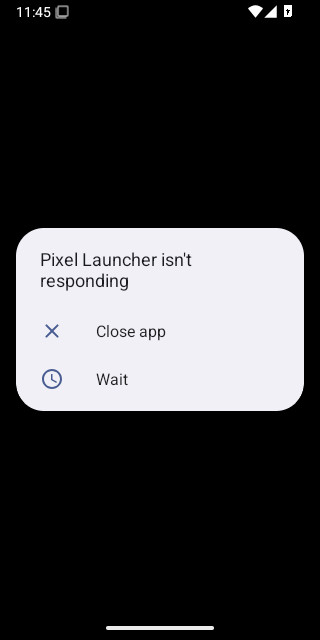
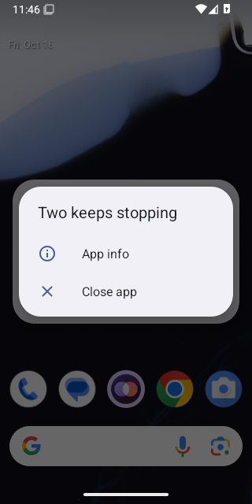
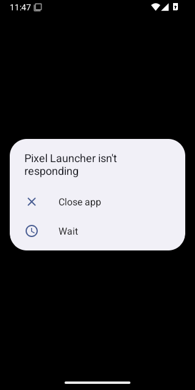
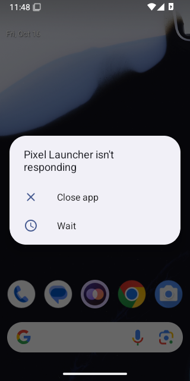

# Calls on Android 15 (API 35)

WebView: com.google.android.webview, 124.0.6367.219

## FAIL - First call while Priya is offline, allowing the microphone

Stopped: `timed out after 20s waiting for Android's microphone question`

- NO  the app is still open - `{"pidBefore":"","pidAfter":""}`

<details><summary>Steps</summary>

- 33.7s tap Call - `"pressed Call"`

</details>

### Crash

```
a/app/~~L8Z_v1sysfft_3VNmKBTRg==/com.google.android.trichromelibrary_636771938-cqZVRUj9m4g1nvFDbADP1A==/TrichromeLibrary.apk (offset 0x8cc000)
10-16 11:45:24.152  3000  3000 E AndroidRuntime: #01 pc 0x00000000029066c3 /data/app/~~L8Z_v1sysfft_3VNmKBTRg==/com.google.android.trichromelibrary_636771938-cqZVRUj9m4g1nvFDbADP1A==/TrichromeLibrary.apk (offset 0x8cc000)
10-16 11:45:24.152  3000  3000 E AndroidRuntime: #02 pc 0x0000000002906b8c /data/app/~~L8Z_v1sysfft_3VNmKBTRg==/com.google.android.trichromelibrary_636771938-cqZVRUj9m4g1nvFDbADP1A==/TrichromeLibrary.apk (offset 0x8cc000)
10-16 11:45:24.152  3000  3000 E AndroidRuntime: #03 pc 0x0000000003ee6053 /data/app/~~L8Z_v1sysfft_3VNmKBTRg==/com.google.android.trichromelibrary_636771938-cqZVRUj9m4g1nvFDbADP1A==/TrichromeLibrary.apk (offset 0x8cc000)
10-16 11:45:24.152  3000  3000 E AndroidRuntime: #04 pc 0x0000000003f08be8 /data/app/~~L8Z_v1sysfft_3VNmKBTRg==/com.google.android.trichromelibrary_636771938-cqZVRUj9m4g1nvFDbADP1A==/TrichromeLibrary.apk (offset 0x8cc000)
10-16 11:45:24.152  3000  3000 E AndroidRuntime: #05 pc 0x0000000003efd9db /data/app/~~L8Z_v1sysfft_3VNmKBTRg==/com.google.android.trichromelibrary_636771938-cqZVRUj9m4g1nvFDbADP1A==/TrichromeLibrary.apk (offset 0x8cc000)
10-16 11:45:24.152  3000  3000 E AndroidRuntime: #06 pc 0x0000000004980750 /data/app/~~L8Z_v1sysfft_3VNmKBTRg==/com.google.android.trichromelibrary_636771938-cqZVRUj9m4g1nvFDbADP1A==/TrichromeLibrary.apk (offset 0x8cc000)
10-16 11:45:24.152  3000  3000 E AndroidRuntime: #07 pc 0x00000000048d502e /data/app/~~L8Z_v1sysfft_3VNmKBTRg==/com.google.android.trichromelibrary_636771938-cqZVRUj9m4g1nvFDbADP1A==/TrichromeLibrary.apk (offset 0x8cc000)
10-16 11:45:24.152  3000  3000 E AndroidRuntime: #08 pc 0x000000000295665f /data/app/~~L8Z_v1sysfft_3VNmKBTRg==/com.google.android.trichromelibrary_636771938-cqZVRUj9m4g1nvFDbADP1A==/TrichromeLibrary.apk (offset 0x8cc000)
10-16 11:45:24.152  3000  3000 E AndroidRuntime: #09 pc 0x00000000028d9390 /data/app/~~L8Z_v1sysfft_3VNmKBTRg==/com.google.android.trichromelibrary_636771938-cqZVRUj9m4g1nvFDbADP1A==/TrichromeLibrary.apk (offset 0x8cc000)
10-16 11:45:24.152  3000  3000 E AndroidRuntime: #10 pc 0x000000000540ce3f /data/app/~~L8Z_v1sysfft_3VNmKBTRg==/com.google.android.trichromelibrary_636771938-cqZVRUj9m4g1nvFDbADP1A==/TrichromeLibrary.apk (offset 0x8cc000)
10-16 11:45:24.152  3000  3000 E AndroidRuntime: #11 pc 0x000000000341f764 /data/app/~~L8Z_v1sysfft_3VNmKBTRg==/com.google.android.trichromelibrary_636771938-cqZVRUj9m4g1nvFDbADP1A==/TrichromeLibrary.apk (offset 0x8cc000)
10-16 11:45:24.152  3000  3000 E AndroidRuntime: #12 pc 0x000000000341f72d /data/app/~~L8Z_v1sysfft_3VNmKBTRg==/com.google.android.trichromelibrary_636771938-cqZVRUj9m4g1nvFDbADP1A==/TrichromeLibrary.apk (offset 0x8cc000)
10-16 11:45:24.152  3000  3000 E AndroidRuntime: #13 pc 0x000000000341f6c1 /data/app/~~L8Z_v1sysfft_3VNmKBTRg==/com.google.android.trichromelibrary_636771938-cqZVRUj9m4g1nvFDbADP1A==/TrichromeLibrary.apk (offset 0x8cc000)
10-16 11:45:24.152  3000  3000 E AndroidRuntime: #14 pc 0x00000000000036d6 /system/lib64/libutils.so
10-16 11:45:24.152  3000  3000 E AndroidRuntime: #15 pc 0x00000000000aa5e3 /system/lib64/libandroid_runtime.so
10-16 11:45:24.152  3000  3000 E AndroidRuntime: 
10-16 11:45:24.152  3000  3000 E AndroidRuntime: 	at org.chromium.base.JniAndroid.handleException(chromium-TrichromeWebViewGoogle6432.apk-stable-636771938:21)
10-16 11:45:24.152  3000  3000 E AndroidRuntime: 	at android.os.MessageQueue.nativePollOnce(Native Method)
10-16 11:45:24.152  3000  3000 E AndroidRuntime: 	at android.os.MessageQueue.next(MessageQueue.java:346)
10-16 11:45:24.152  3000  3000 E AndroidRuntime: 	at android.os.Looper.loopOnce(Looper.java:189)
10-16 11:45:24.152  3000  3000 E AndroidRuntime: 	at android.os.Looper.loop(Looper.java:317)
10-16 11:45:24.152  3000  3000 E AndroidRuntime: 	at android.app.ActivityThread.main(ActivityThread.java:8705)
10-16 11:45:24.152  3000  3000 E AndroidRuntime: 	at java.lang.reflect.Method.invoke(Native Method)
10-16 11:45:24.152  3000  3000 E AndroidRuntime: 	at com.android.internal.os.RuntimeInit$MethodAndArgsCaller.run(RuntimeInit.java:580)
10-16 11:45:24.152  3000  3000 E AndroidRuntime: 	at com.android.internal.os.ZygoteInit.main(ZygoteInit.java:886)
10-16 11:45:24.152  3000  3000 E AndroidRuntime: Caused by: java.lang.IllegalArgumentException: Can only use lower 16 bits for requestCode
10-16 11:45:24.152  3000  3000 E AndroidRuntime: 	at androidx.fragment.app.FragmentActivity.checkForValidRequestCode(FragmentActivity.java:714)
10-16 11:45:24.152  3000  3000 E AndroidRuntime: 	at androidx.fragment.app.FragmentActivity.validateRequestPermissionsRequestCode(FragmentActivity.java:729)
10-16 11:45:24.152  3000  3000 E AndroidRuntime: 	at androidx.core.app.ActivityCompat.requestPermissions(ActivityCompat.java:542)
10-16 11:45:24.152  3000  3000 E AndroidRuntime: 	at androidx.activity.ComponentActivity$activityResultRegistry$1.onLaunch(ComponentActivity.kt:194)
10-16 11:45:24.152  3000  3000 E AndroidRuntime: 	at androidx.activity.result.ActivityResultRegistry$register$3.launch(ActivityResultRegistry.kt:191)
10-16 11:45:24.152  3000  3000 E AndroidRuntime: 	at androidx.activity.compose.ActivityResultLauncherHolder.launch(ActivityResultRegistry.kt:150)
10-16 11:45:24.152  3000  3000 E AndroidRuntime: 	at androidx.activity.compose.ManagedActivityResultLauncher.launch(ActivityResultRegistry.kt:139)
10-16 11:45:24.152  3000  3000 E AndroidRuntime: 	at androidx.activity.result.ActivityResultLauncher.launch(ActivityResultLauncher.kt:37)
10-16 11:45:24.152  3000  3000 E AndroidRuntime: 	at app.two.android.features.web.TwoWebViewKt$TwoWebView$2$1$1$4.onPermissionRequest(TwoWebView.kt:957)
10-16 11:45:24.152  3000  3000 E AndroidRuntime: 	at org.chromium.android_webview.AwContents.onPermissionRequest(chromium-TrichromeWebViewGoogle6432.apk-stable-636771938:55)
10-16 11:45:24.152  3000  3000 E AndroidRuntime: 	... 8 more

```

```
ACTIVITY MANAGER PROCESS EXIT INFO (dumpsys activity exit-info)
Last Timestamp of Persistence Into Persistent Storage: 1970-01-01 00:00:00.000
  package: app.two.android
    Historical Process Exit for uid=10209
        ApplicationExitInfo #0:
          timestamp=2026-10-16 11:45:24.233 pid=3195 realUid=99001 packageUid=10209 definingUid=10151 user=0
          process=com.google.android.webview:sandboxed_process0:org.chromium.content.app.SandboxedProcessService0:0 reason=1 (EXIT_SELF) subreason=17 (ISOLATED NOT NEEDED) status=0
          importance=300 pss=0.00 rss=0.00 description=isolated not needed state=empty trace=null
        ApplicationExitInfo #1:
          timestamp=2026-10-16 11:45:24.159 pid=3000 realUid=10209 packageUid=10209 definingUid=10209 user=0
          process=app.two.android reason=4 (APP CRASH(EXCEPTION)) subreason=0 (UNKNOWN) status=0
          importance=100 pss=0.00 rss=0.00 description=crash state=empty trace=null

```

 

Log: [first-call-while-priya-is-offline-allowing-the-mic.log](first-call-while-priya-is-offline-allowing-the-mic.log)

## FAIL - Call while Priya is offline rings out

Stopped: `page went away`

- NO  the call service runs in the foreground
- NO  the app is still open - `{"pidBefore":"","pidAfter":""}`

<details><summary>Steps</summary>

- 70.2s tap Call - `"pressed Call"`

</details>

### Crash

```
a/app/~~L8Z_v1sysfft_3VNmKBTRg==/com.google.android.trichromelibrary_636771938-cqZVRUj9m4g1nvFDbADP1A==/TrichromeLibrary.apk (offset 0x8cc000)
10-16 11:46:00.839  4401  4401 E AndroidRuntime: #01 pc 0x00000000029066c3 /data/app/~~L8Z_v1sysfft_3VNmKBTRg==/com.google.android.trichromelibrary_636771938-cqZVRUj9m4g1nvFDbADP1A==/TrichromeLibrary.apk (offset 0x8cc000)
10-16 11:46:00.839  4401  4401 E AndroidRuntime: #02 pc 0x0000000002906b8c /data/app/~~L8Z_v1sysfft_3VNmKBTRg==/com.google.android.trichromelibrary_636771938-cqZVRUj9m4g1nvFDbADP1A==/TrichromeLibrary.apk (offset 0x8cc000)
10-16 11:46:00.839  4401  4401 E AndroidRuntime: #03 pc 0x0000000003ee6053 /data/app/~~L8Z_v1sysfft_3VNmKBTRg==/com.google.android.trichromelibrary_636771938-cqZVRUj9m4g1nvFDbADP1A==/TrichromeLibrary.apk (offset 0x8cc000)
10-16 11:46:00.839  4401  4401 E AndroidRuntime: #04 pc 0x0000000003f08be8 /data/app/~~L8Z_v1sysfft_3VNmKBTRg==/com.google.android.trichromelibrary_636771938-cqZVRUj9m4g1nvFDbADP1A==/TrichromeLibrary.apk (offset 0x8cc000)
10-16 11:46:00.839  4401  4401 E AndroidRuntime: #05 pc 0x0000000003efd9db /data/app/~~L8Z_v1sysfft_3VNmKBTRg==/com.google.android.trichromelibrary_636771938-cqZVRUj9m4g1nvFDbADP1A==/TrichromeLibrary.apk (offset 0x8cc000)
10-16 11:46:00.839  4401  4401 E AndroidRuntime: #06 pc 0x0000000004980750 /data/app/~~L8Z_v1sysfft_3VNmKBTRg==/com.google.android.trichromelibrary_636771938-cqZVRUj9m4g1nvFDbADP1A==/TrichromeLibrary.apk (offset 0x8cc000)
10-16 11:46:00.839  4401  4401 E AndroidRuntime: #07 pc 0x00000000048d502e /data/app/~~L8Z_v1sysfft_3VNmKBTRg==/com.google.android.trichromelibrary_636771938-cqZVRUj9m4g1nvFDbADP1A==/TrichromeLibrary.apk (offset 0x8cc000)
10-16 11:46:00.839  4401  4401 E AndroidRuntime: #08 pc 0x000000000295665f /data/app/~~L8Z_v1sysfft_3VNmKBTRg==/com.google.android.trichromelibrary_636771938-cqZVRUj9m4g1nvFDbADP1A==/TrichromeLibrary.apk (offset 0x8cc000)
10-16 11:46:00.839  4401  4401 E AndroidRuntime: #09 pc 0x00000000028d9390 /data/app/~~L8Z_v1sysfft_3VNmKBTRg==/com.google.android.trichromelibrary_636771938-cqZVRUj9m4g1nvFDbADP1A==/TrichromeLibrary.apk (offset 0x8cc000)
10-16 11:46:00.839  4401  4401 E AndroidRuntime: #10 pc 0x000000000540ce3f /data/app/~~L8Z_v1sysfft_3VNmKBTRg==/com.google.android.trichromelibrary_636771938-cqZVRUj9m4g1nvFDbADP1A==/TrichromeLibrary.apk (offset 0x8cc000)
10-16 11:46:00.839  4401  4401 E AndroidRuntime: #11 pc 0x000000000341f764 /data/app/~~L8Z_v1sysfft_3VNmKBTRg==/com.google.android.trichromelibrary_636771938-cqZVRUj9m4g1nvFDbADP1A==/TrichromeLibrary.apk (offset 0x8cc000)
10-16 11:46:00.839  4401  4401 E AndroidRuntime: #12 pc 0x000000000341f72d /data/app/~~L8Z_v1sysfft_3VNmKBTRg==/com.google.android.trichromelibrary_636771938-cqZVRUj9m4g1nvFDbADP1A==/TrichromeLibrary.apk (offset 0x8cc000)
10-16 11:46:00.839  4401  4401 E AndroidRuntime: #13 pc 0x000000000341f6c1 /data/app/~~L8Z_v1sysfft_3VNmKBTRg==/com.google.android.trichromelibrary_636771938-cqZVRUj9m4g1nvFDbADP1A==/TrichromeLibrary.apk (offset 0x8cc000)
10-16 11:46:00.839  4401  4401 E AndroidRuntime: #14 pc 0x00000000000036d6 /system/lib64/libutils.so
10-16 11:46:00.839  4401  4401 E AndroidRuntime: #15 pc 0x00000000000aa5e3 /system/lib64/libandroid_runtime.so
10-16 11:46:00.839  4401  4401 E AndroidRuntime: 
10-16 11:46:00.839  4401  4401 E AndroidRuntime: 	at org.chromium.base.JniAndroid.handleException(chromium-TrichromeWebViewGoogle6432.apk-stable-636771938:21)
10-16 11:46:00.839  4401  4401 E AndroidRuntime: 	at android.os.MessageQueue.nativePollOnce(Native Method)
10-16 11:46:00.839  4401  4401 E AndroidRuntime: 	at android.os.MessageQueue.next(MessageQueue.java:346)
10-16 11:46:00.839  4401  4401 E AndroidRuntime: 	at android.os.Looper.loopOnce(Looper.java:189)
10-16 11:46:00.839  4401  4401 E AndroidRuntime: 	at android.os.Looper.loop(Looper.java:317)
10-16 11:46:00.839  4401  4401 E AndroidRuntime: 	at android.app.ActivityThread.main(ActivityThread.java:8705)
10-16 11:46:00.839  4401  4401 E AndroidRuntime: 	at java.lang.reflect.Method.invoke(Native Method)
10-16 11:46:00.839  4401  4401 E AndroidRuntime: 	at com.android.internal.os.RuntimeInit$MethodAndArgsCaller.run(RuntimeInit.java:580)
10-16 11:46:00.839  4401  4401 E AndroidRuntime: 	at com.android.internal.os.ZygoteInit.main(ZygoteInit.java:886)
10-16 11:46:00.839  4401  4401 E AndroidRuntime: Caused by: java.lang.IllegalArgumentException: Can only use lower 16 bits for requestCode
10-16 11:46:00.839  4401  4401 E AndroidRuntime: 	at androidx.fragment.app.FragmentActivity.checkForValidRequestCode(FragmentActivity.java:714)
10-16 11:46:00.839  4401  4401 E AndroidRuntime: 	at androidx.fragment.app.FragmentActivity.validateRequestPermissionsRequestCode(FragmentActivity.java:729)
10-16 11:46:00.839  4401  4401 E AndroidRuntime: 	at androidx.core.app.ActivityCompat.requestPermissions(ActivityCompat.java:542)
10-16 11:46:00.839  4401  4401 E AndroidRuntime: 	at androidx.activity.ComponentActivity$activityResultRegistry$1.onLaunch(ComponentActivity.kt:194)
10-16 11:46:00.839  4401  4401 E AndroidRuntime: 	at androidx.activity.result.ActivityResultRegistry$register$3.launch(ActivityResultRegistry.kt:191)
10-16 11:46:00.839  4401  4401 E AndroidRuntime: 	at androidx.activity.compose.ActivityResultLauncherHolder.launch(ActivityResultRegistry.kt:150)
10-16 11:46:00.839  4401  4401 E AndroidRuntime: 	at androidx.activity.compose.ManagedActivityResultLauncher.launch(ActivityResultRegistry.kt:139)
10-16 11:46:00.839  4401  4401 E AndroidRuntime: 	at androidx.activity.result.ActivityResultLauncher.launch(ActivityResultLauncher.kt:37)
10-16 11:46:00.839  4401  4401 E AndroidRuntime: 	at app.two.android.features.web.TwoWebViewKt$TwoWebView$2$1$1$4.onPermissionRequest(TwoWebView.kt:957)
10-16 11:46:00.839  4401  4401 E AndroidRuntime: 	at org.chromium.android_webview.AwContents.onPermissionRequest(chromium-TrichromeWebViewGoogle6432.apk-stable-636771938:55)
10-16 11:46:00.839  4401  4401 E AndroidRuntime: 	... 8 more

```

```
ACTIVITY MANAGER PROCESS EXIT INFO (dumpsys activity exit-info)
Last Timestamp of Persistence Into Persistent Storage: 1970-01-01 00:00:00.000
  package: app.two.android
    Historical Process Exit for uid=10209
        ApplicationExitInfo #0:
          timestamp=2026-10-16 11:46:14.782 pid=4429 realUid=99002 packageUid=10209 definingUid=10151 user=0
          process=com.google.android.webview:sandboxed_process0:org.chromium.content.app.SandboxedProcessService0:0 reason=13 (OTHER KILLS BY SYSTEM) subreason=17 (ISOLATED NOT NEEDED) status=0
          importance=300 pss=0.00 rss=0.00 description=isolated not needed state=empty trace=null
        ApplicationExitInfo #1:
          timestamp=2026-10-16 11:46:14.763 pid=4401 realUid=10209 packageUid=10209 definingUid=10209 user=0
          process=app.two.android reason=9 (EXCESSIVE RESOURCE USAGE) subreason=7 (EXCESSIVE CPU USAGE) status=0
          importance=100 pss=0.00 rss=0.00 description=[EXCESSIVE CPU USAGE] excessive binder traffic during cached state=empty trace=null
        ApplicationExitInfo #2:
          timestamp=2026-10-16 11:45:24.233 pid=3195 realUid=99001 packageUid=10209 definingUid=10151 user=0
          process=com.google.android.webview:sandboxed_process0:org.chromium.content.app.SandboxedProcessService0:0 reason=1 (EXIT_SELF) subreason=17 (ISOLATED NOT NEEDED) status=0
          importance=300 pss=0.00 rss=0.00 description=isolated not needed state=empty trace=null
        ApplicationExitInfo #3:
          timestamp=2026-10-16 11:45:24.159 pid=3000 realUid=10209 packageUid=10209 definingUid=10209 user=0
          process=app.two.android reason=4 (APP CRASH(EXCEPTION)) subreason=0 (UNKNOWN) status=0
          importance=100 pss=0.00 rss=0.00 description=crash state=empty trace=null

```

 

Log: [call-while-priya-is-offline-rings-out.log](call-while-priya-is-offline-rings-out.log)

## FAIL - Call cancelled straight away, ten times

Stopped: `the app closed (Cancel after 0 ms)`

- NO  the app is still open - `{"pidBefore":"","pidAfter":""}`

<details><summary>Steps</summary>

- 99.4s Call, then Cancel after 0 ms - `true`

</details>

### Crash

```
a/app/~~L8Z_v1sysfft_3VNmKBTRg==/com.google.android.trichromelibrary_636771938-cqZVRUj9m4g1nvFDbADP1A==/TrichromeLibrary.apk (offset 0x8cc000)
10-16 11:46:29.512  4671  4671 E AndroidRuntime: #01 pc 0x00000000029066c3 /data/app/~~L8Z_v1sysfft_3VNmKBTRg==/com.google.android.trichromelibrary_636771938-cqZVRUj9m4g1nvFDbADP1A==/TrichromeLibrary.apk (offset 0x8cc000)
10-16 11:46:29.512  4671  4671 E AndroidRuntime: #02 pc 0x0000000002906b8c /data/app/~~L8Z_v1sysfft_3VNmKBTRg==/com.google.android.trichromelibrary_636771938-cqZVRUj9m4g1nvFDbADP1A==/TrichromeLibrary.apk (offset 0x8cc000)
10-16 11:46:29.512  4671  4671 E AndroidRuntime: #03 pc 0x0000000003ee6053 /data/app/~~L8Z_v1sysfft_3VNmKBTRg==/com.google.android.trichromelibrary_636771938-cqZVRUj9m4g1nvFDbADP1A==/TrichromeLibrary.apk (offset 0x8cc000)
10-16 11:46:29.512  4671  4671 E AndroidRuntime: #04 pc 0x0000000003f08be8 /data/app/~~L8Z_v1sysfft_3VNmKBTRg==/com.google.android.trichromelibrary_636771938-cqZVRUj9m4g1nvFDbADP1A==/TrichromeLibrary.apk (offset 0x8cc000)
10-16 11:46:29.512  4671  4671 E AndroidRuntime: #05 pc 0x0000000003efd9db /data/app/~~L8Z_v1sysfft_3VNmKBTRg==/com.google.android.trichromelibrary_636771938-cqZVRUj9m4g1nvFDbADP1A==/TrichromeLibrary.apk (offset 0x8cc000)
10-16 11:46:29.512  4671  4671 E AndroidRuntime: #06 pc 0x0000000004980750 /data/app/~~L8Z_v1sysfft_3VNmKBTRg==/com.google.android.trichromelibrary_636771938-cqZVRUj9m4g1nvFDbADP1A==/TrichromeLibrary.apk (offset 0x8cc000)
10-16 11:46:29.512  4671  4671 E AndroidRuntime: #07 pc 0x00000000048d502e /data/app/~~L8Z_v1sysfft_3VNmKBTRg==/com.google.android.trichromelibrary_636771938-cqZVRUj9m4g1nvFDbADP1A==/TrichromeLibrary.apk (offset 0x8cc000)
10-16 11:46:29.512  4671  4671 E AndroidRuntime: #08 pc 0x000000000295665f /data/app/~~L8Z_v1sysfft_3VNmKBTRg==/com.google.android.trichromelibrary_636771938-cqZVRUj9m4g1nvFDbADP1A==/TrichromeLibrary.apk (offset 0x8cc000)
10-16 11:46:29.512  4671  4671 E AndroidRuntime: #09 pc 0x00000000028d9390 /data/app/~~L8Z_v1sysfft_3VNmKBTRg==/com.google.android.trichromelibrary_636771938-cqZVRUj9m4g1nvFDbADP1A==/TrichromeLibrary.apk (offset 0x8cc000)
10-16 11:46:29.512  4671  4671 E AndroidRuntime: #10 pc 0x000000000540ce3f /data/app/~~L8Z_v1sysfft_3VNmKBTRg==/com.google.android.trichromelibrary_636771938-cqZVRUj9m4g1nvFDbADP1A==/TrichromeLibrary.apk (offset 0x8cc000)
10-16 11:46:29.512  4671  4671 E AndroidRuntime: #11 pc 0x000000000341f764 /data/app/~~L8Z_v1sysfft_3VNmKBTRg==/com.google.android.trichromelibrary_636771938-cqZVRUj9m4g1nvFDbADP1A==/TrichromeLibrary.apk (offset 0x8cc000)
10-16 11:46:29.512  4671  4671 E AndroidRuntime: #12 pc 0x000000000341f72d /data/app/~~L8Z_v1sysfft_3VNmKBTRg==/com.google.android.trichromelibrary_636771938-cqZVRUj9m4g1nvFDbADP1A==/TrichromeLibrary.apk (offset 0x8cc000)
10-16 11:46:29.512  4671  4671 E AndroidRuntime: #13 pc 0x000000000341f6c1 /data/app/~~L8Z_v1sysfft_3VNmKBTRg==/com.google.android.trichromelibrary_636771938-cqZVRUj9m4g1nvFDbADP1A==/TrichromeLibrary.apk (offset 0x8cc000)
10-16 11:46:29.512  4671  4671 E AndroidRuntime: #14 pc 0x00000000000036d6 /system/lib64/libutils.so
10-16 11:46:29.512  4671  4671 E AndroidRuntime: #15 pc 0x00000000000aa5e3 /system/lib64/libandroid_runtime.so
10-16 11:46:29.512  4671  4671 E AndroidRuntime: 
10-16 11:46:29.512  4671  4671 E AndroidRuntime: 	at org.chromium.base.JniAndroid.handleException(chromium-TrichromeWebViewGoogle6432.apk-stable-636771938:21)
10-16 11:46:29.512  4671  4671 E AndroidRuntime: 	at android.os.MessageQueue.nativePollOnce(Native Method)
10-16 11:46:29.512  4671  4671 E AndroidRuntime: 	at android.os.MessageQueue.next(MessageQueue.java:346)
10-16 11:46:29.512  4671  4671 E AndroidRuntime: 	at android.os.Looper.loopOnce(Looper.java:189)
10-16 11:46:29.512  4671  4671 E AndroidRuntime: 	at android.os.Looper.loop(Looper.java:317)
10-16 11:46:29.512  4671  4671 E AndroidRuntime: 	at android.app.ActivityThread.main(ActivityThread.java:8705)
10-16 11:46:29.512  4671  4671 E AndroidRuntime: 	at java.lang.reflect.Method.invoke(Native Method)
10-16 11:46:29.512  4671  4671 E AndroidRuntime: 	at com.android.internal.os.RuntimeInit$MethodAndArgsCaller.run(RuntimeInit.java:580)
10-16 11:46:29.512  4671  4671 E AndroidRuntime: 	at com.android.internal.os.ZygoteInit.main(ZygoteInit.java:886)
10-16 11:46:29.512  4671  4671 E AndroidRuntime: Caused by: java.lang.IllegalArgumentException: Can only use lower 16 bits for requestCode
10-16 11:46:29.512  4671  4671 E AndroidRuntime: 	at androidx.fragment.app.FragmentActivity.checkForValidRequestCode(FragmentActivity.java:714)
10-16 11:46:29.512  4671  4671 E AndroidRuntime: 	at androidx.fragment.app.FragmentActivity.validateRequestPermissionsRequestCode(FragmentActivity.java:729)
10-16 11:46:29.512  4671  4671 E AndroidRuntime: 	at androidx.core.app.ActivityCompat.requestPermissions(ActivityCompat.java:542)
10-16 11:46:29.512  4671  4671 E AndroidRuntime: 	at androidx.activity.ComponentActivity$activityResultRegistry$1.onLaunch(ComponentActivity.kt:194)
10-16 11:46:29.512  4671  4671 E AndroidRuntime: 	at androidx.activity.result.ActivityResultRegistry$register$3.launch(ActivityResultRegistry.kt:191)
10-16 11:46:29.512  4671  4671 E AndroidRuntime: 	at androidx.activity.compose.ActivityResultLauncherHolder.launch(ActivityResultRegistry.kt:150)
10-16 11:46:29.512  4671  4671 E AndroidRuntime: 	at androidx.activity.compose.ManagedActivityResultLauncher.launch(ActivityResultRegistry.kt:139)
10-16 11:46:29.512  4671  4671 E AndroidRuntime: 	at androidx.activity.result.ActivityResultLauncher.launch(ActivityResultLauncher.kt:37)
10-16 11:46:29.512  4671  4671 E AndroidRuntime: 	at app.two.android.features.web.TwoWebViewKt$TwoWebView$2$1$1$4.onPermissionRequest(TwoWebView.kt:957)
10-16 11:46:29.512  4671  4671 E AndroidRuntime: 	at org.chromium.android_webview.AwContents.onPermissionRequest(chromium-TrichromeWebViewGoogle6432.apk-stable-636771938:55)
10-16 11:46:29.512  4671  4671 E AndroidRuntime: 	... 8 more

```

```
ACTIVITY MANAGER PROCESS EXIT INFO (dumpsys activity exit-info)
Last Timestamp of Persistence Into Persistent Storage: 1970-01-01 00:00:00.000
  package: app.two.android
    Historical Process Exit for uid=10209
        ApplicationExitInfo #0:
          timestamp=2026-10-16 11:46:29.541 pid=4701 realUid=99003 packageUid=10209 definingUid=10151 user=0
          process=com.google.android.webview:sandboxed_process0:org.chromium.content.app.SandboxedProcessService0:0 reason=13 (OTHER KILLS BY SYSTEM) subreason=17 (ISOLATED NOT NEEDED) status=0
          importance=300 pss=0.00 rss=0.00 description=isolated not needed state=empty trace=null
        ApplicationExitInfo #1:
          timestamp=2026-10-16 11:46:29.515 pid=4671 realUid=10209 packageUid=10209 definingUid=10209 user=0
          process=app.two.android reason=4 (APP CRASH(EXCEPTION)) subreason=0 (UNKNOWN) status=0
          importance=100 pss=0.00 rss=0.00 description=crash state=empty trace=null
        ApplicationExitInfo #2:
          timestamp=2026-10-16 11:46:14.782 pid=4429 realUid=99002 packageUid=10209 definingUid=10151 user=0
          process=com.google.android.webview:sandboxed_process0:org.chromium.content.app.SandboxedProcessService0:0 reason=13 (OTHER KILLS BY SYSTEM) subreason=17 (ISOLATED NOT NEEDED) status=0
          importance=300 pss=0.00 rss=0.00 description=isolated not needed state=empty trace=null
        ApplicationExitInfo #3:
          timestamp=2026-10-16 11:46:14.763 pid=4401 realUid=10209 packageUid=10209 definingUid=10209 user=0
          process=app.two.android reason=9 (EXCESSIVE RESOURCE USAGE) subreason=7 (EXCESSIVE CPU USAGE) status=0
          importance=100 pss=0.00 rss=0.00 description=[EXCESSIVE CPU USAGE] excessive binder traffic during cached state=empty trace=null
        ApplicationExitInfo #4:
          timestamp=2026-10-16 11:45:24.233 pid=3195 realUid=99001 packageUid=10209 definingUid=10151 user=0
          process=com.google.android.webview:sandboxed_process0:org.chromium.content.app.SandboxedProcessService0:0 reason=1 (EXIT_SELF) subreason=17 (ISOLATED NOT NEEDED) status=0
          importance=300 pss=0.00 rss=0.00 description=isolated not needed state=empty trace=null
        ApplicationExitInfo #5:
          timestamp=2026-10-16 11:45:24.159 pid=3000 realUid=10209 packageUid=10209 definingUid=10209 user=0
          process=app.two.android reason=4 (APP CRASH(EXCEPTION)) subreason=0 (UNKNOWN) status=0
          importance=100 pss=0.00 rss=0.00 description=crash state=empty trace=null

```


Log: [call-cancelled-straight-away-ten-times.log](call-cancelled-straight-away-ten-times.log)

## FAIL - Call that Priya answers, with the speaker on and off

Stopped: `timed out after 20s waiting for Priya's phone to ring`

- NO  the app is still open - `{"pidBefore":"","pidAfter":""}`

<details><summary>Steps</summary>

- 132.5s tap Call - `"pressed Call"`

</details>

### Crash

```
a/app/~~L8Z_v1sysfft_3VNmKBTRg==/com.google.android.trichromelibrary_636771938-cqZVRUj9m4g1nvFDbADP1A==/TrichromeLibrary.apk (offset 0x8cc000)
10-16 11:47:02.541  4818  4818 E AndroidRuntime: #01 pc 0x00000000029066c3 /data/app/~~L8Z_v1sysfft_3VNmKBTRg==/com.google.android.trichromelibrary_636771938-cqZVRUj9m4g1nvFDbADP1A==/TrichromeLibrary.apk (offset 0x8cc000)
10-16 11:47:02.541  4818  4818 E AndroidRuntime: #02 pc 0x0000000002906b8c /data/app/~~L8Z_v1sysfft_3VNmKBTRg==/com.google.android.trichromelibrary_636771938-cqZVRUj9m4g1nvFDbADP1A==/TrichromeLibrary.apk (offset 0x8cc000)
10-16 11:47:02.541  4818  4818 E AndroidRuntime: #03 pc 0x0000000003ee6053 /data/app/~~L8Z_v1sysfft_3VNmKBTRg==/com.google.android.trichromelibrary_636771938-cqZVRUj9m4g1nvFDbADP1A==/TrichromeLibrary.apk (offset 0x8cc000)
10-16 11:47:02.541  4818  4818 E AndroidRuntime: #04 pc 0x0000000003f08be8 /data/app/~~L8Z_v1sysfft_3VNmKBTRg==/com.google.android.trichromelibrary_636771938-cqZVRUj9m4g1nvFDbADP1A==/TrichromeLibrary.apk (offset 0x8cc000)
10-16 11:47:02.541  4818  4818 E AndroidRuntime: #05 pc 0x0000000003efd9db /data/app/~~L8Z_v1sysfft_3VNmKBTRg==/com.google.android.trichromelibrary_636771938-cqZVRUj9m4g1nvFDbADP1A==/TrichromeLibrary.apk (offset 0x8cc000)
10-16 11:47:02.541  4818  4818 E AndroidRuntime: #06 pc 0x0000000004980750 /data/app/~~L8Z_v1sysfft_3VNmKBTRg==/com.google.android.trichromelibrary_636771938-cqZVRUj9m4g1nvFDbADP1A==/TrichromeLibrary.apk (offset 0x8cc000)
10-16 11:47:02.541  4818  4818 E AndroidRuntime: #07 pc 0x00000000048d502e /data/app/~~L8Z_v1sysfft_3VNmKBTRg==/com.google.android.trichromelibrary_636771938-cqZVRUj9m4g1nvFDbADP1A==/TrichromeLibrary.apk (offset 0x8cc000)
10-16 11:47:02.541  4818  4818 E AndroidRuntime: #08 pc 0x000000000295665f /data/app/~~L8Z_v1sysfft_3VNmKBTRg==/com.google.android.trichromelibrary_636771938-cqZVRUj9m4g1nvFDbADP1A==/TrichromeLibrary.apk (offset 0x8cc000)
10-16 11:47:02.541  4818  4818 E AndroidRuntime: #09 pc 0x00000000028d9390 /data/app/~~L8Z_v1sysfft_3VNmKBTRg==/com.google.android.trichromelibrary_636771938-cqZVRUj9m4g1nvFDbADP1A==/TrichromeLibrary.apk (offset 0x8cc000)
10-16 11:47:02.541  4818  4818 E AndroidRuntime: #10 pc 0x000000000540ce3f /data/app/~~L8Z_v1sysfft_3VNmKBTRg==/com.google.android.trichromelibrary_636771938-cqZVRUj9m4g1nvFDbADP1A==/TrichromeLibrary.apk (offset 0x8cc000)
10-16 11:47:02.541  4818  4818 E AndroidRuntime: #11 pc 0x000000000341f764 /data/app/~~L8Z_v1sysfft_3VNmKBTRg==/com.google.android.trichromelibrary_636771938-cqZVRUj9m4g1nvFDbADP1A==/TrichromeLibrary.apk (offset 0x8cc000)
10-16 11:47:02.541  4818  4818 E AndroidRuntime: #12 pc 0x000000000341f72d /data/app/~~L8Z_v1sysfft_3VNmKBTRg==/com.google.android.trichromelibrary_636771938-cqZVRUj9m4g1nvFDbADP1A==/TrichromeLibrary.apk (offset 0x8cc000)
10-16 11:47:02.541  4818  4818 E AndroidRuntime: #13 pc 0x000000000341f6c1 /data/app/~~L8Z_v1sysfft_3VNmKBTRg==/com.google.android.trichromelibrary_636771938-cqZVRUj9m4g1nvFDbADP1A==/TrichromeLibrary.apk (offset 0x8cc000)
10-16 11:47:02.541  4818  4818 E AndroidRuntime: #14 pc 0x00000000000036d6 /system/lib64/libutils.so
10-16 11:47:02.541  4818  4818 E AndroidRuntime: #15 pc 0x00000000000aa5e3 /system/lib64/libandroid_runtime.so
10-16 11:47:02.541  4818  4818 E AndroidRuntime: 
10-16 11:47:02.541  4818  4818 E AndroidRuntime: 	at org.chromium.base.JniAndroid.handleException(chromium-TrichromeWebViewGoogle6432.apk-stable-636771938:21)
10-16 11:47:02.541  4818  4818 E AndroidRuntime: 	at android.os.MessageQueue.nativePollOnce(Native Method)
10-16 11:47:02.541  4818  4818 E AndroidRuntime: 	at android.os.MessageQueue.next(MessageQueue.java:346)
10-16 11:47:02.541  4818  4818 E AndroidRuntime: 	at android.os.Looper.loopOnce(Looper.java:189)
10-16 11:47:02.541  4818  4818 E AndroidRuntime: 	at android.os.Looper.loop(Looper.java:317)
10-16 11:47:02.541  4818  4818 E AndroidRuntime: 	at android.app.ActivityThread.main(ActivityThread.java:8705)
10-16 11:47:02.541  4818  4818 E AndroidRuntime: 	at java.lang.reflect.Method.invoke(Native Method)
10-16 11:47:02.541  4818  4818 E AndroidRuntime: 	at com.android.internal.os.RuntimeInit$MethodAndArgsCaller.run(RuntimeInit.java:580)
10-16 11:47:02.541  4818  4818 E AndroidRuntime: 	at com.android.internal.os.ZygoteInit.main(ZygoteInit.java:886)
10-16 11:47:02.541  4818  4818 E AndroidRuntime: Caused by: java.lang.IllegalArgumentException: Can only use lower 16 bits for requestCode
10-16 11:47:02.541  4818  4818 E AndroidRuntime: 	at androidx.fragment.app.FragmentActivity.checkForValidRequestCode(FragmentActivity.java:714)
10-16 11:47:02.541  4818  4818 E AndroidRuntime: 	at androidx.fragment.app.FragmentActivity.validateRequestPermissionsRequestCode(FragmentActivity.java:729)
10-16 11:47:02.541  4818  4818 E AndroidRuntime: 	at androidx.core.app.ActivityCompat.requestPermissions(ActivityCompat.java:542)
10-16 11:47:02.541  4818  4818 E AndroidRuntime: 	at androidx.activity.ComponentActivity$activityResultRegistry$1.onLaunch(ComponentActivity.kt:194)
10-16 11:47:02.541  4818  4818 E AndroidRuntime: 	at androidx.activity.result.ActivityResultRegistry$register$3.launch(ActivityResultRegistry.kt:191)
10-16 11:47:02.541  4818  4818 E AndroidRuntime: 	at androidx.activity.compose.ActivityResultLauncherHolder.launch(ActivityResultRegistry.kt:150)
10-16 11:47:02.541  4818  4818 E AndroidRuntime: 	at androidx.activity.compose.ManagedActivityResultLauncher.launch(ActivityResultRegistry.kt:139)
10-16 11:47:02.541  4818  4818 E AndroidRuntime: 	at androidx.activity.result.ActivityResultLauncher.launch(ActivityResultLauncher.kt:37)
10-16 11:47:02.541  4818  4818 E AndroidRuntime: 	at app.two.android.features.web.TwoWebViewKt$TwoWebView$2$1$1$4.onPermissionRequest(TwoWebView.kt:957)
10-16 11:47:02.541  4818  4818 E AndroidRuntime: 	at org.chromium.android_webview.AwContents.onPermissionRequest(chromium-TrichromeWebViewGoogle6432.apk-stable-636771938:55)
10-16 11:47:02.541  4818  4818 E AndroidRuntime: 	... 8 more

```

```
ACTIVITY MANAGER PROCESS EXIT INFO (dumpsys activity exit-info)
Last Timestamp of Persistence Into Persistent Storage: 1970-01-01 00:00:00.000
  package: app.two.android
    Historical Process Exit for uid=10209
        ApplicationExitInfo #0:
          timestamp=2026-10-16 11:47:02.562 pid=4849 realUid=99004 packageUid=10209 definingUid=10151 user=0
          process=com.google.android.webview:sandboxed_process0:org.chromium.content.app.SandboxedProcessService0:0 reason=1 (EXIT_SELF) subreason=17 (ISOLATED NOT NEEDED) status=0
          importance=300 pss=0.00 rss=0.00 description=isolated not needed state=empty trace=null
        ApplicationExitInfo #1:
          timestamp=2026-10-16 11:47:02.543 pid=4818 realUid=10209 packageUid=10209 definingUid=10209 user=0
          process=app.two.android reason=4 (APP CRASH(EXCEPTION)) subreason=0 (UNKNOWN) status=0
          importance=100 pss=0.00 rss=0.00 description=crash state=empty trace=null
        ApplicationExitInfo #2:
          timestamp=2026-10-16 11:46:29.541 pid=4701 realUid=99003 packageUid=10209 definingUid=10151 user=0
          process=com.google.android.webview:sandboxed_process0:org.chromium.content.app.SandboxedProcessService0:0 reason=13 (OTHER KILLS BY SYSTEM) subreason=17 (ISOLATED NOT NEEDED) status=0
          importance=300 pss=0.00 rss=0.00 description=isolated not needed state=empty trace=null
        ApplicationExitInfo #3:
          timestamp=2026-10-16 11:46:29.515 pid=4671 realUid=10209 packageUid=10209 definingUid=10209 user=0
          process=app.two.android reason=4 (APP CRASH(EXCEPTION)) subreason=0 (UNKNOWN) status=0
          importance=100 pss=0.00 rss=0.00 description=crash state=empty trace=null
        ApplicationExitInfo #4:
          timestamp=2026-10-16 11:46:14.782 pid=4429 realUid=99002 packageUid=10209 definingUid=10151 user=0
          process=com.google.android.webview:sandboxed_process0:org.chromium.content.app.SandboxedProcessService0:0 reason=13 (OTHER KILLS BY SYSTEM) subreason=17 (ISOLATED NOT NEEDED) status=0
          importance=300 pss=0.00 rss=0.00 description=isolated not needed state=empty trace=null
        ApplicationExitInfo #5:
          timestamp=2026-10-16 11:46:14.763 pid=4401 realUid=10209 packageUid=10209 definingUid=10209 user=0
          process=app.two.android reason=9 (EXCESSIVE RESOURCE USAGE) subreason=7 (EXCESSIVE CPU USAGE) status=0
          importance=100 pss=0.00 rss=0.00 description=[EXCESSIVE CPU USAGE] excessive binder traffic during cached state=empty trace=null
        ApplicationExitInfo #6:
          timestamp=2026-10-16 11:45:24.233 pid=3195 realUid=99001 packageUid=10209 definingUid=10151 user=0
          process=com.google.android.webview:sandboxed_process0:org.chromium.content.app.SandboxedProcessService0:0 reason=1 (EXIT_SELF) subreason=17 (ISOLATED NOT NEEDED) status=0
          importance=300 pss=0.00 rss=0.00 description=isolated not needed state=empty trace=null
        ApplicationExitInfo #7:
          timestamp=2026-10-16 11:45:24.159 pid=3000 realUid=10209 packageUid=10209 definingUid=10209 user=0
          process=app.two.android reason=4 (APP CRASH(EXCEPTION)) subreason=0 (UNKNOWN) status=0
          importance=100 pss=0.00 rss=0.00 description=crash state=empty trace=null

```


Log: [call-that-priya-answers-with-the-speaker-on-and-of.log](call-that-priya-answers-with-the-speaker-on-and-of.log)

## FAIL - Priya calls and you answer

Stopped: `timed out after 30s waiting for the call to connect (page went away)`

- ok  your phone rings - `"P Priya is calling you Decline Accept"`
- NO  the app is still open - `{"pidBefore":"","pidAfter":""}`

<details><summary>Steps</summary>

- 170.0s Priya taps Call - `"pressed Call"`
- 171.3s tap Accept - `"pressed Accept"`

</details>

### Crash

```
a/app/~~L8Z_v1sysfft_3VNmKBTRg==/com.google.android.trichromelibrary_636771938-cqZVRUj9m4g1nvFDbADP1A==/TrichromeLibrary.apk (offset 0x8cc000)
10-16 11:47:41.299  4990  4990 E AndroidRuntime: #01 pc 0x00000000029066c3 /data/app/~~L8Z_v1sysfft_3VNmKBTRg==/com.google.android.trichromelibrary_636771938-cqZVRUj9m4g1nvFDbADP1A==/TrichromeLibrary.apk (offset 0x8cc000)
10-16 11:47:41.299  4990  4990 E AndroidRuntime: #02 pc 0x0000000002906b8c /data/app/~~L8Z_v1sysfft_3VNmKBTRg==/com.google.android.trichromelibrary_636771938-cqZVRUj9m4g1nvFDbADP1A==/TrichromeLibrary.apk (offset 0x8cc000)
10-16 11:47:41.299  4990  4990 E AndroidRuntime: #03 pc 0x0000000003ee6053 /data/app/~~L8Z_v1sysfft_3VNmKBTRg==/com.google.android.trichromelibrary_636771938-cqZVRUj9m4g1nvFDbADP1A==/TrichromeLibrary.apk (offset 0x8cc000)
10-16 11:47:41.299  4990  4990 E AndroidRuntime: #04 pc 0x0000000003f08be8 /data/app/~~L8Z_v1sysfft_3VNmKBTRg==/com.google.android.trichromelibrary_636771938-cqZVRUj9m4g1nvFDbADP1A==/TrichromeLibrary.apk (offset 0x8cc000)
10-16 11:47:41.299  4990  4990 E AndroidRuntime: #05 pc 0x0000000003efd9db /data/app/~~L8Z_v1sysfft_3VNmKBTRg==/com.google.android.trichromelibrary_636771938-cqZVRUj9m4g1nvFDbADP1A==/TrichromeLibrary.apk (offset 0x8cc000)
10-16 11:47:41.299  4990  4990 E AndroidRuntime: #06 pc 0x0000000004980750 /data/app/~~L8Z_v1sysfft_3VNmKBTRg==/com.google.android.trichromelibrary_636771938-cqZVRUj9m4g1nvFDbADP1A==/TrichromeLibrary.apk (offset 0x8cc000)
10-16 11:47:41.299  4990  4990 E AndroidRuntime: #07 pc 0x00000000048d502e /data/app/~~L8Z_v1sysfft_3VNmKBTRg==/com.google.android.trichromelibrary_636771938-cqZVRUj9m4g1nvFDbADP1A==/TrichromeLibrary.apk (offset 0x8cc000)
10-16 11:47:41.299  4990  4990 E AndroidRuntime: #08 pc 0x000000000295665f /data/app/~~L8Z_v1sysfft_3VNmKBTRg==/com.google.android.trichromelibrary_636771938-cqZVRUj9m4g1nvFDbADP1A==/TrichromeLibrary.apk (offset 0x8cc000)
10-16 11:47:41.299  4990  4990 E AndroidRuntime: #09 pc 0x00000000028d9390 /data/app/~~L8Z_v1sysfft_3VNmKBTRg==/com.google.android.trichromelibrary_636771938-cqZVRUj9m4g1nvFDbADP1A==/TrichromeLibrary.apk (offset 0x8cc000)
10-16 11:47:41.299  4990  4990 E AndroidRuntime: #10 pc 0x000000000540ce3f /data/app/~~L8Z_v1sysfft_3VNmKBTRg==/com.google.android.trichromelibrary_636771938-cqZVRUj9m4g1nvFDbADP1A==/TrichromeLibrary.apk (offset 0x8cc000)
10-16 11:47:41.299  4990  4990 E AndroidRuntime: #11 pc 0x000000000341f764 /data/app/~~L8Z_v1sysfft_3VNmKBTRg==/com.google.android.trichromelibrary_636771938-cqZVRUj9m4g1nvFDbADP1A==/TrichromeLibrary.apk (offset 0x8cc000)
10-16 11:47:41.299  4990  4990 E AndroidRuntime: #12 pc 0x000000000341f72d /data/app/~~L8Z_v1sysfft_3VNmKBTRg==/com.google.android.trichromelibrary_636771938-cqZVRUj9m4g1nvFDbADP1A==/TrichromeLibrary.apk (offset 0x8cc000)
10-16 11:47:41.299  4990  4990 E AndroidRuntime: #13 pc 0x000000000341f6c1 /data/app/~~L8Z_v1sysfft_3VNmKBTRg==/com.google.android.trichromelibrary_636771938-cqZVRUj9m4g1nvFDbADP1A==/TrichromeLibrary.apk (offset 0x8cc000)
10-16 11:47:41.299  4990  4990 E AndroidRuntime: #14 pc 0x00000000000036d6 /system/lib64/libutils.so
10-16 11:47:41.299  4990  4990 E AndroidRuntime: #15 pc 0x00000000000aa5e3 /system/lib64/libandroid_runtime.so
10-16 11:47:41.299  4990  4990 E AndroidRuntime: 
10-16 11:47:41.299  4990  4990 E AndroidRuntime: 	at org.chromium.base.JniAndroid.handleException(chromium-TrichromeWebViewGoogle6432.apk-stable-636771938:21)
10-16 11:47:41.299  4990  4990 E AndroidRuntime: 	at android.os.MessageQueue.nativePollOnce(Native Method)
10-16 11:47:41.299  4990  4990 E AndroidRuntime: 	at android.os.MessageQueue.next(MessageQueue.java:346)
10-16 11:47:41.299  4990  4990 E AndroidRuntime: 	at android.os.Looper.loopOnce(Looper.java:189)
10-16 11:47:41.299  4990  4990 E AndroidRuntime: 	at android.os.Looper.loop(Looper.java:317)
10-16 11:47:41.299  4990  4990 E AndroidRuntime: 	at android.app.ActivityThread.main(ActivityThread.java:8705)
10-16 11:47:41.299  4990  4990 E AndroidRuntime: 	at java.lang.reflect.Method.invoke(Native Method)
10-16 11:47:41.299  4990  4990 E AndroidRuntime: 	at com.android.internal.os.RuntimeInit$MethodAndArgsCaller.run(RuntimeInit.java:580)
10-16 11:47:41.299  4990  4990 E AndroidRuntime: 	at com.android.internal.os.ZygoteInit.main(ZygoteInit.java:886)
10-16 11:47:41.299  4990  4990 E AndroidRuntime: Caused by: java.lang.IllegalArgumentException: Can only use lower 16 bits for requestCode
10-16 11:47:41.299  4990  4990 E AndroidRuntime: 	at androidx.fragment.app.FragmentActivity.checkForValidRequestCode(FragmentActivity.java:714)
10-16 11:47:41.299  4990  4990 E AndroidRuntime: 	at androidx.fragment.app.FragmentActivity.validateRequestPermissionsRequestCode(FragmentActivity.java:729)
10-16 11:47:41.299  4990  4990 E AndroidRuntime: 	at androidx.core.app.ActivityCompat.requestPermissions(ActivityCompat.java:542)
10-16 11:47:41.299  4990  4990 E AndroidRuntime: 	at androidx.activity.ComponentActivity$activityResultRegistry$1.onLaunch(ComponentActivity.kt:194)
10-16 11:47:41.299  4990  4990 E AndroidRuntime: 	at androidx.activity.result.ActivityResultRegistry$register$3.launch(ActivityResultRegistry.kt:191)
10-16 11:47:41.299  4990  4990 E AndroidRuntime: 	at androidx.activity.compose.ActivityResultLauncherHolder.launch(ActivityResultRegistry.kt:150)
10-16 11:47:41.299  4990  4990 E AndroidRuntime: 	at androidx.activity.compose.ManagedActivityResultLauncher.launch(ActivityResultRegistry.kt:139)
10-16 11:47:41.299  4990  4990 E AndroidRuntime: 	at androidx.activity.result.ActivityResultLauncher.launch(ActivityResultLauncher.kt:37)
10-16 11:47:41.299  4990  4990 E AndroidRuntime: 	at app.two.android.features.web.TwoWebViewKt$TwoWebView$2$1$1$4.onPermissionRequest(TwoWebView.kt:957)
10-16 11:47:41.299  4990  4990 E AndroidRuntime: 	at org.chromium.android_webview.AwContents.onPermissionRequest(chromium-TrichromeWebViewGoogle6432.apk-stable-636771938:55)
10-16 11:47:41.299  4990  4990 E AndroidRuntime: 	... 8 more

```

```
ACTIVITY MANAGER PROCESS EXIT INFO (dumpsys activity exit-info)
Last Timestamp of Persistence Into Persistent Storage: 1970-01-01 00:00:00.000
  package: app.two.android
    Historical Process Exit for uid=10209
        ApplicationExitInfo #0:
          timestamp=2026-10-16 11:47:41.330 pid=5019 realUid=99005 packageUid=10209 definingUid=10151 user=0
          process=com.google.android.webview:sandboxed_process0:org.chromium.content.app.SandboxedProcessService0:0 reason=1 (EXIT_SELF) subreason=17 (ISOLATED NOT NEEDED) status=0
          importance=300 pss=0.00 rss=0.00 description=isolated not needed state=empty trace=null
        ApplicationExitInfo #1:
          timestamp=2026-10-16 11:47:41.303 pid=4990 realUid=10209 packageUid=10209 definingUid=10209 user=0
          process=app.two.android reason=4 (APP CRASH(EXCEPTION)) subreason=0 (UNKNOWN) status=0
          importance=100 pss=0.00 rss=0.00 description=crash state=empty trace=null
        ApplicationExitInfo #2:
          timestamp=2026-10-16 11:47:02.562 pid=4849 realUid=99004 packageUid=10209 definingUid=10151 user=0
          process=com.google.android.webview:sandboxed_process0:org.chromium.content.app.SandboxedProcessService0:0 reason=1 (EXIT_SELF) subreason=17 (ISOLATED NOT NEEDED) status=0
          importance=300 pss=0.00 rss=0.00 description=isolated not needed state=empty trace=null
        ApplicationExitInfo #3:
          timestamp=2026-10-16 11:47:02.543 pid=4818 realUid=10209 packageUid=10209 definingUid=10209 user=0
          process=app.two.android reason=4 (APP CRASH(EXCEPTION)) subreason=0 (UNKNOWN) status=0
          importance=100 pss=0.00 rss=0.00 description=crash state=empty trace=null
        ApplicationExitInfo #4:
          timestamp=2026-10-16 11:46:29.541 pid=4701 realUid=99003 packageUid=10209 definingUid=10151 user=0
          process=com.google.android.webview:sandboxed_process0:org.chromium.content.app.SandboxedProcessService0:0 reason=13 (OTHER KILLS BY SYSTEM) subreason=17 (ISOLATED NOT NEEDED) status=0
          importance=300 pss=0.00 rss=0.00 description=isolated not needed state=empty trace=null
        ApplicationExitInfo #5:
          timestamp=2026-10-16 11:46:29.515 pid=4671 realUid=10209 packageUid=10209 definingUid=10209 user=0
          process=app.two.android reason=4 (APP CRASH(EXCEPTION)) subreason=0 (UNKNOWN) status=0
          importance=100 pss=0.00 rss=0.00 description=crash state=empty trace=null
        ApplicationExitInfo #6:
          timestamp=2026-10-16 11:46:14.782 pid=4429 realUid=99002 packageUid=10209 definingUid=10151 user=0
          process=com.google.android.webview:sandboxed_process0:org.chromium.content.app.SandboxedProcessService0:0 reason=13 (OTHER KILLS BY SYSTEM) subreason=17 (ISOLATED NOT NEEDED) status=0
          importance=300 pss=0.00 rss=0.00 description=isolated not needed state=empty trace=null
        ApplicationExitInfo #7:
          timestamp=2026-10-16 11:46:14.763 pid=4401 realUid=10209 packageUid=10209 definingUid=10209 user=0
          process=app.two.android reason=9 (EXCESSIVE RESOURCE USAGE) subreason=7 (EXCESSIVE CPU USAGE) status=0
          importance=100 pss=0.00 rss=0.00 description=[EXCESSIVE CPU USAGE] excessive binder traffic during cached state=empty trace=null
        ApplicationExitInfo #8:
          timestamp=2026-10-16 11:45:24.233 pid=3195 realUid=99001 packageUid=10209 definingUid=10151 user=0
          process=com.google.android.webview:sandboxed_process0:org.chromium.content.app.SandboxedProcessService0:0 reason=1 (EXIT_SELF) subreason=17 (ISOLATED NOT NEEDED) status=0
          importance=300 pss=0.00 rss=0.00 description=isolated not needed state=empty trace=null
        ApplicationExitInfo #9:
          timestamp=2026-10-16 11:45:24.159 pid=3000 realUid=10209 packageUid=10209 definingUid=10209 user=0
          process=app.two.android reason=4 (APP CRASH(EXCEPTION)) subreason=0 (UNKNOWN) status=0
          importance=100 pss=0.00 rss=0.00 description=crash state=empty trace=null

```

 

Log: [priya-calls-and-you-answer.log](priya-calls-and-you-answer.log)

## FAIL - Screen turned off in the middle of a call

Stopped: `timed out after 20s waiting for Priya's phone to ring`

- NO  the app is still open - `{"pidBefore":"","pidAfter":""}`

<details><summary>Steps</summary>

- 217.3s tap Call - `"pressed Call"`

</details>

### Crash

```
a/app/~~L8Z_v1sysfft_3VNmKBTRg==/com.google.android.trichromelibrary_636771938-cqZVRUj9m4g1nvFDbADP1A==/TrichromeLibrary.apk (offset 0x8cc000)
10-16 11:48:27.265  5134  5134 E AndroidRuntime: #01 pc 0x00000000029066c3 /data/app/~~L8Z_v1sysfft_3VNmKBTRg==/com.google.android.trichromelibrary_636771938-cqZVRUj9m4g1nvFDbADP1A==/TrichromeLibrary.apk (offset 0x8cc000)
10-16 11:48:27.265  5134  5134 E AndroidRuntime: #02 pc 0x0000000002906b8c /data/app/~~L8Z_v1sysfft_3VNmKBTRg==/com.google.android.trichromelibrary_636771938-cqZVRUj9m4g1nvFDbADP1A==/TrichromeLibrary.apk (offset 0x8cc000)
10-16 11:48:27.265  5134  5134 E AndroidRuntime: #03 pc 0x0000000003ee6053 /data/app/~~L8Z_v1sysfft_3VNmKBTRg==/com.google.android.trichromelibrary_636771938-cqZVRUj9m4g1nvFDbADP1A==/TrichromeLibrary.apk (offset 0x8cc000)
10-16 11:48:27.265  5134  5134 E AndroidRuntime: #04 pc 0x0000000003f08be8 /data/app/~~L8Z_v1sysfft_3VNmKBTRg==/com.google.android.trichromelibrary_636771938-cqZVRUj9m4g1nvFDbADP1A==/TrichromeLibrary.apk (offset 0x8cc000)
10-16 11:48:27.265  5134  5134 E AndroidRuntime: #05 pc 0x0000000003efd9db /data/app/~~L8Z_v1sysfft_3VNmKBTRg==/com.google.android.trichromelibrary_636771938-cqZVRUj9m4g1nvFDbADP1A==/TrichromeLibrary.apk (offset 0x8cc000)
10-16 11:48:27.265  5134  5134 E AndroidRuntime: #06 pc 0x0000000004980750 /data/app/~~L8Z_v1sysfft_3VNmKBTRg==/com.google.android.trichromelibrary_636771938-cqZVRUj9m4g1nvFDbADP1A==/TrichromeLibrary.apk (offset 0x8cc000)
10-16 11:48:27.265  5134  5134 E AndroidRuntime: #07 pc 0x00000000048d502e /data/app/~~L8Z_v1sysfft_3VNmKBTRg==/com.google.android.trichromelibrary_636771938-cqZVRUj9m4g1nvFDbADP1A==/TrichromeLibrary.apk (offset 0x8cc000)
10-16 11:48:27.265  5134  5134 E AndroidRuntime: #08 pc 0x000000000295665f /data/app/~~L8Z_v1sysfft_3VNmKBTRg==/com.google.android.trichromelibrary_636771938-cqZVRUj9m4g1nvFDbADP1A==/TrichromeLibrary.apk (offset 0x8cc000)
10-16 11:48:27.265  5134  5134 E AndroidRuntime: #09 pc 0x00000000028d9390 /data/app/~~L8Z_v1sysfft_3VNmKBTRg==/com.google.android.trichromelibrary_636771938-cqZVRUj9m4g1nvFDbADP1A==/TrichromeLibrary.apk (offset 0x8cc000)
10-16 11:48:27.265  5134  5134 E AndroidRuntime: #10 pc 0x000000000540ce3f /data/app/~~L8Z_v1sysfft_3VNmKBTRg==/com.google.android.trichromelibrary_636771938-cqZVRUj9m4g1nvFDbADP1A==/TrichromeLibrary.apk (offset 0x8cc000)
10-16 11:48:27.265  5134  5134 E AndroidRuntime: #11 pc 0x000000000341f764 /data/app/~~L8Z_v1sysfft_3VNmKBTRg==/com.google.android.trichromelibrary_636771938-cqZVRUj9m4g1nvFDbADP1A==/TrichromeLibrary.apk (offset 0x8cc000)
10-16 11:48:27.265  5134  5134 E AndroidRuntime: #12 pc 0x000000000341f72d /data/app/~~L8Z_v1sysfft_3VNmKBTRg==/com.google.android.trichromelibrary_636771938-cqZVRUj9m4g1nvFDbADP1A==/TrichromeLibrary.apk (offset 0x8cc000)
10-16 11:48:27.265  5134  5134 E AndroidRuntime: #13 pc 0x000000000341f6c1 /data/app/~~L8Z_v1sysfft_3VNmKBTRg==/com.google.android.trichromelibrary_636771938-cqZVRUj9m4g1nvFDbADP1A==/TrichromeLibrary.apk (offset 0x8cc000)
10-16 11:48:27.265  5134  5134 E AndroidRuntime: #14 pc 0x00000000000036d6 /system/lib64/libutils.so
10-16 11:48:27.265  5134  5134 E AndroidRuntime: #15 pc 0x00000000000aa5e3 /system/lib64/libandroid_runtime.so
10-16 11:48:27.265  5134  5134 E AndroidRuntime: 
10-16 11:48:27.265  5134  5134 E AndroidRuntime: 	at org.chromium.base.JniAndroid.handleException(chromium-TrichromeWebViewGoogle6432.apk-stable-636771938:21)
10-16 11:48:27.265  5134  5134 E AndroidRuntime: 	at android.os.MessageQueue.nativePollOnce(Native Method)
10-16 11:48:27.265  5134  5134 E AndroidRuntime: 	at android.os.MessageQueue.next(MessageQueue.java:346)
10-16 11:48:27.265  5134  5134 E AndroidRuntime: 	at android.os.Looper.loopOnce(Looper.java:189)
10-16 11:48:27.265  5134  5134 E AndroidRuntime: 	at android.os.Looper.loop(Looper.java:317)
10-16 11:48:27.265  5134  5134 E AndroidRuntime: 	at android.app.ActivityThread.main(ActivityThread.java:8705)
10-16 11:48:27.265  5134  5134 E AndroidRuntime: 	at java.lang.reflect.Method.invoke(Native Method)
10-16 11:48:27.265  5134  5134 E AndroidRuntime: 	at com.android.internal.os.RuntimeInit$MethodAndArgsCaller.run(RuntimeInit.java:580)
10-16 11:48:27.265  5134  5134 E AndroidRuntime: 	at com.android.internal.os.ZygoteInit.main(ZygoteInit.java:886)
10-16 11:48:27.265  5134  5134 E AndroidRuntime: Caused by: java.lang.IllegalArgumentException: Can only use lower 16 bits for requestCode
10-16 11:48:27.265  5134  5134 E AndroidRuntime: 	at androidx.fragment.app.FragmentActivity.checkForValidRequestCode(FragmentActivity.java:714)
10-16 11:48:27.265  5134  5134 E AndroidRuntime: 	at androidx.fragment.app.FragmentActivity.validateRequestPermissionsRequestCode(FragmentActivity.java:729)
10-16 11:48:27.265  5134  5134 E AndroidRuntime: 	at androidx.core.app.ActivityCompat.requestPermissions(ActivityCompat.java:542)
10-16 11:48:27.265  5134  5134 E AndroidRuntime: 	at androidx.activity.ComponentActivity$activityResultRegistry$1.onLaunch(ComponentActivity.kt:194)
10-16 11:48:27.265  5134  5134 E AndroidRuntime: 	at androidx.activity.result.ActivityResultRegistry$register$3.launch(ActivityResultRegistry.kt:191)
10-16 11:48:27.265  5134  5134 E AndroidRuntime: 	at androidx.activity.compose.ActivityResultLauncherHolder.launch(ActivityResultRegistry.kt:150)
10-16 11:48:27.265  5134  5134 E AndroidRuntime: 	at androidx.activity.compose.ManagedActivityResultLauncher.launch(ActivityResultRegistry.kt:139)
10-16 11:48:27.265  5134  5134 E AndroidRuntime: 	at androidx.activity.result.ActivityResultLauncher.launch(ActivityResultLauncher.kt:37)
10-16 11:48:27.265  5134  5134 E AndroidRuntime: 	at app.two.android.features.web.TwoWebViewKt$TwoWebView$2$1$1$4.onPermissionRequest(TwoWebView.kt:957)
10-16 11:48:27.265  5134  5134 E AndroidRuntime: 	at org.chromium.android_webview.AwContents.onPermissionRequest(chromium-TrichromeWebViewGoogle6432.apk-stable-636771938:55)
10-16 11:48:27.265  5134  5134 E AndroidRuntime: 	... 8 more

```

```
ACTIVITY MANAGER PROCESS EXIT INFO (dumpsys activity exit-info)
Last Timestamp of Persistence Into Persistent Storage: 1970-01-01 00:00:00.000
  package: app.two.android
    Historical Process Exit for uid=10209
        ApplicationExitInfo #0:
          timestamp=2026-10-16 11:48:41.746 pid=5164 realUid=99006 packageUid=10209 definingUid=10151 user=0
          process=com.google.android.webview:sandboxed_process0:org.chromium.content.app.SandboxedProcessService0:0 reason=1 (EXIT_SELF) subreason=17 (ISOLATED NOT NEEDED) status=0
          importance=100 pss=0.00 rss=0.00 description=isolated not needed state=empty trace=null
        ApplicationExitInfo #1:
          timestamp=2026-10-16 11:48:41.709 pid=5134 realUid=10209 packageUid=10209 definingUid=10209 user=0
          process=app.two.android reason=9 (EXCESSIVE RESOURCE USAGE) subreason=7 (EXCESSIVE CPU USAGE) status=0
          importance=100 pss=0.00 rss=0.00 description=[EXCESSIVE CPU USAGE] excessive binder traffic during cached state=empty trace=null
        ApplicationExitInfo #2:
          timestamp=2026-10-16 11:47:41.330 pid=5019 realUid=99005 packageUid=10209 definingUid=10151 user=0
          process=com.google.android.webview:sandboxed_process0:org.chromium.content.app.SandboxedProcessService0:0 reason=1 (EXIT_SELF) subreason=17 (ISOLATED NOT NEEDED) status=0
          importance=300 pss=0.00 rss=0.00 description=isolated not needed state=empty trace=null
        ApplicationExitInfo #3:
          timestamp=2026-10-16 11:47:41.303 pid=4990 realUid=10209 packageUid=10209 definingUid=10209 user=0
          process=app.two.android reason=4 (APP CRASH(EXCEPTION)) subreason=0 (UNKNOWN) status=0
          importance=100 pss=0.00 rss=0.00 description=crash state=empty trace=null
        ApplicationExitInfo #4:
          timestamp=2026-10-16 11:47:02.562 pid=4849 realUid=99004 packageUid=10209 definingUid=10151 user=0
          process=com.google.android.webview:sandboxed_process0:org.chromium.content.app.SandboxedProcessService0:0 reason=1 (EXIT_SELF) subreason=17 (ISOLATED NOT NEEDED) status=0
          importance=300 pss=0.00 rss=0.00 description=isolated not needed state=empty trace=null
        ApplicationExitInfo #5:
          timestamp=2026-10-16 11:47:02.543 pid=4818 realUid=10209 packageUid=10209 definingUid=10209 user=0
          process=app.two.android reason=4 (APP CRASH(EXCEPTION)) subreason=0 (UNKNOWN) status=0
          importance=100 pss=0.00 rss=0.00 description=crash state=empty trace=null
        ApplicationExitInfo #6:
          timestamp=2026-10-16 11:46:29.541 pid=4701 realUid=99003 packageUid=10209 definingUid=10151 user=0
          process=com.google.android.webview:sandboxed_process0:org.chromium.content.app.SandboxedProcessService0:0 reason=13 (OTHER KILLS BY SYSTEM) subreason=17 (ISOLATED NOT NEEDED) status=0
          importance=300 pss=0.00 rss=0.00 description=isolated not needed state=empty trace=null
        ApplicationExitInfo #7:
          timestamp=2026-10-16 11:46:29.515 pid=4671 realUid=10209 packageUid=10209 definingUid=10209 user=0
          process=app.two.android reason=4 (APP CRASH(EXCEPTION)) subreason=0 (UNKNOWN) status=0
          importance=100 pss=0.00 rss=0.00 description=crash state=empty trace=null
        ApplicationExitInfo #8:
          timestamp=2026-10-16 11:46:14.782 pid=4429 realUid=99002 packageUid=10209 definingUid=10151 user=0
          process=com.google.android.webview:sandboxed_process0:org.chromium.content.app.SandboxedProcessService0:0 reason=13 (OTHER KILLS BY SYSTEM) subreason=17 (ISOLATED NOT NEEDED) status=0
          importance=300 pss=0.00 rss=0.00 description=isolated not needed state=empty trace=null
        ApplicationExitInfo #9:
          timestamp=2026-10-16 11:46:14.763 pid=4401 realUid=10209 packageUid=10209 definingUid=10209 user=0
          process=app.two.android reason=9 (EXCESSIVE RESOURCE USAGE) subreason=7 (EXCESSIVE CPU USAGE) status=0
          importance=100 pss=0.00 rss=0.00 description=[EXCESSIVE CPU USAGE] excessive binder traffic during cached state=empty trace=null
        ApplicationExitInfo #10:
          timestamp=2026-10-16 11:45:24.233 pid=3195 realUid=99001 packageUid=10209 definingUid=10151 user=0
          process=com.google.android.webview:sandboxed_process0:org.chromium.content.app.SandboxedProcessService0:0 reason=1 (EXIT_SELF) subreason=17 (ISOLATED NOT NEEDED) status=0
          importance=300 pss=0.00 rss=0.00 description=isolated not needed state=empty trace=null
        ApplicationExitInfo #11:
          timestamp=2026-10-16 11:45:24.159 pid=3000 realUid=10209 packageUid=10209 definingUid=10209 user=0
          process=app.two.android reason=4 (APP CRASH(EXCEPTION)) subreason=0 (UNKNOWN) status=0
          importance=100 pss=0.00 rss=0.00 description=crash state=empty trace=null

```



Log: [screen-turned-off-in-the-middle-of-a-call.log](screen-turned-off-in-the-middle-of-a-call.log)

## FAIL - Call when you don't allow the microphone

Stopped: `timed out after 20s waiting for Android's microphone question`

- NO  the app is still open - `{"pidBefore":"","pidAfter":""}`

<details><summary>Steps</summary>

- 254.0s tap Call - `"pressed Call"`

</details>

### Crash

```
a/app/~~L8Z_v1sysfft_3VNmKBTRg==/com.google.android.trichromelibrary_636771938-cqZVRUj9m4g1nvFDbADP1A==/TrichromeLibrary.apk (offset 0x8cc000)
10-16 11:49:05.083  5287  5287 E AndroidRuntime: #01 pc 0x00000000029066c3 /data/app/~~L8Z_v1sysfft_3VNmKBTRg==/com.google.android.trichromelibrary_636771938-cqZVRUj9m4g1nvFDbADP1A==/TrichromeLibrary.apk (offset 0x8cc000)
10-16 11:49:05.083  5287  5287 E AndroidRuntime: #02 pc 0x0000000002906b8c /data/app/~~L8Z_v1sysfft_3VNmKBTRg==/com.google.android.trichromelibrary_636771938-cqZVRUj9m4g1nvFDbADP1A==/TrichromeLibrary.apk (offset 0x8cc000)
10-16 11:49:05.083  5287  5287 E AndroidRuntime: #03 pc 0x0000000003ee6053 /data/app/~~L8Z_v1sysfft_3VNmKBTRg==/com.google.android.trichromelibrary_636771938-cqZVRUj9m4g1nvFDbADP1A==/TrichromeLibrary.apk (offset 0x8cc000)
10-16 11:49:05.083  5287  5287 E AndroidRuntime: #04 pc 0x0000000003f08be8 /data/app/~~L8Z_v1sysfft_3VNmKBTRg==/com.google.android.trichromelibrary_636771938-cqZVRUj9m4g1nvFDbADP1A==/TrichromeLibrary.apk (offset 0x8cc000)
10-16 11:49:05.083  5287  5287 E AndroidRuntime: #05 pc 0x0000000003efd9db /data/app/~~L8Z_v1sysfft_3VNmKBTRg==/com.google.android.trichromelibrary_636771938-cqZVRUj9m4g1nvFDbADP1A==/TrichromeLibrary.apk (offset 0x8cc000)
10-16 11:49:05.083  5287  5287 E AndroidRuntime: #06 pc 0x0000000004980750 /data/app/~~L8Z_v1sysfft_3VNmKBTRg==/com.google.android.trichromelibrary_636771938-cqZVRUj9m4g1nvFDbADP1A==/TrichromeLibrary.apk (offset 0x8cc000)
10-16 11:49:05.083  5287  5287 E AndroidRuntime: #07 pc 0x00000000048d502e /data/app/~~L8Z_v1sysfft_3VNmKBTRg==/com.google.android.trichromelibrary_636771938-cqZVRUj9m4g1nvFDbADP1A==/TrichromeLibrary.apk (offset 0x8cc000)
10-16 11:49:05.083  5287  5287 E AndroidRuntime: #08 pc 0x000000000295665f /data/app/~~L8Z_v1sysfft_3VNmKBTRg==/com.google.android.trichromelibrary_636771938-cqZVRUj9m4g1nvFDbADP1A==/TrichromeLibrary.apk (offset 0x8cc000)
10-16 11:49:05.083  5287  5287 E AndroidRuntime: #09 pc 0x00000000028d9390 /data/app/~~L8Z_v1sysfft_3VNmKBTRg==/com.google.android.trichromelibrary_636771938-cqZVRUj9m4g1nvFDbADP1A==/TrichromeLibrary.apk (offset 0x8cc000)
10-16 11:49:05.083  5287  5287 E AndroidRuntime: #10 pc 0x000000000540ce3f /data/app/~~L8Z_v1sysfft_3VNmKBTRg==/com.google.android.trichromelibrary_636771938-cqZVRUj9m4g1nvFDbADP1A==/TrichromeLibrary.apk (offset 0x8cc000)
10-16 11:49:05.083  5287  5287 E AndroidRuntime: #11 pc 0x000000000341f764 /data/app/~~L8Z_v1sysfft_3VNmKBTRg==/com.google.android.trichromelibrary_636771938-cqZVRUj9m4g1nvFDbADP1A==/TrichromeLibrary.apk (offset 0x8cc000)
10-16 11:49:05.083  5287  5287 E AndroidRuntime: #12 pc 0x000000000341f72d /data/app/~~L8Z_v1sysfft_3VNmKBTRg==/com.google.android.trichromelibrary_636771938-cqZVRUj9m4g1nvFDbADP1A==/TrichromeLibrary.apk (offset 0x8cc000)
10-16 11:49:05.083  5287  5287 E AndroidRuntime: #13 pc 0x000000000341f6c1 /data/app/~~L8Z_v1sysfft_3VNmKBTRg==/com.google.android.trichromelibrary_636771938-cqZVRUj9m4g1nvFDbADP1A==/TrichromeLibrary.apk (offset 0x8cc000)
10-16 11:49:05.083  5287  5287 E AndroidRuntime: #14 pc 0x00000000000036d6 /system/lib64/libutils.so
10-16 11:49:05.083  5287  5287 E AndroidRuntime: #15 pc 0x00000000000aa5e3 /system/lib64/libandroid_runtime.so
10-16 11:49:05.083  5287  5287 E AndroidRuntime: 
10-16 11:49:05.083  5287  5287 E AndroidRuntime: 	at org.chromium.base.JniAndroid.handleException(chromium-TrichromeWebViewGoogle6432.apk-stable-636771938:21)
10-16 11:49:05.083  5287  5287 E AndroidRuntime: 	at android.os.MessageQueue.nativePollOnce(Native Method)
10-16 11:49:05.083  5287  5287 E AndroidRuntime: 	at android.os.MessageQueue.next(MessageQueue.java:346)
10-16 11:49:05.083  5287  5287 E AndroidRuntime: 	at android.os.Looper.loopOnce(Looper.java:189)
10-16 11:49:05.083  5287  5287 E AndroidRuntime: 	at android.os.Looper.loop(Looper.java:317)
10-16 11:49:05.083  5287  5287 E AndroidRuntime: 	at android.app.ActivityThread.main(ActivityThread.java:8705)
10-16 11:49:05.083  5287  5287 E AndroidRuntime: 	at java.lang.reflect.Method.invoke(Native Method)
10-16 11:49:05.083  5287  5287 E AndroidRuntime: 	at com.android.internal.os.RuntimeInit$MethodAndArgsCaller.run(RuntimeInit.java:580)
10-16 11:49:05.083  5287  5287 E AndroidRuntime: 	at com.android.internal.os.ZygoteInit.main(ZygoteInit.java:886)
10-16 11:49:05.083  5287  5287 E AndroidRuntime: Caused by: java.lang.IllegalArgumentException: Can only use lower 16 bits for requestCode
10-16 11:49:05.083  5287  5287 E AndroidRuntime: 	at androidx.fragment.app.FragmentActivity.checkForValidRequestCode(FragmentActivity.java:714)
10-16 11:49:05.083  5287  5287 E AndroidRuntime: 	at androidx.fragment.app.FragmentActivity.validateRequestPermissionsRequestCode(FragmentActivity.java:729)
10-16 11:49:05.083  5287  5287 E AndroidRuntime: 	at androidx.core.app.ActivityCompat.requestPermissions(ActivityCompat.java:542)
10-16 11:49:05.083  5287  5287 E AndroidRuntime: 	at androidx.activity.ComponentActivity$activityResultRegistry$1.onLaunch(ComponentActivity.kt:194)
10-16 11:49:05.083  5287  5287 E AndroidRuntime: 	at androidx.activity.result.ActivityResultRegistry$register$3.launch(ActivityResultRegistry.kt:191)
10-16 11:49:05.083  5287  5287 E AndroidRuntime: 	at androidx.activity.compose.ActivityResultLauncherHolder.launch(ActivityResultRegistry.kt:150)
10-16 11:49:05.084  5287  5287 E AndroidRuntime: 	at androidx.activity.compose.ManagedActivityResultLauncher.launch(ActivityResultRegistry.kt:139)
10-16 11:49:05.084  5287  5287 E AndroidRuntime: 	at androidx.activity.result.ActivityResultLauncher.launch(ActivityResultLauncher.kt:37)
10-16 11:49:05.084  5287  5287 E AndroidRuntime: 	at app.two.android.features.web.TwoWebViewKt$TwoWebView$2$1$1$4.onPermissionRequest(TwoWebView.kt:957)
10-16 11:49:05.084  5287  5287 E AndroidRuntime: 	at org.chromium.android_webview.AwContents.onPermissionRequest(chromium-TrichromeWebViewGoogle6432.apk-stable-636771938:55)
10-16 11:49:05.084  5287  5287 E AndroidRuntime: 	... 8 more

```

```
ACTIVITY MANAGER PROCESS EXIT INFO (dumpsys activity exit-info)
Last Timestamp of Persistence Into Persistent Storage: 1970-01-01 00:00:00.000
  package: app.two.android
    Historical Process Exit for uid=10209
        ApplicationExitInfo #0:
          timestamp=2026-10-16 11:49:05.112 pid=5319 realUid=99007 packageUid=10209 definingUid=10151 user=0
          process=com.google.android.webview:sandboxed_process0:org.chromium.content.app.SandboxedProcessService0:0 reason=13 (OTHER KILLS BY SYSTEM) subreason=17 (ISOLATED NOT NEEDED) status=0
          importance=300 pss=0.00 rss=0.00 description=isolated not needed state=empty trace=null
        ApplicationExitInfo #1:
          timestamp=2026-10-16 11:49:05.085 pid=5287 realUid=10209 packageUid=10209 definingUid=10209 user=0
          process=app.two.android reason=4 (APP CRASH(EXCEPTION)) subreason=0 (UNKNOWN) status=0
          importance=100 pss=0.00 rss=0.00 description=crash state=empty trace=null
        ApplicationExitInfo #2:
          timestamp=2026-10-16 11:48:41.746 pid=5164 realUid=99006 packageUid=10209 definingUid=10151 user=0
          process=com.google.android.webview:sandboxed_process0:org.chromium.content.app.SandboxedProcessService0:0 reason=1 (EXIT_SELF) subreason=17 (ISOLATED NOT NEEDED) status=0
          importance=100 pss=0.00 rss=0.00 description=isolated not needed state=empty trace=null
        ApplicationExitInfo #3:
          timestamp=2026-10-16 11:48:41.709 pid=5134 realUid=10209 packageUid=10209 definingUid=10209 user=0
          process=app.two.android reason=9 (EXCESSIVE RESOURCE USAGE) subreason=7 (EXCESSIVE CPU USAGE) status=0
          importance=100 pss=0.00 rss=0.00 description=[EXCESSIVE CPU USAGE] excessive binder traffic during cached state=empty trace=null
        ApplicationExitInfo #4:
          timestamp=2026-10-16 11:47:41.330 pid=5019 realUid=99005 packageUid=10209 definingUid=10151 user=0
          process=com.google.android.webview:sandboxed_process0:org.chromium.content.app.SandboxedProcessService0:0 reason=1 (EXIT_SELF) subreason=17 (ISOLATED NOT NEEDED) status=0
          importance=300 pss=0.00 rss=0.00 description=isolated not needed state=empty trace=null
        ApplicationExitInfo #5:
          timestamp=2026-10-16 11:47:41.303 pid=4990 realUid=10209 packageUid=10209 definingUid=10209 user=0
          process=app.two.android reason=4 (APP CRASH(EXCEPTION)) subreason=0 (UNKNOWN) status=0
          importance=100 pss=0.00 rss=0.00 description=crash state=empty trace=null
        ApplicationExitInfo #6:
          timestamp=2026-10-16 11:47:02.562 pid=4849 realUid=99004 packageUid=10209 definingUid=10151 user=0
          process=com.google.android.webview:sandboxed_process0:org.chromium.content.app.SandboxedProcessService0:0 reason=1 (EXIT_SELF) subreason=17 (ISOLATED NOT NEEDED) status=0
          importance=300 pss=0.00 rss=0.00 description=isolated not needed state=empty trace=null
        ApplicationExitInfo #7:
          timestamp=2026-10-16 11:47:02.543 pid=4818 realUid=10209 packageUid=10209 definingUid=10209 user=0
          process=app.two.android reason=4 (APP CRASH(EXCEPTION)) subreason=0 (UNKNOWN) status=0
          importance=100 pss=0.00 rss=0.00 description=crash state=empty trace=null
        ApplicationExitInfo #8:
          timestamp=2026-10-16 11:46:29.541 pid=4701 realUid=99003 packageUid=10209 definingUid=10151 user=0
          process=com.google.android.webview:sandboxed_process0:org.chromium.content.app.SandboxedProcessService0:0 reason=13 (OTHER KILLS BY SYSTEM) subreason=17 (ISOLATED NOT NEEDED) status=0
          importance=300 pss=0.00 rss=0.00 description=isolated not needed state=empty trace=null
        ApplicationExitInfo #9:
          timestamp=2026-10-16 11:46:29.515 pid=4671 realUid=10209 packageUid=10209 definingUid=10209 user=0
          process=app.two.android reason=4 (APP CRASH(EXCEPTION)) subreason=0 (UNKNOWN) status=0
          importance=100 pss=0.00 rss=0.00 description=crash state=empty trace=null
        ApplicationExitInfo #10:
          timestamp=2026-10-16 11:46:14.782 pid=4429 realUid=99002 packageUid=10209 definingUid=10151 user=0
          process=com.google.android.webview:sandboxed_process0:org.chromium.content.app.SandboxedProcessService0:0 reason=13 (OTHER KILLS BY SYSTEM) subreason=17 (ISOLATED NOT NEEDED) status=0
          importance=300 pss=0.00 rss=0.00 description=isolated not needed state=empty trace=null
        ApplicationExitInfo #11:
          timestamp=2026-10-16 11:46:14.763 pid=4401 realUid=10209 packageUid=10209 definingUid=10209 user=0
          process=app.two.android reason=9 (EXCESSIVE RESOURCE USAGE) subreason=7 (EXCESSIVE CPU USAGE) status=0
          importance=100 pss=0.00 rss=0.00 description=[EXCESSIVE CPU USAGE] excessive binder traffic during cached state=empty trace=null
        ApplicationExitInfo #12:
          timestamp=2026-10-16 11:45:24.233 pid=3195 realUid=99001 packageUid=10209 definingUid=10151 user=0
          process=com.google.android.webview:sandboxed_process0:org.chromium.content.app.SandboxedProcessService0:0 reason=1 (EXIT_SELF) subreason=17 (ISOLATED NOT NEEDED) status=0
          importance=300 pss=0.00 rss=0.00 description=isolated not needed state=empty trace=null
        ApplicationExitInfo #13:
          timestamp=2026-10-16 11:45:24.159 pid=3000 realUid=10209 packageUid=10209 definingUid=10209 user=0
          process=app.two.android reason=4 (APP CRASH(EXCEPTION)) subreason=0 (UNKNOWN) status=0
          importance=100 pss=0.00 rss=0.00 description=crash state=empty trace=null

```


Log: [call-when-you-don-t-allow-the-microphone.log](call-when-you-don-t-allow-the-microphone.log)
