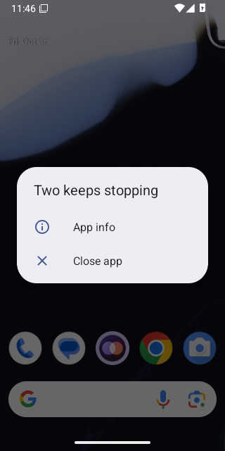
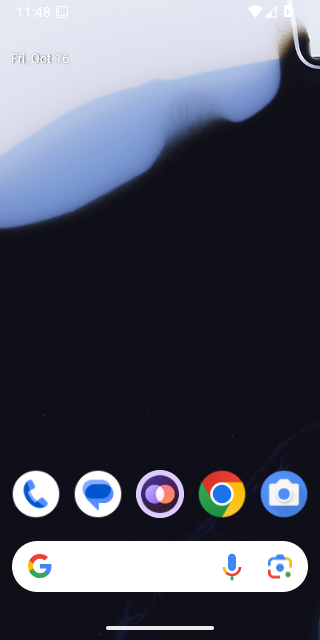

# Calls on Android 16 (API 36)

WebView: com.google.android.webview, 133.0.6943.137

## FAIL - First call while Priya is offline, allowing the microphone

Stopped: `timed out after 20s waiting for Android's microphone question`

- NO  the app is still open - `{"pidBefore":"","pidAfter":""}`

<details><summary>Steps</summary>

- 39.1s tap Call - `"pressed Call"`

</details>

### Crash

```
zqeu,^%x)L3bh\P`zjjovZ71nJrL~w?b7*`A;fhX9wr"N}mz=5Hmmz5glGvM%st:6,]KoTm6cKa9c%ie\w0QjVP9n+v~^4?&f[Z,vM=N~M"x&Y6joKkOg]=1je4bn0|p*tOnOYh}/m\pQO<!oI}uL(Ab<6I1`A;jb.?l\i;hX9HJd[
10-16 11:46:13.279  4155  4155 F crashpad: $rVTC=u<x`,uYK7TwGjN(q>^XG\p28]rYpTywBGU)e@&.GcK?xj2vM}G4c3KXMAft(/GqTm6cK?xH/Z&PT@+yoTGJp.8=Jwt@u^Q^+}5B9mz=N6)rMJ&<E&S$
10-16 11:46:13.279  4155  4155 F crashpad: -----END CRASHPAD MINIDUMP-----
10-16 11:46:13.366  2863  2863 E AndroidRuntime: FATAL EXCEPTION: main
10-16 11:46:13.366  2863  2863 E AndroidRuntime: Process: app.two.android, PID: 2863
10-16 11:46:13.366  2863  2863 E AndroidRuntime: org.chromium.base.JniAndroid$UncaughtExceptionException: Native stack trace:
10-16 11:46:13.366  2863  2863 E AndroidRuntime: #00 pc 0x0000000002d931fc /data/app/~~_Ffj62S7aPtdMof5i6KFUg==/com.google.android.trichromelibrary_694313738-yRVKTsT9dX-3ZVPvIeINcA==/TrichromeLibrary.apk (offset 0x898000)
10-16 11:46:13.366  2863  2863 E AndroidRuntime: #01 pc 0x0000000004b0e8d6 /data/app/~~_Ffj62S7aPtdMof5i6KFUg==/com.google.android.trichromelibrary_694313738-yRVKTsT9dX-3ZVPvIeINcA==/TrichromeLibrary.apk (offset 0x898000)
10-16 11:46:13.366  2863  2863 E AndroidRuntime: #02 pc 0x0000000004b44d84 /data/app/~~_Ffj62S7aPtdMof5i6KFUg==/com.google.android.trichromelibrary_694313738-yRVKTsT9dX-3ZVPvIeINcA==/TrichromeLibrary.apk (offset 0x898000)
10-16 11:46:13.366  2863  2863 E AndroidRuntime: #03 pc 0x0000000004b32cc6 /data/app/~~_Ffj62S7aPtdMof5i6KFUg==/com.google.android.trichromelibrary_694313738-yRVKTsT9dX-3ZVPvIeINcA==/TrichromeLibrary.apk (offset 0x898000)
10-16 11:46:13.366  2863  2863 E AndroidRuntime: #04 pc 0x0000000005e2acdb /data/app/~~_Ffj62S7aPtdMof5i6KFUg==/com.google.android.trichromelibrary_694313738-yRVKTsT9dX-3ZVPvIeINcA==/TrichromeLibrary.apk (offset 0x898000)
10-16 11:46:13.366  2863  2863 E AndroidRuntime: #05 pc 0x0000000005c7f141 /data/app/~~_Ffj62S7aPtdMof5i6KFUg==/com.google.android.trichromelibrary_694313738-yRVKTsT9dX-3ZVPvIeINcA==/TrichromeLibrary.apk (offset 0x898000)
10-16 11:46:13.366  2863  2863 E AndroidRuntime: #06 pc 0x00000000023e3caf /data/app/~~_Ffj62S7aPtdMof5i6KFUg==/com.google.android.trichromelibrary_694313738-yRVKTsT9dX-3ZVPvIeINcA==/TrichromeLibrary.apk (offset 0x898000)
10-16 11:46:13.366  2863  2863 E AndroidRuntime: #07 pc 0x0000000007155456 /data/app/~~_Ffj62S7aPtdMof5i6KFUg==/com.google.android.trichromelibrary_694313738-yRVKTsT9dX-3ZVPvIeINcA==/TrichromeLibrary.apk (offset 0x898000)
10-16 11:46:13.366  2863  2863 E AndroidRuntime: #08 pc 0x0000000007155a9f /data/app/~~_Ffj62S7aPtdMof5i6KFUg==/com.google.android.trichromelibrary_694313738-yRVKTsT9dX-3ZVPvIeINcA==/TrichromeLibrary.apk (offset 0x898000)
10-16 11:46:13.366  2863  2863 E AndroidRuntime: #09 pc 0x0000000007175e34 /data/app/~~_Ffj62S7aPtdMof5i6KFUg==/com.google.android.trichromelibrary_694313738-yRVKTsT9dX-3ZVPvIeINcA==/TrichromeLibrary.apk (offset 0x898000)
10-16 11:46:13.366  2863  2863 E AndroidRuntime: #10 pc 0x00000000000075db /system/lib64/libutils.so
10-16 11:46:13.366  2863  2863 E AndroidRuntime: #11 pc 0x00000000000dd2a6 /system/lib64/libandroid_runtime.so
10-16 11:46:13.366  2863  2863 E AndroidRuntime: 
10-16 11:46:13.366  2863  2863 E AndroidRuntime: 	at org.chromium.base.JniAndroid.handleException(chromium-TrichromeWebViewGoogle6432.aab-stable-694313738:21)
10-16 11:46:13.366  2863  2863 E AndroidRuntime: 	at android.os.MessageQueue.nativePollOnce(Native Method)
10-16 11:46:13.366  2863  2863 E AndroidRuntime: 	at android.os.MessageQueue.nextLegacy(MessageQueue.java:913)
10-16 11:46:13.366  2863  2863 E AndroidRuntime: 	at android.os.MessageQueue.next(MessageQueue.java:1025)
10-16 11:46:13.366  2863  2863 E AndroidRuntime: 	at android.os.Looper.loopOnce(Looper.java:196)
10-16 11:46:13.366  2863  2863 E AndroidRuntime: 	at android.os.Looper.loop(Looper.java:338)
10-16 11:46:13.366  2863  2863 E AndroidRuntime: 	at android.app.ActivityThread.main(ActivityThread.java:9067)
10-16 11:46:13.366  2863  2863 E AndroidRuntime: 	at java.lang.reflect.Method.invoke(Native Method)
10-16 11:46:13.366  2863  2863 E AndroidRuntime: 	at com.android.internal.os.RuntimeInit$MethodAndArgsCaller.run(RuntimeInit.java:593)
10-16 11:46:13.366  2863  2863 E AndroidRuntime: 	at com.android.internal.os.ZygoteInit.main(ZygoteInit.java:932)
10-16 11:46:13.366  2863  2863 E AndroidRuntime: Caused by: java.lang.IllegalArgumentException: Can only use lower 16 bits for requestCode
10-16 11:46:13.366  2863  2863 E AndroidRuntime: 	at androidx.fragment.app.FragmentActivity.checkForValidRequestCode(FragmentActivity.java:714)
10-16 11:46:13.366  2863  2863 E AndroidRuntime: 	at androidx.fragment.app.FragmentActivity.validateRequestPermissionsRequestCode(FragmentActivity.java:729)
10-16 11:46:13.366  2863  2863 E AndroidRuntime: 	at androidx.core.app.ActivityCompat.requestPermissions(ActivityCompat.java:542)
10-16 11:46:13.366  2863  2863 E AndroidRuntime: 	at androidx.activity.ComponentActivity$activityResultRegistry$1.onLaunch(ComponentActivity.kt:194)
10-16 11:46:13.366  2863  2863 E AndroidRuntime: 	at androidx.activity.result.ActivityResultRegistry$register$3.launch(ActivityResultRegistry.kt:191)
10-16 11:46:13.366  2863  2863 E AndroidRuntime: 	at androidx.activity.compose.ActivityResultLauncherHolder.launch(ActivityResultRegistry.kt:150)
10-16 11:46:13.366  2863  2863 E AndroidRuntime: 	at androidx.activity.compose.ManagedActivityResultLauncher.launch(ActivityResultRegistry.kt:139)
10-16 11:46:13.366  2863  2863 E AndroidRuntime: 	at androidx.activity.result.ActivityResultLauncher.launch(ActivityResultLauncher.kt:37)
10-16 11:46:13.366  2863  2863 E AndroidRuntime: 	at app.two.android.features.web.TwoWebViewKt$TwoWebView$2$1$1$4.onPermissionRequest(TwoWebView.kt:957)
10-16 11:46:13.366  2863  2863 E AndroidRuntime: 	at org.chromium.android_webview.AwContents.onPermissionRequest(chromium-TrichromeWebViewGoogle6432.aab-stable-694313738:55)
10-16 11:46:13.366  2863  2863 E AndroidRuntime: 	... 9 more

```

```
ACTIVITY MANAGER PROCESS EXIT INFO (dumpsys activity exit-info)
Last Timestamp of Persistence Into Persistent Storage: 1970-01-01 00:00:00.000
  package: app.two.android
    Historical Process Exit for uid=10216
        ApplicationExitInfo #0:
          timestamp=2026-10-16 11:46:13.433 pid=2984 realUid=99000 packageUid=10216 definingUid=10166 user=0
          process=com.google.android.webview:sandboxed_process0:org.chromium.content.app.SandboxedProcessService0:0 reason=13 (OTHER KILLS BY SYSTEM) subreason=17 (ISOLATED NOT NEEDED) status=0
          importance=300 pss=0.00 rss=0.00 description=isolated not needed state=empty trace=null
        ApplicationExitInfo #1:
          timestamp=2026-10-16 11:46:13.372 pid=2863 realUid=10216 packageUid=10216 definingUid=10216 user=0
          process=app.two.android reason=4 (APP CRASH(EXCEPTION)) subreason=0 (UNKNOWN) status=0
          importance=100 pss=0.00 rss=0.00 description=crash state=empty trace=null

```

 

Log: [first-call-while-priya-is-offline-allowing-the-mic.log](first-call-while-priya-is-offline-allowing-the-mic.log)

## FAIL - Call while Priya is offline rings out

Stopped: `page went away`

- NO  the call service runs in the foreground
- NO  the app is still open - `{"pidBefore":"","pidAfter":""}`

<details><summary>Steps</summary>

- 80.2s tap Call - `"pressed Call"`

</details>

### Crash

```
@V6+Rn4j3gI=+aS8_JQI7*rmUI77v:U-zUo|t@Z<bhyuVEn;lw8mX@-V,9vGHc39mP;?W*W4;Nozr\aD5"5jv},!tpaot"8g6>G,tpQ|>fh<dK_,[UpZ`o[':}H=q|FmYOADO_amwLr#m5@L6nPZ6uoPa?Q7AzfjIG17A,u,aVP4/:4d/$,(Z9q"Gys\py_N^b\~6~@$t[I"RAr*>-Rn0c5_@N0tu"(v(0M2*y6PghGd46Opu%L3vfw*t=b1:%&Gdr$g+ivyj"KcuS;%q|P(muIY^hv37-8@A{FgvIR[v,68qT,/:66dSbD7wg;ya4S0rhGmlhGJRNr.xDBt[19
10-16 11:46:54.444  4920  4920 F crashpad: -----END CRASHPAD MINIDUMP-----
10-16 11:46:54.455  4683  4683 E AndroidRuntime: FATAL EXCEPTION: main
10-16 11:46:54.455  4683  4683 E AndroidRuntime: Process: app.two.android, PID: 4683
10-16 11:46:54.455  4683  4683 E AndroidRuntime: org.chromium.base.JniAndroid$UncaughtExceptionException: Native stack trace:
10-16 11:46:54.455  4683  4683 E AndroidRuntime: #00 pc 0x0000000002d931fc /data/app/~~_Ffj62S7aPtdMof5i6KFUg==/com.google.android.trichromelibrary_694313738-yRVKTsT9dX-3ZVPvIeINcA==/TrichromeLibrary.apk (offset 0x898000)
10-16 11:46:54.455  4683  4683 E AndroidRuntime: #01 pc 0x0000000004b0e8d6 /data/app/~~_Ffj62S7aPtdMof5i6KFUg==/com.google.android.trichromelibrary_694313738-yRVKTsT9dX-3ZVPvIeINcA==/TrichromeLibrary.apk (offset 0x898000)
10-16 11:46:54.455  4683  4683 E AndroidRuntime: #02 pc 0x0000000004b44d84 /data/app/~~_Ffj62S7aPtdMof5i6KFUg==/com.google.android.trichromelibrary_694313738-yRVKTsT9dX-3ZVPvIeINcA==/TrichromeLibrary.apk (offset 0x898000)
10-16 11:46:54.455  4683  4683 E AndroidRuntime: #03 pc 0x0000000004b32cc6 /data/app/~~_Ffj62S7aPtdMof5i6KFUg==/com.google.android.trichromelibrary_694313738-yRVKTsT9dX-3ZVPvIeINcA==/TrichromeLibrary.apk (offset 0x898000)
10-16 11:46:54.455  4683  4683 E AndroidRuntime: #04 pc 0x0000000005e2acdb /data/app/~~_Ffj62S7aPtdMof5i6KFUg==/com.google.android.trichromelibrary_694313738-yRVKTsT9dX-3ZVPvIeINcA==/TrichromeLibrary.apk (offset 0x898000)
10-16 11:46:54.455  4683  4683 E AndroidRuntime: #05 pc 0x0000000005c7f141 /data/app/~~_Ffj62S7aPtdMof5i6KFUg==/com.google.android.trichromelibrary_694313738-yRVKTsT9dX-3ZVPvIeINcA==/TrichromeLibrary.apk (offset 0x898000)
10-16 11:46:54.455  4683  4683 E AndroidRuntime: #06 pc 0x00000000023e3caf /data/app/~~_Ffj62S7aPtdMof5i6KFUg==/com.google.android.trichromelibrary_694313738-yRVKTsT9dX-3ZVPvIeINcA==/TrichromeLibrary.apk (offset 0x898000)
10-16 11:46:54.455  4683  4683 E AndroidRuntime: #07 pc 0x0000000007155456 /data/app/~~_Ffj62S7aPtdMof5i6KFUg==/com.google.android.trichromelibrary_694313738-yRVKTsT9dX-3ZVPvIeINcA==/TrichromeLibrary.apk (offset 0x898000)
10-16 11:46:54.455  4683  4683 E AndroidRuntime: #08 pc 0x0000000007155a9f /data/app/~~_Ffj62S7aPtdMof5i6KFUg==/com.google.android.trichromelibrary_694313738-yRVKTsT9dX-3ZVPvIeINcA==/TrichromeLibrary.apk (offset 0x898000)
10-16 11:46:54.455  4683  4683 E AndroidRuntime: #09 pc 0x0000000007175e34 /data/app/~~_Ffj62S7aPtdMof5i6KFUg==/com.google.android.trichromelibrary_694313738-yRVKTsT9dX-3ZVPvIeINcA==/TrichromeLibrary.apk (offset 0x898000)
10-16 11:46:54.455  4683  4683 E AndroidRuntime: #10 pc 0x00000000000075db /system/lib64/libutils.so
10-16 11:46:54.455  4683  4683 E AndroidRuntime: #11 pc 0x00000000000dd2a6 /system/lib64/libandroid_runtime.so
10-16 11:46:54.455  4683  4683 E AndroidRuntime: 
10-16 11:46:54.455  4683  4683 E AndroidRuntime: 	at org.chromium.base.JniAndroid.handleException(chromium-TrichromeWebViewGoogle6432.aab-stable-694313738:21)
10-16 11:46:54.455  4683  4683 E AndroidRuntime: 	at android.os.MessageQueue.nativePollOnce(Native Method)
10-16 11:46:54.455  4683  4683 E AndroidRuntime: 	at android.os.MessageQueue.nextLegacy(MessageQueue.java:913)
10-16 11:46:54.455  4683  4683 E AndroidRuntime: 	at android.os.MessageQueue.next(MessageQueue.java:1025)
10-16 11:46:54.455  4683  4683 E AndroidRuntime: 	at android.os.Looper.loopOnce(Looper.java:196)
10-16 11:46:54.455  4683  4683 E AndroidRuntime: 	at android.os.Looper.loop(Looper.java:338)
10-16 11:46:54.455  4683  4683 E AndroidRuntime: 	at android.app.ActivityThread.main(ActivityThread.java:9067)
10-16 11:46:54.455  4683  4683 E AndroidRuntime: 	at java.lang.reflect.Method.invoke(Native Method)
10-16 11:46:54.455  4683  4683 E AndroidRuntime: 	at com.android.internal.os.RuntimeInit$MethodAndArgsCaller.run(RuntimeInit.java:593)
10-16 11:46:54.455  4683  4683 E AndroidRuntime: 	at com.android.internal.os.ZygoteInit.main(ZygoteInit.java:932)
10-16 11:46:54.455  4683  4683 E AndroidRuntime: Caused by: java.lang.IllegalArgumentException: Can only use lower 16 bits for requestCode
10-16 11:46:54.455  4683  4683 E AndroidRuntime: 	at androidx.fragment.app.FragmentActivity.checkForValidRequestCode(FragmentActivity.java:714)
10-16 11:46:54.455  4683  4683 E AndroidRuntime: 	at androidx.fragment.app.FragmentActivity.validateRequestPermissionsRequestCode(FragmentActivity.java:729)
10-16 11:46:54.455  4683  4683 E AndroidRuntime: 	at androidx.core.app.ActivityCompat.requestPermissions(ActivityCompat.java:542)
10-16 11:46:54.455  4683  4683 E AndroidRuntime: 	at androidx.activity.ComponentActivity$activityResultRegistry$1.onLaunch(ComponentActivity.kt:194)
10-16 11:46:54.455  4683  4683 E AndroidRuntime: 	at androidx.activity.result.ActivityResultRegistry$register$3.launch(ActivityResultRegistry.kt:191)
10-16 11:46:54.455  4683  4683 E AndroidRuntime: 	at androidx.activity.compose.ActivityResultLauncherHolder.launch(ActivityResultRegistry.kt:150)
10-16 11:46:54.455  4683  4683 E AndroidRuntime: 	at androidx.activity.compose.ManagedActivityResultLauncher.launch(ActivityResultRegistry.kt:139)
10-16 11:46:54.455  4683  4683 E AndroidRuntime: 	at androidx.activity.result.ActivityResultLauncher.launch(ActivityResultLauncher.kt:37)
10-16 11:46:54.455  4683  4683 E AndroidRuntime: 	at app.two.android.features.web.TwoWebViewKt$TwoWebView$2$1$1$4.onPermissionRequest(TwoWebView.kt:957)
10-16 11:46:54.455  4683  4683 E AndroidRuntime: 	at org.chromium.android_webview.AwContents.onPermissionRequest(chromium-TrichromeWebViewGoogle6432.aab-stable-694313738:55)
10-16 11:46:54.455  4683  4683 E AndroidRuntime: 	... 9 more

```

```
ACTIVITY MANAGER PROCESS EXIT INFO (dumpsys activity exit-info)
Last Timestamp of Persistence Into Persistent Storage: 1970-01-01 00:00:00.000
  package: app.two.android
    Historical Process Exit for uid=10216
        ApplicationExitInfo #0:
          timestamp=2026-10-16 11:47:08.723 pid=4683 realUid=10216 packageUid=10216 definingUid=10216 user=0
          process=app.two.android reason=9 (EXCESSIVE RESOURCE USAGE) subreason=7 (EXCESSIVE CPU USAGE) status=0
          importance=400 pss=0.00 rss=0.00 description=excessive binder traffic during cached state=empty trace=null
        ApplicationExitInfo #1:
          timestamp=2026-10-16 11:46:54.457 pid=4683 realUid=10216 packageUid=10216 definingUid=10216 user=0
          process=app.two.android reason=4 (APP CRASH(EXCEPTION)) subreason=0 (UNKNOWN) status=0
          importance=100 pss=0.00 rss=0.00 description=crash state=empty trace=null
        ApplicationExitInfo #2:
          timestamp=2026-10-16 11:46:13.433 pid=2984 realUid=99000 packageUid=10216 definingUid=10166 user=0
          process=com.google.android.webview:sandboxed_process0:org.chromium.content.app.SandboxedProcessService0:0 reason=13 (OTHER KILLS BY SYSTEM) subreason=17 (ISOLATED NOT NEEDED) status=0
          importance=300 pss=0.00 rss=0.00 description=isolated not needed state=empty trace=null
        ApplicationExitInfo #3:
          timestamp=2026-10-16 11:46:13.372 pid=2863 realUid=10216 packageUid=10216 definingUid=10216 user=0
          process=app.two.android reason=4 (APP CRASH(EXCEPTION)) subreason=0 (UNKNOWN) status=0
          importance=100 pss=0.00 rss=0.00 description=crash state=empty trace=null
    Historical Process Exit for uid=99001
        ApplicationExitInfo #0:
          timestamp=2026-10-16 11:47:08.784 pid=4722 realUid=99001 packageUid=10216 definingUid=10166 user=0
          process=com.google.android.webview:sandboxed_process0:org.chromium.content.app.SandboxedProcessService0:0 reason=1 (EXIT_SELF) subreason=0 (UNKNOWN) status=0
          importance=300 pss=0.00 rss=0.00 description=null state=empty trace=null

```

 

Log: [call-while-priya-is-offline-rings-out.log](call-while-priya-is-offline-rings-out.log)

## FAIL - Call cancelled straight away, ten times

Stopped: `the app closed (Cancel after 0 ms)`

- NO  the app is still open - `{"pidBefore":"","pidAfter":""}`

<details><summary>Steps</summary>

- 114.9s Call, then Cancel after 0 ms - `true`

</details>

### Crash

```
$z@l9_;4b^dEly5TkMH%By^gu{Go%6iga/*zf"SxTjCEU\KKJ6b&VIw-63F?bkuih26t8[1`0V*7m~R*D?t|vc{O6guR3lJ6j<B@&zzYP7siod"`W2AqZArtP9o]n4QRR.i$R]g\"`swZ(VAnH96-4Y2n>v`c~3gl`UfK&aS_zD=\BB!rHs$rOt0Yf1~;^oJw;vlZXMGL1rfd8(-a$6n?m:P;OkDgl2YvRu4\,2W5+wD}Wn`_ZN0)1V*V>hjCgg1xDstM(q{^NLebFt:&Dr,]:&@p`@zbbwJ79Lbb`>##igJK*M@iasfA<`3v,Y%m>^O4$_3|zoQ=Edj6OlOkh%
10-16 11:47:28.605  5430  5430 F crashpad: -----END CRASHPAD MINIDUMP-----
10-16 11:47:28.616  5003  5003 E AndroidRuntime: FATAL EXCEPTION: main
10-16 11:47:28.616  5003  5003 E AndroidRuntime: Process: app.two.android, PID: 5003
10-16 11:47:28.616  5003  5003 E AndroidRuntime: org.chromium.base.JniAndroid$UncaughtExceptionException: Native stack trace:
10-16 11:47:28.616  5003  5003 E AndroidRuntime: #00 pc 0x0000000002d931fc /data/app/~~_Ffj62S7aPtdMof5i6KFUg==/com.google.android.trichromelibrary_694313738-yRVKTsT9dX-3ZVPvIeINcA==/TrichromeLibrary.apk (offset 0x898000)
10-16 11:47:28.616  5003  5003 E AndroidRuntime: #01 pc 0x0000000004b0e8d6 /data/app/~~_Ffj62S7aPtdMof5i6KFUg==/com.google.android.trichromelibrary_694313738-yRVKTsT9dX-3ZVPvIeINcA==/TrichromeLibrary.apk (offset 0x898000)
10-16 11:47:28.616  5003  5003 E AndroidRuntime: #02 pc 0x0000000004b44d84 /data/app/~~_Ffj62S7aPtdMof5i6KFUg==/com.google.android.trichromelibrary_694313738-yRVKTsT9dX-3ZVPvIeINcA==/TrichromeLibrary.apk (offset 0x898000)
10-16 11:47:28.616  5003  5003 E AndroidRuntime: #03 pc 0x0000000004b32cc6 /data/app/~~_Ffj62S7aPtdMof5i6KFUg==/com.google.android.trichromelibrary_694313738-yRVKTsT9dX-3ZVPvIeINcA==/TrichromeLibrary.apk (offset 0x898000)
10-16 11:47:28.616  5003  5003 E AndroidRuntime: #04 pc 0x0000000005e2acdb /data/app/~~_Ffj62S7aPtdMof5i6KFUg==/com.google.android.trichromelibrary_694313738-yRVKTsT9dX-3ZVPvIeINcA==/TrichromeLibrary.apk (offset 0x898000)
10-16 11:47:28.616  5003  5003 E AndroidRuntime: #05 pc 0x0000000005c7f141 /data/app/~~_Ffj62S7aPtdMof5i6KFUg==/com.google.android.trichromelibrary_694313738-yRVKTsT9dX-3ZVPvIeINcA==/TrichromeLibrary.apk (offset 0x898000)
10-16 11:47:28.616  5003  5003 E AndroidRuntime: #06 pc 0x00000000023e3caf /data/app/~~_Ffj62S7aPtdMof5i6KFUg==/com.google.android.trichromelibrary_694313738-yRVKTsT9dX-3ZVPvIeINcA==/TrichromeLibrary.apk (offset 0x898000)
10-16 11:47:28.616  5003  5003 E AndroidRuntime: #07 pc 0x0000000007155456 /data/app/~~_Ffj62S7aPtdMof5i6KFUg==/com.google.android.trichromelibrary_694313738-yRVKTsT9dX-3ZVPvIeINcA==/TrichromeLibrary.apk (offset 0x898000)
10-16 11:47:28.616  5003  5003 E AndroidRuntime: #08 pc 0x0000000007155a9f /data/app/~~_Ffj62S7aPtdMof5i6KFUg==/com.google.android.trichromelibrary_694313738-yRVKTsT9dX-3ZVPvIeINcA==/TrichromeLibrary.apk (offset 0x898000)
10-16 11:47:28.616  5003  5003 E AndroidRuntime: #09 pc 0x0000000007175e34 /data/app/~~_Ffj62S7aPtdMof5i6KFUg==/com.google.android.trichromelibrary_694313738-yRVKTsT9dX-3ZVPvIeINcA==/TrichromeLibrary.apk (offset 0x898000)
10-16 11:47:28.616  5003  5003 E AndroidRuntime: #10 pc 0x00000000000075db /system/lib64/libutils.so
10-16 11:47:28.616  5003  5003 E AndroidRuntime: #11 pc 0x00000000000dd2a6 /system/lib64/libandroid_runtime.so
10-16 11:47:28.616  5003  5003 E AndroidRuntime: 
10-16 11:47:28.616  5003  5003 E AndroidRuntime: 	at org.chromium.base.JniAndroid.handleException(chromium-TrichromeWebViewGoogle6432.aab-stable-694313738:21)
10-16 11:47:28.616  5003  5003 E AndroidRuntime: 	at android.os.MessageQueue.nativePollOnce(Native Method)
10-16 11:47:28.616  5003  5003 E AndroidRuntime: 	at android.os.MessageQueue.nextLegacy(MessageQueue.java:913)
10-16 11:47:28.616  5003  5003 E AndroidRuntime: 	at android.os.MessageQueue.next(MessageQueue.java:1025)
10-16 11:47:28.616  5003  5003 E AndroidRuntime: 	at android.os.Looper.loopOnce(Looper.java:196)
10-16 11:47:28.616  5003  5003 E AndroidRuntime: 	at android.os.Looper.loop(Looper.java:338)
10-16 11:47:28.616  5003  5003 E AndroidRuntime: 	at android.app.ActivityThread.main(ActivityThread.java:9067)
10-16 11:47:28.616  5003  5003 E AndroidRuntime: 	at java.lang.reflect.Method.invoke(Native Method)
10-16 11:47:28.616  5003  5003 E AndroidRuntime: 	at com.android.internal.os.RuntimeInit$MethodAndArgsCaller.run(RuntimeInit.java:593)
10-16 11:47:28.616  5003  5003 E AndroidRuntime: 	at com.android.internal.os.ZygoteInit.main(ZygoteInit.java:932)
10-16 11:47:28.616  5003  5003 E AndroidRuntime: Caused by: java.lang.IllegalArgumentException: Can only use lower 16 bits for requestCode
10-16 11:47:28.616  5003  5003 E AndroidRuntime: 	at androidx.fragment.app.FragmentActivity.checkForValidRequestCode(FragmentActivity.java:714)
10-16 11:47:28.616  5003  5003 E AndroidRuntime: 	at androidx.fragment.app.FragmentActivity.validateRequestPermissionsRequestCode(FragmentActivity.java:729)
10-16 11:47:28.616  5003  5003 E AndroidRuntime: 	at androidx.core.app.ActivityCompat.requestPermissions(ActivityCompat.java:542)
10-16 11:47:28.616  5003  5003 E AndroidRuntime: 	at androidx.activity.ComponentActivity$activityResultRegistry$1.onLaunch(ComponentActivity.kt:194)
10-16 11:47:28.616  5003  5003 E AndroidRuntime: 	at androidx.activity.result.ActivityResultRegistry$register$3.launch(ActivityResultRegistry.kt:191)
10-16 11:47:28.616  5003  5003 E AndroidRuntime: 	at androidx.activity.compose.ActivityResultLauncherHolder.launch(ActivityResultRegistry.kt:150)
10-16 11:47:28.616  5003  5003 E AndroidRuntime: 	at androidx.activity.compose.ManagedActivityResultLauncher.launch(ActivityResultRegistry.kt:139)
10-16 11:47:28.616  5003  5003 E AndroidRuntime: 	at androidx.activity.result.ActivityResultLauncher.launch(ActivityResultLauncher.kt:37)
10-16 11:47:28.616  5003  5003 E AndroidRuntime: 	at app.two.android.features.web.TwoWebViewKt$TwoWebView$2$1$1$4.onPermissionRequest(TwoWebView.kt:957)
10-16 11:47:28.616  5003  5003 E AndroidRuntime: 	at org.chromium.android_webview.AwContents.onPermissionRequest(chromium-TrichromeWebViewGoogle6432.aab-stable-694313738:55)
10-16 11:47:28.616  5003  5003 E AndroidRuntime: 	... 9 more

```

```
ACTIVITY MANAGER PROCESS EXIT INFO (dumpsys activity exit-info)
Last Timestamp of Persistence Into Persistent Storage: 1970-01-01 00:00:00.000
  package: app.two.android
    Historical Process Exit for uid=10216
        ApplicationExitInfo #0:
          timestamp=2026-10-16 11:47:28.642 pid=5040 realUid=99003 packageUid=10216 definingUid=10166 user=0
          process=com.google.android.webview:sandboxed_process0:org.chromium.content.app.SandboxedProcessService0:0 reason=1 (EXIT_SELF) subreason=17 (ISOLATED NOT NEEDED) status=0
          importance=300 pss=0.00 rss=0.00 description=isolated not needed state=empty trace=null
        ApplicationExitInfo #1:
          timestamp=2026-10-16 11:47:28.618 pid=5003 realUid=10216 packageUid=10216 definingUid=10216 user=0
          process=app.two.android reason=4 (APP CRASH(EXCEPTION)) subreason=0 (UNKNOWN) status=0
          importance=100 pss=0.00 rss=0.00 description=crash state=empty trace=null
        ApplicationExitInfo #2:
          timestamp=2026-10-16 11:47:08.723 pid=4683 realUid=10216 packageUid=10216 definingUid=10216 user=0
          process=app.two.android reason=9 (EXCESSIVE RESOURCE USAGE) subreason=7 (EXCESSIVE CPU USAGE) status=0
          importance=400 pss=0.00 rss=0.00 description=excessive binder traffic during cached state=empty trace=null
        ApplicationExitInfo #3:
          timestamp=2026-10-16 11:46:54.457 pid=4683 realUid=10216 packageUid=10216 definingUid=10216 user=0
          process=app.two.android reason=4 (APP CRASH(EXCEPTION)) subreason=0 (UNKNOWN) status=0
          importance=100 pss=0.00 rss=0.00 description=crash state=empty trace=null
        ApplicationExitInfo #4:
          timestamp=2026-10-16 11:46:13.433 pid=2984 realUid=99000 packageUid=10216 definingUid=10166 user=0
          process=com.google.android.webview:sandboxed_process0:org.chromium.content.app.SandboxedProcessService0:0 reason=13 (OTHER KILLS BY SYSTEM) subreason=17 (ISOLATED NOT NEEDED) status=0
          importance=300 pss=0.00 rss=0.00 description=isolated not needed state=empty trace=null
        ApplicationExitInfo #5:
          timestamp=2026-10-16 11:46:13.372 pid=2863 realUid=10216 packageUid=10216 definingUid=10216 user=0
          process=app.two.android reason=4 (APP CRASH(EXCEPTION)) subreason=0 (UNKNOWN) status=0
          importance=100 pss=0.00 rss=0.00 description=crash state=empty trace=null
    Historical Process Exit for uid=99001
        ApplicationExitInfo #0:
          timestamp=2026-10-16 11:47:08.784 pid=4722 realUid=99001 packageUid=10216 definingUid=10166 user=0
          process=com.google.android.webview:sandboxed_process0:org.chromium.content.app.SandboxedProcessService0:0 reason=1 (EXIT_SELF) subreason=0 (UNKNOWN) status=0
          importance=300 pss=0.00 rss=0.00 description=null state=empty trace=null

```


Log: [call-cancelled-straight-away-ten-times.log](call-cancelled-straight-away-ten-times.log)

## FAIL - Call that Priya answers, with the speaker on and off

Stopped: `timed out after 20s waiting for Priya's phone to ring`

- NO  the app is still open - `{"pidBefore":"","pidAfter":""}`

<details><summary>Steps</summary>

- 151.9s tap Call - `"pressed Call"`

</details>

### Crash

```
O&x5t_3ypjXOOYN2b6rdh)m#O#OZacnZ+&,KW:bmmn:j"n>E6Dg[SNBT{vaxoM[D7is73/:|`Nw@kCS^B!vP)@A]gTKL0}16Lsm7On/?Hd`mGFiBi.nLj?j`jj\l`dQigR8nT!Q;oaD86kw6.#}&x%(|'GA>J9l>@&ucLgXqZCC+Lky_Ez0AIT;FR"Viwh7j8`D{s#*v8"0hvxUT3XN&xO-9^{nfkLwZv@b@^<'Hw,+J0^p&xyB$ll'0mA4tY$1A3}G/z2r@b~M*rRL$=etpzSr\jwM{vqaTm$m2Ryknr6o^x?HZAS\4-7L(T>pzuwM?end=LVk:?5b'xVPDEH!
10-16 11:48:05.567  5616  5616 F crashpad: -----END CRASHPAD MINIDUMP-----
10-16 11:48:05.581  5466  5466 E AndroidRuntime: FATAL EXCEPTION: main
10-16 11:48:05.581  5466  5466 E AndroidRuntime: Process: app.two.android, PID: 5466
10-16 11:48:05.581  5466  5466 E AndroidRuntime: org.chromium.base.JniAndroid$UncaughtExceptionException: Native stack trace:
10-16 11:48:05.581  5466  5466 E AndroidRuntime: #00 pc 0x0000000002d931fc /data/app/~~_Ffj62S7aPtdMof5i6KFUg==/com.google.android.trichromelibrary_694313738-yRVKTsT9dX-3ZVPvIeINcA==/TrichromeLibrary.apk (offset 0x898000)
10-16 11:48:05.581  5466  5466 E AndroidRuntime: #01 pc 0x0000000004b0e8d6 /data/app/~~_Ffj62S7aPtdMof5i6KFUg==/com.google.android.trichromelibrary_694313738-yRVKTsT9dX-3ZVPvIeINcA==/TrichromeLibrary.apk (offset 0x898000)
10-16 11:48:05.581  5466  5466 E AndroidRuntime: #02 pc 0x0000000004b44d84 /data/app/~~_Ffj62S7aPtdMof5i6KFUg==/com.google.android.trichromelibrary_694313738-yRVKTsT9dX-3ZVPvIeINcA==/TrichromeLibrary.apk (offset 0x898000)
10-16 11:48:05.581  5466  5466 E AndroidRuntime: #03 pc 0x0000000004b32cc6 /data/app/~~_Ffj62S7aPtdMof5i6KFUg==/com.google.android.trichromelibrary_694313738-yRVKTsT9dX-3ZVPvIeINcA==/TrichromeLibrary.apk (offset 0x898000)
10-16 11:48:05.581  5466  5466 E AndroidRuntime: #04 pc 0x0000000005e2acdb /data/app/~~_Ffj62S7aPtdMof5i6KFUg==/com.google.android.trichromelibrary_694313738-yRVKTsT9dX-3ZVPvIeINcA==/TrichromeLibrary.apk (offset 0x898000)
10-16 11:48:05.581  5466  5466 E AndroidRuntime: #05 pc 0x0000000005c7f141 /data/app/~~_Ffj62S7aPtdMof5i6KFUg==/com.google.android.trichromelibrary_694313738-yRVKTsT9dX-3ZVPvIeINcA==/TrichromeLibrary.apk (offset 0x898000)
10-16 11:48:05.581  5466  5466 E AndroidRuntime: #06 pc 0x00000000023e3caf /data/app/~~_Ffj62S7aPtdMof5i6KFUg==/com.google.android.trichromelibrary_694313738-yRVKTsT9dX-3ZVPvIeINcA==/TrichromeLibrary.apk (offset 0x898000)
10-16 11:48:05.581  5466  5466 E AndroidRuntime: #07 pc 0x0000000007155456 /data/app/~~_Ffj62S7aPtdMof5i6KFUg==/com.google.android.trichromelibrary_694313738-yRVKTsT9dX-3ZVPvIeINcA==/TrichromeLibrary.apk (offset 0x898000)
10-16 11:48:05.581  5466  5466 E AndroidRuntime: #08 pc 0x0000000007155a9f /data/app/~~_Ffj62S7aPtdMof5i6KFUg==/com.google.android.trichromelibrary_694313738-yRVKTsT9dX-3ZVPvIeINcA==/TrichromeLibrary.apk (offset 0x898000)
10-16 11:48:05.581  5466  5466 E AndroidRuntime: #09 pc 0x0000000007175e34 /data/app/~~_Ffj62S7aPtdMof5i6KFUg==/com.google.android.trichromelibrary_694313738-yRVKTsT9dX-3ZVPvIeINcA==/TrichromeLibrary.apk (offset 0x898000)
10-16 11:48:05.581  5466  5466 E AndroidRuntime: #10 pc 0x00000000000075db /system/lib64/libutils.so
10-16 11:48:05.581  5466  5466 E AndroidRuntime: #11 pc 0x00000000000dd2a6 /system/lib64/libandroid_runtime.so
10-16 11:48:05.581  5466  5466 E AndroidRuntime: 
10-16 11:48:05.581  5466  5466 E AndroidRuntime: 	at org.chromium.base.JniAndroid.handleException(chromium-TrichromeWebViewGoogle6432.aab-stable-694313738:21)
10-16 11:48:05.581  5466  5466 E AndroidRuntime: 	at android.os.MessageQueue.nativePollOnce(Native Method)
10-16 11:48:05.581  5466  5466 E AndroidRuntime: 	at android.os.MessageQueue.nextLegacy(MessageQueue.java:913)
10-16 11:48:05.581  5466  5466 E AndroidRuntime: 	at android.os.MessageQueue.next(MessageQueue.java:1025)
10-16 11:48:05.581  5466  5466 E AndroidRuntime: 	at android.os.Looper.loopOnce(Looper.java:196)
10-16 11:48:05.581  5466  5466 E AndroidRuntime: 	at android.os.Looper.loop(Looper.java:338)
10-16 11:48:05.581  5466  5466 E AndroidRuntime: 	at android.app.ActivityThread.main(ActivityThread.java:9067)
10-16 11:48:05.581  5466  5466 E AndroidRuntime: 	at java.lang.reflect.Method.invoke(Native Method)
10-16 11:48:05.581  5466  5466 E AndroidRuntime: 	at com.android.internal.os.RuntimeInit$MethodAndArgsCaller.run(RuntimeInit.java:593)
10-16 11:48:05.581  5466  5466 E AndroidRuntime: 	at com.android.internal.os.ZygoteInit.main(ZygoteInit.java:932)
10-16 11:48:05.581  5466  5466 E AndroidRuntime: Caused by: java.lang.IllegalArgumentException: Can only use lower 16 bits for requestCode
10-16 11:48:05.581  5466  5466 E AndroidRuntime: 	at androidx.fragment.app.FragmentActivity.checkForValidRequestCode(FragmentActivity.java:714)
10-16 11:48:05.581  5466  5466 E AndroidRuntime: 	at androidx.fragment.app.FragmentActivity.validateRequestPermissionsRequestCode(FragmentActivity.java:729)
10-16 11:48:05.581  5466  5466 E AndroidRuntime: 	at androidx.core.app.ActivityCompat.requestPermissions(ActivityCompat.java:542)
10-16 11:48:05.581  5466  5466 E AndroidRuntime: 	at androidx.activity.ComponentActivity$activityResultRegistry$1.onLaunch(ComponentActivity.kt:194)
10-16 11:48:05.581  5466  5466 E AndroidRuntime: 	at androidx.activity.result.ActivityResultRegistry$register$3.launch(ActivityResultRegistry.kt:191)
10-16 11:48:05.581  5466  5466 E AndroidRuntime: 	at androidx.activity.compose.ActivityResultLauncherHolder.launch(ActivityResultRegistry.kt:150)
10-16 11:48:05.581  5466  5466 E AndroidRuntime: 	at androidx.activity.compose.ManagedActivityResultLauncher.launch(ActivityResultRegistry.kt:139)
10-16 11:48:05.581  5466  5466 E AndroidRuntime: 	at androidx.activity.result.ActivityResultLauncher.launch(ActivityResultLauncher.kt:37)
10-16 11:48:05.581  5466  5466 E AndroidRuntime: 	at app.two.android.features.web.TwoWebViewKt$TwoWebView$2$1$1$4.onPermissionRequest(TwoWebView.kt:957)
10-16 11:48:05.581  5466  5466 E AndroidRuntime: 	at org.chromium.android_webview.AwContents.onPermissionRequest(chromium-TrichromeWebViewGoogle6432.aab-stable-694313738:55)
10-16 11:48:05.581  5466  5466 E AndroidRuntime: 	... 9 more

```

```
ACTIVITY MANAGER PROCESS EXIT INFO (dumpsys activity exit-info)
Last Timestamp of Persistence Into Persistent Storage: 1970-01-01 00:00:00.000
  package: app.two.android
    Historical Process Exit for uid=10216
        ApplicationExitInfo #0:
          timestamp=2026-10-16 11:48:05.610 pid=5497 realUid=99004 packageUid=10216 definingUid=10166 user=0
          process=com.google.android.webview:sandboxed_process0:org.chromium.content.app.SandboxedProcessService0:0 reason=1 (EXIT_SELF) subreason=17 (ISOLATED NOT NEEDED) status=0
          importance=300 pss=0.00 rss=0.00 description=isolated not needed state=empty trace=null
        ApplicationExitInfo #1:
          timestamp=2026-10-16 11:48:05.583 pid=5466 realUid=10216 packageUid=10216 definingUid=10216 user=0
          process=app.two.android reason=4 (APP CRASH(EXCEPTION)) subreason=0 (UNKNOWN) status=0
          importance=100 pss=0.00 rss=0.00 description=crash state=empty trace=null
        ApplicationExitInfo #2:
          timestamp=2026-10-16 11:47:28.642 pid=5040 realUid=99003 packageUid=10216 definingUid=10166 user=0
          process=com.google.android.webview:sandboxed_process0:org.chromium.content.app.SandboxedProcessService0:0 reason=1 (EXIT_SELF) subreason=17 (ISOLATED NOT NEEDED) status=0
          importance=300 pss=0.00 rss=0.00 description=isolated not needed state=empty trace=null
        ApplicationExitInfo #3:
          timestamp=2026-10-16 11:47:28.618 pid=5003 realUid=10216 packageUid=10216 definingUid=10216 user=0
          process=app.two.android reason=4 (APP CRASH(EXCEPTION)) subreason=0 (UNKNOWN) status=0
          importance=100 pss=0.00 rss=0.00 description=crash state=empty trace=null
        ApplicationExitInfo #4:
          timestamp=2026-10-16 11:47:08.723 pid=4683 realUid=10216 packageUid=10216 definingUid=10216 user=0
          process=app.two.android reason=9 (EXCESSIVE RESOURCE USAGE) subreason=7 (EXCESSIVE CPU USAGE) status=0
          importance=400 pss=0.00 rss=0.00 description=excessive binder traffic during cached state=empty trace=null
        ApplicationExitInfo #5:
          timestamp=2026-10-16 11:46:54.457 pid=4683 realUid=10216 packageUid=10216 definingUid=10216 user=0
          process=app.two.android reason=4 (APP CRASH(EXCEPTION)) subreason=0 (UNKNOWN) status=0
          importance=100 pss=0.00 rss=0.00 description=crash state=empty trace=null
        ApplicationExitInfo #6:
          timestamp=2026-10-16 11:46:13.433 pid=2984 realUid=99000 packageUid=10216 definingUid=10166 user=0
          process=com.google.android.webview:sandboxed_process0:org.chromium.content.app.SandboxedProcessService0:0 reason=13 (OTHER KILLS BY SYSTEM) subreason=17 (ISOLATED NOT NEEDED) status=0
          importance=300 pss=0.00 rss=0.00 description=isolated not needed state=empty trace=null
        ApplicationExitInfo #7:
          timestamp=2026-10-16 11:46:13.372 pid=2863 realUid=10216 packageUid=10216 definingUid=10216 user=0
          process=app.two.android reason=4 (APP CRASH(EXCEPTION)) subreason=0 (UNKNOWN) status=0
          importance=100 pss=0.00 rss=0.00 description=crash state=empty trace=null
    Historical Process Exit for uid=99001
        ApplicationExitInfo #0:
          timestamp=2026-10-16 11:47:08.784 pid=4722 realUid=99001 packageUid=10216 definingUid=10166 user=0
          process=com.google.android.webview:sandboxed_process0:org.chromium.content.app.SandboxedProcessService0:0 reason=1 (EXIT_SELF) subreason=0 (UNKNOWN) status=0
          importance=300 pss=0.00 rss=0.00 description=null state=empty trace=null

```



Log: [call-that-priya-answers-with-the-speaker-on-and-of.log](call-that-priya-answers-with-the-speaker-on-and-of.log)

## FAIL - Priya calls and you answer

Stopped: `timed out after 30s waiting for the call to connect (page went away)`

- ok  your phone rings - `"P Priya is calling you Decline Accept"`
- NO  the app is still open - `{"pidBefore":"","pidAfter":""}`

<details><summary>Steps</summary>

- 193.5s Priya taps Call - `"pressed Call"`
- 194.7s tap Accept - `"pressed Accept"`

</details>

### Crash

```
wqp(2K}l)kb0pwT&,x~hD+RY5\x'nn(t;sb[Z_
10-16 11:48:48.398  5781  5781 F crashpad: k;)b}0<r~8T6P)rQ3t%>$6{qqT_NLSb+=C>f"{%sgH-8?l_!qib+CbRU8-~GrRXv=O[0w:B`nWYv!!f.Z&")f631]eas-7GE'Axw4p$]Rb}nGkA&W6\PA&Yc0DI[fvClV><4[rTXpg2bpS~P;WMV5K`61)2b36^WYO91uMIW,ZNk6<1sliSpMz/OMjCEX=xa1Nt;xayrS{JAf.@)q|O`y^)sK7-sBSAPZfEuVB_rJK|h>T_*CL8m/ibf|w"RzVD5*
10-16 11:48:48.398  5781  5781 F crashpad: -----END CRASHPAD MINIDUMP-----
10-16 11:48:48.409  5662  5662 E AndroidRuntime: FATAL EXCEPTION: main
10-16 11:48:48.409  5662  5662 E AndroidRuntime: Process: app.two.android, PID: 5662
10-16 11:48:48.409  5662  5662 E AndroidRuntime: org.chromium.base.JniAndroid$UncaughtExceptionException: Native stack trace:
10-16 11:48:48.409  5662  5662 E AndroidRuntime: #00 pc 0x0000000002d931fc /data/app/~~_Ffj62S7aPtdMof5i6KFUg==/com.google.android.trichromelibrary_694313738-yRVKTsT9dX-3ZVPvIeINcA==/TrichromeLibrary.apk (offset 0x898000)
10-16 11:48:48.409  5662  5662 E AndroidRuntime: #01 pc 0x0000000004b0e8d6 /data/app/~~_Ffj62S7aPtdMof5i6KFUg==/com.google.android.trichromelibrary_694313738-yRVKTsT9dX-3ZVPvIeINcA==/TrichromeLibrary.apk (offset 0x898000)
10-16 11:48:48.409  5662  5662 E AndroidRuntime: #02 pc 0x0000000004b44d84 /data/app/~~_Ffj62S7aPtdMof5i6KFUg==/com.google.android.trichromelibrary_694313738-yRVKTsT9dX-3ZVPvIeINcA==/TrichromeLibrary.apk (offset 0x898000)
10-16 11:48:48.409  5662  5662 E AndroidRuntime: #03 pc 0x0000000004b32cc6 /data/app/~~_Ffj62S7aPtdMof5i6KFUg==/com.google.android.trichromelibrary_694313738-yRVKTsT9dX-3ZVPvIeINcA==/TrichromeLibrary.apk (offset 0x898000)
10-16 11:48:48.409  5662  5662 E AndroidRuntime: #04 pc 0x0000000005e2acdb /data/app/~~_Ffj62S7aPtdMof5i6KFUg==/com.google.android.trichromelibrary_694313738-yRVKTsT9dX-3ZVPvIeINcA==/TrichromeLibrary.apk (offset 0x898000)
10-16 11:48:48.409  5662  5662 E AndroidRuntime: #05 pc 0x0000000005c7f141 /data/app/~~_Ffj62S7aPtdMof5i6KFUg==/com.google.android.trichromelibrary_694313738-yRVKTsT9dX-3ZVPvIeINcA==/TrichromeLibrary.apk (offset 0x898000)
10-16 11:48:48.409  5662  5662 E AndroidRuntime: #06 pc 0x00000000023e3caf /data/app/~~_Ffj62S7aPtdMof5i6KFUg==/com.google.android.trichromelibrary_694313738-yRVKTsT9dX-3ZVPvIeINcA==/TrichromeLibrary.apk (offset 0x898000)
10-16 11:48:48.409  5662  5662 E AndroidRuntime: #07 pc 0x0000000007155456 /data/app/~~_Ffj62S7aPtdMof5i6KFUg==/com.google.android.trichromelibrary_694313738-yRVKTsT9dX-3ZVPvIeINcA==/TrichromeLibrary.apk (offset 0x898000)
10-16 11:48:48.409  5662  5662 E AndroidRuntime: #08 pc 0x0000000007155a9f /data/app/~~_Ffj62S7aPtdMof5i6KFUg==/com.google.android.trichromelibrary_694313738-yRVKTsT9dX-3ZVPvIeINcA==/TrichromeLibrary.apk (offset 0x898000)
10-16 11:48:48.409  5662  5662 E AndroidRuntime: #09 pc 0x0000000007175e34 /data/app/~~_Ffj62S7aPtdMof5i6KFUg==/com.google.android.trichromelibrary_694313738-yRVKTsT9dX-3ZVPvIeINcA==/TrichromeLibrary.apk (offset 0x898000)
10-16 11:48:48.409  5662  5662 E AndroidRuntime: #10 pc 0x00000000000075db /system/lib64/libutils.so
10-16 11:48:48.409  5662  5662 E AndroidRuntime: #11 pc 0x00000000000dd2a6 /system/lib64/libandroid_runtime.so
10-16 11:48:48.409  5662  5662 E AndroidRuntime: 
10-16 11:48:48.409  5662  5662 E AndroidRuntime: 	at org.chromium.base.JniAndroid.handleException(chromium-TrichromeWebViewGoogle6432.aab-stable-694313738:21)
10-16 11:48:48.409  5662  5662 E AndroidRuntime: 	at android.os.MessageQueue.nativePollOnce(Native Method)
10-16 11:48:48.409  5662  5662 E AndroidRuntime: 	at android.os.MessageQueue.nextLegacy(MessageQueue.java:913)
10-16 11:48:48.409  5662  5662 E AndroidRuntime: 	at android.os.MessageQueue.next(MessageQueue.java:1025)
10-16 11:48:48.409  5662  5662 E AndroidRuntime: 	at android.os.Looper.loopOnce(Looper.java:196)
10-16 11:48:48.409  5662  5662 E AndroidRuntime: 	at android.os.Looper.loop(Looper.java:338)
10-16 11:48:48.409  5662  5662 E AndroidRuntime: 	at android.app.ActivityThread.main(ActivityThread.java:9067)
10-16 11:48:48.409  5662  5662 E AndroidRuntime: 	at java.lang.reflect.Method.invoke(Native Method)
10-16 11:48:48.409  5662  5662 E AndroidRuntime: 	at com.android.internal.os.RuntimeInit$MethodAndArgsCaller.run(RuntimeInit.java:593)
10-16 11:48:48.409  5662  5662 E AndroidRuntime: 	at com.android.internal.os.ZygoteInit.main(ZygoteInit.java:932)
10-16 11:48:48.409  5662  5662 E AndroidRuntime: Caused by: java.lang.IllegalArgumentException: Can only use lower 16 bits for requestCode
10-16 11:48:48.409  5662  5662 E AndroidRuntime: 	at androidx.fragment.app.FragmentActivity.checkForValidRequestCode(FragmentActivity.java:714)
10-16 11:48:48.409  5662  5662 E AndroidRuntime: 	at androidx.fragment.app.FragmentActivity.validateRequestPermissionsRequestCode(FragmentActivity.java:729)
10-16 11:48:48.409  5662  5662 E AndroidRuntime: 	at androidx.core.app.ActivityCompat.requestPermissions(ActivityCompat.java:542)
10-16 11:48:48.409  5662  5662 E AndroidRuntime: 	at androidx.activity.ComponentActivity$activityResultRegistry$1.onLaunch(ComponentActivity.kt:194)
10-16 11:48:48.409  5662  5662 E AndroidRuntime: 	at androidx.activity.result.ActivityResultRegistry$register$3.launch(ActivityResultRegistry.kt:191)
10-16 11:48:48.409  5662  5662 E AndroidRuntime: 	at androidx.activity.compose.ActivityResultLauncherHolder.launch(ActivityResultRegistry.kt:150)
10-16 11:48:48.409  5662  5662 E AndroidRuntime: 	at androidx.activity.compose.ManagedActivityResultLauncher.launch(ActivityResultRegistry.kt:139)
10-16 11:48:48.409  5662  5662 E AndroidRuntime: 	at androidx.activity.result.ActivityResultLauncher.launch(ActivityResultLauncher.kt:37)
10-16 11:48:48.409  5662  5662 E AndroidRuntime: 	at app.two.android.features.web.TwoWebViewKt$TwoWebView$2$1$1$4.onPermissionRequest(TwoWebView.kt:957)
10-16 11:48:48.409  5662  5662 E AndroidRuntime: 	at org.chromium.android_webview.AwContents.onPermissionRequest(chromium-TrichromeWebViewGoogle6432.aab-stable-694313738:55)
10-16 11:48:48.409  5662  5662 E AndroidRuntime: 	... 9 more

```

```
ACTIVITY MANAGER PROCESS EXIT INFO (dumpsys activity exit-info)
Last Timestamp of Persistence Into Persistent Storage: 1970-01-01 00:00:00.000
  package: app.two.android
    Historical Process Exit for uid=10216
        ApplicationExitInfo #0:
          timestamp=2026-10-16 11:48:48.432 pid=5699 realUid=99005 packageUid=10216 definingUid=10166 user=0
          process=com.google.android.webview:sandboxed_process0:org.chromium.content.app.SandboxedProcessService0:0 reason=1 (EXIT_SELF) subreason=17 (ISOLATED NOT NEEDED) status=0
          importance=300 pss=0.00 rss=0.00 description=isolated not needed state=empty trace=null
        ApplicationExitInfo #1:
          timestamp=2026-10-16 11:48:48.413 pid=5662 realUid=10216 packageUid=10216 definingUid=10216 user=0
          process=app.two.android reason=4 (APP CRASH(EXCEPTION)) subreason=0 (UNKNOWN) status=0
          importance=100 pss=0.00 rss=0.00 description=crash state=empty trace=null
        ApplicationExitInfo #2:
          timestamp=2026-10-16 11:48:05.610 pid=5497 realUid=99004 packageUid=10216 definingUid=10166 user=0
          process=com.google.android.webview:sandboxed_process0:org.chromium.content.app.SandboxedProcessService0:0 reason=1 (EXIT_SELF) subreason=17 (ISOLATED NOT NEEDED) status=0
          importance=300 pss=0.00 rss=0.00 description=isolated not needed state=empty trace=null
        ApplicationExitInfo #3:
          timestamp=2026-10-16 11:48:05.583 pid=5466 realUid=10216 packageUid=10216 definingUid=10216 user=0
          process=app.two.android reason=4 (APP CRASH(EXCEPTION)) subreason=0 (UNKNOWN) status=0
          importance=100 pss=0.00 rss=0.00 description=crash state=empty trace=null
        ApplicationExitInfo #4:
          timestamp=2026-10-16 11:47:28.642 pid=5040 realUid=99003 packageUid=10216 definingUid=10166 user=0
          process=com.google.android.webview:sandboxed_process0:org.chromium.content.app.SandboxedProcessService0:0 reason=1 (EXIT_SELF) subreason=17 (ISOLATED NOT NEEDED) status=0
          importance=300 pss=0.00 rss=0.00 description=isolated not needed state=empty trace=null
        ApplicationExitInfo #5:
          timestamp=2026-10-16 11:47:28.618 pid=5003 realUid=10216 packageUid=10216 definingUid=10216 user=0
          process=app.two.android reason=4 (APP CRASH(EXCEPTION)) subreason=0 (UNKNOWN) status=0
          importance=100 pss=0.00 rss=0.00 description=crash state=empty trace=null
        ApplicationExitInfo #6:
          timestamp=2026-10-16 11:47:08.723 pid=4683 realUid=10216 packageUid=10216 definingUid=10216 user=0
          process=app.two.android reason=9 (EXCESSIVE RESOURCE USAGE) subreason=7 (EXCESSIVE CPU USAGE) status=0
          importance=400 pss=0.00 rss=0.00 description=excessive binder traffic during cached state=empty trace=null
        ApplicationExitInfo #7:
          timestamp=2026-10-16 11:46:54.457 pid=4683 realUid=10216 packageUid=10216 definingUid=10216 user=0
          process=app.two.android reason=4 (APP CRASH(EXCEPTION)) subreason=0 (UNKNOWN) status=0
          importance=100 pss=0.00 rss=0.00 description=crash state=empty trace=null
        ApplicationExitInfo #8:
          timestamp=2026-10-16 11:46:13.433 pid=2984 realUid=99000 packageUid=10216 definingUid=10166 user=0
          process=com.google.android.webview:sandboxed_process0:org.chromium.content.app.SandboxedProcessService0:0 reason=13 (OTHER KILLS BY SYSTEM) subreason=17 (ISOLATED NOT NEEDED) status=0
          importance=300 pss=0.00 rss=0.00 description=isolated not needed state=empty trace=null
        ApplicationExitInfo #9:
          timestamp=2026-10-16 11:46:13.372 pid=2863 realUid=10216 packageUid=10216 definingUid=10216 user=0
          process=app.two.android reason=4 (APP CRASH(EXCEPTION)) subreason=0 (UNKNOWN) status=0
          importance=100 pss=0.00 rss=0.00 description=crash state=empty trace=null
    Historical Process Exit for uid=99001
        ApplicationExitInfo #0:
          timestamp=2026-10-16 11:47:08.784 pid=4722 realUid=99001 packageUid=10216 definingUid=10166 user=0
          process=com.google.android.webview:sandboxed_process0:org.chromium.content.app.SandboxedProcessService0:0 reason=1 (EXIT_SELF) subreason=0 (UNKNOWN) status=0
          importance=300 pss=0.00 rss=0.00 description=null state=empty trace=null

```

 

Log: [priya-calls-and-you-answer.log](priya-calls-and-you-answer.log)

## FAIL - Screen turned off in the middle of a call

Stopped: `timed out after 20s waiting for Priya's phone to ring`

- NO  the app is still open - `{"pidBefore":"","pidAfter":""}`

<details><summary>Steps</summary>

- 242.1s tap Call - `"pressed Call"`

</details>

### Crash

```
04s'b9`PP,7+QJnl`HJU_?TJ7Sq=DstPQ\uw8*>|l2px@imHt@Wg(6gRBDmW.y"R6P0ao@]`nW.GY<Ky~T4u4|OD,R6P0r^&v}W01yQ+w!_uGy~F]CwE3W]f]Q6Am~4x(m5MLL;OYut`Ikhlv!QJjNU:.Ah8rr+Tl*[E1@Am47l~@zsLZfu~!C3=!zlBjm#\#3h3|BRa2.(8w^,(sLrkPf(
10-16 11:49:35.938  5980  5980 F crashpad: }Kcv}Bxq8p@"?W~(rK%C,WSlJbNb$L&)M9d+iu[vbaAudrkEY7Vr,cgvh*VlJbDmywvd8NNK.x,C]gyH
10-16 11:49:35.938  5980  5980 F crashpad: -----END CRASHPAD MINIDUMP-----
10-16 11:49:35.950  5865  5865 E AndroidRuntime: FATAL EXCEPTION: main
10-16 11:49:35.950  5865  5865 E AndroidRuntime: Process: app.two.android, PID: 5865
10-16 11:49:35.950  5865  5865 E AndroidRuntime: org.chromium.base.JniAndroid$UncaughtExceptionException: Native stack trace:
10-16 11:49:35.950  5865  5865 E AndroidRuntime: #00 pc 0x0000000002d931fc /data/app/~~_Ffj62S7aPtdMof5i6KFUg==/com.google.android.trichromelibrary_694313738-yRVKTsT9dX-3ZVPvIeINcA==/TrichromeLibrary.apk (offset 0x898000)
10-16 11:49:35.950  5865  5865 E AndroidRuntime: #01 pc 0x0000000004b0e8d6 /data/app/~~_Ffj62S7aPtdMof5i6KFUg==/com.google.android.trichromelibrary_694313738-yRVKTsT9dX-3ZVPvIeINcA==/TrichromeLibrary.apk (offset 0x898000)
10-16 11:49:35.950  5865  5865 E AndroidRuntime: #02 pc 0x0000000004b44d84 /data/app/~~_Ffj62S7aPtdMof5i6KFUg==/com.google.android.trichromelibrary_694313738-yRVKTsT9dX-3ZVPvIeINcA==/TrichromeLibrary.apk (offset 0x898000)
10-16 11:49:35.950  5865  5865 E AndroidRuntime: #03 pc 0x0000000004b32cc6 /data/app/~~_Ffj62S7aPtdMof5i6KFUg==/com.google.android.trichromelibrary_694313738-yRVKTsT9dX-3ZVPvIeINcA==/TrichromeLibrary.apk (offset 0x898000)
10-16 11:49:35.950  5865  5865 E AndroidRuntime: #04 pc 0x0000000005e2acdb /data/app/~~_Ffj62S7aPtdMof5i6KFUg==/com.google.android.trichromelibrary_694313738-yRVKTsT9dX-3ZVPvIeINcA==/TrichromeLibrary.apk (offset 0x898000)
10-16 11:49:35.950  5865  5865 E AndroidRuntime: #05 pc 0x0000000005c7f141 /data/app/~~_Ffj62S7aPtdMof5i6KFUg==/com.google.android.trichromelibrary_694313738-yRVKTsT9dX-3ZVPvIeINcA==/TrichromeLibrary.apk (offset 0x898000)
10-16 11:49:35.950  5865  5865 E AndroidRuntime: #06 pc 0x00000000023e3caf /data/app/~~_Ffj62S7aPtdMof5i6KFUg==/com.google.android.trichromelibrary_694313738-yRVKTsT9dX-3ZVPvIeINcA==/TrichromeLibrary.apk (offset 0x898000)
10-16 11:49:35.950  5865  5865 E AndroidRuntime: #07 pc 0x0000000007155456 /data/app/~~_Ffj62S7aPtdMof5i6KFUg==/com.google.android.trichromelibrary_694313738-yRVKTsT9dX-3ZVPvIeINcA==/TrichromeLibrary.apk (offset 0x898000)
10-16 11:49:35.950  5865  5865 E AndroidRuntime: #08 pc 0x0000000007155a9f /data/app/~~_Ffj62S7aPtdMof5i6KFUg==/com.google.android.trichromelibrary_694313738-yRVKTsT9dX-3ZVPvIeINcA==/TrichromeLibrary.apk (offset 0x898000)
10-16 11:49:35.950  5865  5865 E AndroidRuntime: #09 pc 0x0000000007175e34 /data/app/~~_Ffj62S7aPtdMof5i6KFUg==/com.google.android.trichromelibrary_694313738-yRVKTsT9dX-3ZVPvIeINcA==/TrichromeLibrary.apk (offset 0x898000)
10-16 11:49:35.950  5865  5865 E AndroidRuntime: #10 pc 0x00000000000075db /system/lib64/libutils.so
10-16 11:49:35.950  5865  5865 E AndroidRuntime: #11 pc 0x00000000000dd2a6 /system/lib64/libandroid_runtime.so
10-16 11:49:35.950  5865  5865 E AndroidRuntime: 
10-16 11:49:35.950  5865  5865 E AndroidRuntime: 	at org.chromium.base.JniAndroid.handleException(chromium-TrichromeWebViewGoogle6432.aab-stable-694313738:21)
10-16 11:49:35.950  5865  5865 E AndroidRuntime: 	at android.os.MessageQueue.nativePollOnce(Native Method)
10-16 11:49:35.950  5865  5865 E AndroidRuntime: 	at android.os.MessageQueue.nextLegacy(MessageQueue.java:913)
10-16 11:49:35.950  5865  5865 E AndroidRuntime: 	at android.os.MessageQueue.next(MessageQueue.java:1025)
10-16 11:49:35.950  5865  5865 E AndroidRuntime: 	at android.os.Looper.loopOnce(Looper.java:196)
10-16 11:49:35.950  5865  5865 E AndroidRuntime: 	at android.os.Looper.loop(Looper.java:338)
10-16 11:49:35.950  5865  5865 E AndroidRuntime: 	at android.app.ActivityThread.main(ActivityThread.java:9067)
10-16 11:49:35.950  5865  5865 E AndroidRuntime: 	at java.lang.reflect.Method.invoke(Native Method)
10-16 11:49:35.950  5865  5865 E AndroidRuntime: 	at com.android.internal.os.RuntimeInit$MethodAndArgsCaller.run(RuntimeInit.java:593)
10-16 11:49:35.950  5865  5865 E AndroidRuntime: 	at com.android.internal.os.ZygoteInit.main(ZygoteInit.java:932)
10-16 11:49:35.950  5865  5865 E AndroidRuntime: Caused by: java.lang.IllegalArgumentException: Can only use lower 16 bits for requestCode
10-16 11:49:35.950  5865  5865 E AndroidRuntime: 	at androidx.fragment.app.FragmentActivity.checkForValidRequestCode(FragmentActivity.java:714)
10-16 11:49:35.950  5865  5865 E AndroidRuntime: 	at androidx.fragment.app.FragmentActivity.validateRequestPermissionsRequestCode(FragmentActivity.java:729)
10-16 11:49:35.950  5865  5865 E AndroidRuntime: 	at androidx.core.app.ActivityCompat.requestPermissions(ActivityCompat.java:542)
10-16 11:49:35.950  5865  5865 E AndroidRuntime: 	at androidx.activity.ComponentActivity$activityResultRegistry$1.onLaunch(ComponentActivity.kt:194)
10-16 11:49:35.950  5865  5865 E AndroidRuntime: 	at androidx.activity.result.ActivityResultRegistry$register$3.launch(ActivityResultRegistry.kt:191)
10-16 11:49:35.950  5865  5865 E AndroidRuntime: 	at androidx.activity.compose.ActivityResultLauncherHolder.launch(ActivityResultRegistry.kt:150)
10-16 11:49:35.950  5865  5865 E AndroidRuntime: 	at androidx.activity.compose.ManagedActivityResultLauncher.launch(ActivityResultRegistry.kt:139)
10-16 11:49:35.950  5865  5865 E AndroidRuntime: 	at androidx.activity.result.ActivityResultLauncher.launch(ActivityResultLauncher.kt:37)
10-16 11:49:35.950  5865  5865 E AndroidRuntime: 	at app.two.android.features.web.TwoWebViewKt$TwoWebView$2$1$1$4.onPermissionRequest(TwoWebView.kt:957)
10-16 11:49:35.950  5865  5865 E AndroidRuntime: 	at org.chromium.android_webview.AwContents.onPermissionRequest(chromium-TrichromeWebViewGoogle6432.aab-stable-694313738:55)
10-16 11:49:35.950  5865  5865 E AndroidRuntime: 	... 9 more

```

```
ACTIVITY MANAGER PROCESS EXIT INFO (dumpsys activity exit-info)
Last Timestamp of Persistence Into Persistent Storage: 1970-01-01 00:00:00.000
  package: app.two.android
    Historical Process Exit for uid=10216
        ApplicationExitInfo #0:
          timestamp=2026-10-16 11:49:50.241 pid=5901 realUid=99006 packageUid=10216 definingUid=10166 user=0
          process=com.google.android.webview:sandboxed_process0:org.chromium.content.app.SandboxedProcessService0:0 reason=13 (OTHER KILLS BY SYSTEM) subreason=17 (ISOLATED NOT NEEDED) status=0
          importance=300 pss=0.00 rss=0.00 description=isolated not needed state=empty trace=null
        ApplicationExitInfo #1:
          timestamp=2026-10-16 11:49:50.219 pid=5865 realUid=10216 packageUid=10216 definingUid=10216 user=0
          process=app.two.android reason=9 (EXCESSIVE RESOURCE USAGE) subreason=7 (EXCESSIVE CPU USAGE) status=0
          importance=400 pss=0.00 rss=0.00 description=excessive binder traffic during cached state=empty trace=null
        ApplicationExitInfo #2:
          timestamp=2026-10-16 11:49:35.951 pid=5865 realUid=10216 packageUid=10216 definingUid=10216 user=0
          process=app.two.android reason=4 (APP CRASH(EXCEPTION)) subreason=0 (UNKNOWN) status=0
          importance=100 pss=0.00 rss=0.00 description=crash state=empty trace=null
        ApplicationExitInfo #3:
          timestamp=2026-10-16 11:48:48.432 pid=5699 realUid=99005 packageUid=10216 definingUid=10166 user=0
          process=com.google.android.webview:sandboxed_process0:org.chromium.content.app.SandboxedProcessService0:0 reason=1 (EXIT_SELF) subreason=17 (ISOLATED NOT NEEDED) status=0
          importance=300 pss=0.00 rss=0.00 description=isolated not needed state=empty trace=null
        ApplicationExitInfo #4:
          timestamp=2026-10-16 11:48:48.413 pid=5662 realUid=10216 packageUid=10216 definingUid=10216 user=0
          process=app.two.android reason=4 (APP CRASH(EXCEPTION)) subreason=0 (UNKNOWN) status=0
          importance=100 pss=0.00 rss=0.00 description=crash state=empty trace=null
        ApplicationExitInfo #5:
          timestamp=2026-10-16 11:48:05.610 pid=5497 realUid=99004 packageUid=10216 definingUid=10166 user=0
          process=com.google.android.webview:sandboxed_process0:org.chromium.content.app.SandboxedProcessService0:0 reason=1 (EXIT_SELF) subreason=17 (ISOLATED NOT NEEDED) status=0
          importance=300 pss=0.00 rss=0.00 description=isolated not needed state=empty trace=null
        ApplicationExitInfo #6:
          timestamp=2026-10-16 11:48:05.583 pid=5466 realUid=10216 packageUid=10216 definingUid=10216 user=0
          process=app.two.android reason=4 (APP CRASH(EXCEPTION)) subreason=0 (UNKNOWN) status=0
          importance=100 pss=0.00 rss=0.00 description=crash state=empty trace=null
        ApplicationExitInfo #7:
          timestamp=2026-10-16 11:47:28.642 pid=5040 realUid=99003 packageUid=10216 definingUid=10166 user=0
          process=com.google.android.webview:sandboxed_process0:org.chromium.content.app.SandboxedProcessService0:0 reason=1 (EXIT_SELF) subreason=17 (ISOLATED NOT NEEDED) status=0
          importance=300 pss=0.00 rss=0.00 description=isolated not needed state=empty trace=null
        ApplicationExitInfo #8:
          timestamp=2026-10-16 11:47:28.618 pid=5003 realUid=10216 packageUid=10216 definingUid=10216 user=0
          process=app.two.android reason=4 (APP CRASH(EXCEPTION)) subreason=0 (UNKNOWN) status=0
          importance=100 pss=0.00 rss=0.00 description=crash state=empty trace=null
        ApplicationExitInfo #9:
          timestamp=2026-10-16 11:47:08.723 pid=4683 realUid=10216 packageUid=10216 definingUid=10216 user=0
          process=app.two.android reason=9 (EXCESSIVE RESOURCE USAGE) subreason=7 (EXCESSIVE CPU USAGE) status=0
          importance=400 pss=0.00 rss=0.00 description=excessive binder traffic during cached state=empty trace=null
        ApplicationExitInfo #10:
          timestamp=2026-10-16 11:46:54.457 pid=4683 realUid=10216 packageUid=10216 definingUid=10216 user=0
          process=app.two.android reason=4 (APP CRASH(EXCEPTION)) subreason=0 (UNKNOWN) status=0
          importance=100 pss=0.00 rss=0.00 description=crash state=empty trace=null
        ApplicationExitInfo #11:
          timestamp=2026-10-16 11:46:13.433 pid=2984 realUid=99000 packageUid=10216 definingUid=10166 user=0
          process=com.google.android.webview:sandboxed_process0:org.chromium.content.app.SandboxedProcessService0:0 reason=13 (OTHER KILLS BY SYSTEM) subreason=17 (ISOLATED NOT NEEDED) status=0
          importance=300 pss=0.00 rss=0.00 description=isolated not needed state=empty trace=null
        ApplicationExitInfo #12:
          timestamp=2026-10-16 11:46:13.372 pid=2863 realUid=10216 packageUid=10216 definingUid=10216 user=0
          process=app.two.android reason=4 (APP CRASH(EXCEPTION)) subreason=0 (UNKNOWN) status=0
          importance=100 pss=0.00 rss=0.00 description=crash state=empty trace=null
    Historical Process Exit for uid=99001
        ApplicationExitInfo #0:
          timestamp=2026-10-16 11:47:08.784 pid=4722 realUid=99001 packageUid=10216 definingUid=10166 user=0
          process=com.google.android.webview:sandboxed_process0:org.chromium.content.app.SandboxedProcessService0:0 reason=1 (EXIT_SELF) subreason=0 (UNKNOWN) status=0
          importance=300 pss=0.00 rss=0.00 description=null state=empty trace=null

```


Log: [screen-turned-off-in-the-middle-of-a-call.log](screen-turned-off-in-the-middle-of-a-call.log)

## FAIL - Call when you don't allow the microphone

Stopped: `timed out after 20s waiting for Android's microphone question`

- ok  the app is still open - `{"pidBefore":"","pidAfter":"6060"}`

<details><summary>Steps</summary>

- 279.8s tap Call - `"no Call button"`

</details>

```
{
  "pageErrors": []
}
```


Log: [call-when-you-don-t-allow-the-microphone.log](call-when-you-don-t-allow-the-microphone.log)
