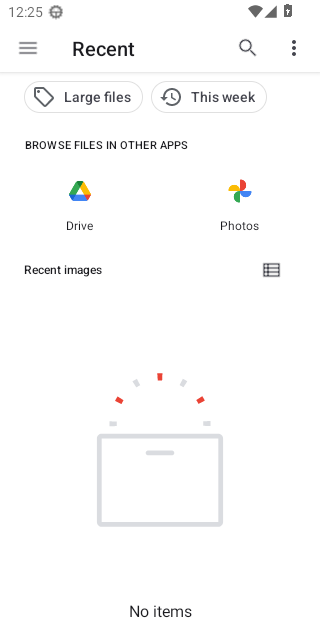
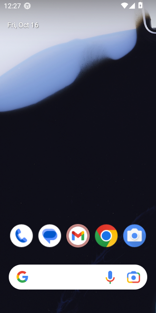

# Calls on Android 13 (API 33)

WebView: com.google.android.webview, 109.0.5414.123

## PASS - First call while Priya is offline, allowing the microphone

- ok  the call screen says Priya is not online - `"END-TO-END ENCRYPTED Y P Partner Not online right now They will see that you called Cancel"`
- ok  the call service runs in the foreground - `{"running":true,"foreground":true}`
- ok  the "Call in progress" notification is up
- ok  the call service has stopped
- ok  the notification has gone
- ok  the app is still open - `{"pidBefore":"","pidAfter":"6251"}`

<details><summary>Steps</summary>

- 40.8s tap Call - `"pressed Call"`
- 43.6s tap "While using the app"
- 47.8s tap Cancel - `"pressed Cancel call"`

</details>

```
{
  "pageErrors": []
}
```

Log: [first-call-while-priya-is-offline-allowing-the-mic.log](first-call-while-priya-is-offline-allowing-the-mic.log)

## PASS - Call while Priya is offline rings out

- ok  the call service runs in the foreground
- ok  after 45 seconds it says No answer - `"END-TO-END ENCRYPTED Y P Partner No answer They will see that you called."`
- ok  the call service has stopped
- ok  the app is still open - `{"pidBefore":"6251","pidAfter":"6251"}`

<details><summary>Steps</summary>

- 54.1s tap Call - `"pressed Call"`

</details>

```
{
  "pageErrors": []
}
```

Log: [call-while-priya-is-offline-rings-out.log](call-while-priya-is-offline-rings-out.log)

## PASS - Call cancelled straight away, ten times

- ok  no call service left running
- ok  the app is still open - `{"pidBefore":"6251","pidAfter":"6251"}`

<details><summary>Steps</summary>

- 106.8s Call, then Cancel after 0 ms - `true`
- 110.3s Call, then Cancel after 20 ms - `true`
- 114.0s Call, then Cancel after 40 ms - `true`
- 117.6s Call, then Cancel after 60 ms - `true`
- 121.3s Call, then Cancel after 90 ms - `true`
- 124.9s Call, then Cancel after 120 ms - `true`
- 128.7s Call, then Cancel after 180 ms - `true`
- 132.5s Call, then Cancel after 250 ms - `true`
- 136.4s Call, then Cancel after 400 ms - `true`
- 140.7s Call, then Cancel after 700 ms - `true`

</details>

```
{
  "pageErrors": []
}
```

Log: [call-cancelled-straight-away-ten-times.log](call-cancelled-straight-away-ten-times.log)

## PASS - Call that Priya answers, with the speaker on and off

- ok  the call connects - `"END-TO-END ENCRYPTED Y P Priya 0:00 Earpiece · 96 kbps Mute End Speaker"`
- ok  the call service runs in the foreground
- ok  still connected after six seconds
- ok  the call service has stopped
- ok  the screen lock at the ear is let go
- ok  the app is still open - `{"pidBefore":"6251","pidAfter":"6251"}`

<details><summary>Steps</summary>

- 162.5s tap Call - `"pressed Call"`
- 163.0s Priya sees - `"END-TO-END ENCRYPTED P D Dinesh online is calling you Decline Accept"`
- 163.2s Priya taps Accept - `"pressed Accept"`
- 164.8s tap Speaker - `"pressed Use speaker"`
- 166.5s tap Speaker again - `"pressed Use earpiece"`
- 169.7s tap End - `"pressed End call"`
- 172.7s Priya sees - `""`

</details>

```
{
  "audioAtEar": [
    "10-16 12:23:39:213 setCommunicationRouteForClient for pid: 6251 device: AudioDeviceAttributes: role:output type:speaker addr: name:sdk_gphone64_x86_64 profiles:[] descriptors:[] from API: setCommunicationDevice() from u/pid:10174/6251",
    "10-16 12:23:39:214 onUpdateCommunicationRoute, preferredCommunicationDevice: AudioDeviceAttributes: role:output type:speaker addr: name:sdk_gphone64_x86_64 profiles:[] descriptors:[] eventSource: setCommunicationDevice() from u/pid:10174/6251",
    "10-16 12:23:43:026 setCommunicationRouteForClient for pid: 6251 device: AudioDeviceAttributes: role:output type:speaker addr: name:sdk_gphone64_x86_64 profiles:[] descriptors:[] from API: setCommunicationDevice() from u/pid:10174/6251",
    "10-16 12:23:43:026 onUpdateCommunicationRoute, preferredCommunicationDevice: AudioDeviceAttributes: role:output type:speaker addr: name:sdk_gphone64_x86_64 profiles:[] descriptors:[] eventSource: setCommunicationDevice() from u/pid:10174/6251",
    "10-16 12:23:46:955 setCommunicationRouteForClient for pid: 6251 device: AudioDeviceAttributes: role:output type:speaker addr: name:sdk_gphone64_x86_64 profiles:[] descriptors:[] from API: setCommunicationDevice() from u/pid:10174/6251",
    "10-16 12:23:46:955 onUpdateCommunicationRoute, preferredCommunicationDevice: AudioDeviceAttributes: role:output type:speaker addr: name:sdk_gphone64_x86_64 profiles:[] descriptors:[] eventSource: setCommunicationDevice() from u/pid:10174/6251",
    "10-16 12:24:09:468 setCommunicationRouteForClient for pid: 6251 device: AudioDeviceAttributes: role:output type:speaker addr: name:sdk_gphone64_x86_64 profiles:[] descriptors:[] from API: setCommunicationDevice() from u/pid:10174/6251",
    "10-16 12:24:09:468 onUpdateCommunicationRoute, preferredCommunicationDevice: AudioDeviceAttributes: role:output type:speaker addr: name:sdk_gphone64_x86_64 profiles:[] descriptors:[] eventSource: setCommunicationDevice() from u/pid:10174/6251"
  ],
  "proximityAtEar": true,
  "audioOnSpeaker": [
    "10-16 12:23:43:026 setCommunicationRouteForClient for pid: 6251 device: AudioDeviceAttributes: role:output type:speaker addr: name:sdk_gphone64_x86_64 profiles:[] descriptors:[] from API: setCommunicationDevice() from u/pid:10174/6251",
    "10-16 12:23:43:026 onUpdateCommunicationRoute, preferredCommunicationDevice: AudioDeviceAttributes: role:output type:speaker addr: name:sdk_gphone64_x86_64 profiles:[] descriptors:[] eventSource: setCommunicationDevice() from u/pid:10174/6251",
    "10-16 12:23:46:955 setCommunicationRouteForClient for pid: 6251 device: AudioDeviceAttributes: role:output type:speaker addr: name:sdk_gphone64_x86_64 profiles:[] descriptors:[] from API: setCommunicationDevice() from u/pid:10174/6251",
    "10-16 12:23:46:955 onUpdateCommunicationRoute, preferredCommunicationDevice: AudioDeviceAttributes: role:output type:speaker addr: name:sdk_gphone64_x86_64 profiles:[] descriptors:[] eventSource: setCommunicationDevice() 
```

Log: [call-that-priya-answers-with-the-speaker-on-and-of.log](call-that-priya-answers-with-the-speaker-on-and-of.log)

## PASS - Priya calls and you answer

- ok  your phone rings - `"END-TO-END ENCRYPTED Y P Priya online is calling you Decline Accept"`
- ok  the call service runs in the foreground
- ok  the call service has stopped
- ok  the app is still open - `{"pidBefore":"6251","pidAfter":"6251"}`

<details><summary>Steps</summary>

- 179.1s Priya taps Call - `"pressed Call"`
- 179.7s tap Accept - `"pressed Accept"`
- 184.4s Priya taps End - `"pressed End call"`
- 187.4s you see - `""`

</details>

```
{
  "pageErrors": []
}
```

Log: [priya-calls-and-you-answer.log](priya-calls-and-you-answer.log)

## PASS - Screen turned off in the middle of a call

- ok  the app is still running with the screen off
- ok  the call is still on (Priya sees a timer)
- ok  the call service still runs in the foreground
- ok  the call service has stopped
- ok  the app is still open - `{"pidBefore":"6251","pidAfter":"6251"}`

<details><summary>Steps</summary>

- 192.1s tap Call - `"pressed Call"`
- 193.1s press the power button
- 205.6s tap End - `"pressed End call"`

</details>

```
{
  "pageErrors": []
}
```

Log: [screen-turned-off-in-the-middle-of-a-call.log](screen-turned-off-in-the-middle-of-a-call.log)

## PASS - Choosing a photo opens the picker

- ok  Android's picker is open - `"topResumedActivity=ActivityRecord{2497427 u0 com.google.android.documentsui/com.android.documentsui.picker.PickActivity} t9}"`
- ok  back in the chat
- ok  the app is still open - `{"pidBefore":"6251","pidAfter":"6251"}`

<details><summary>Steps</summary>

- 211.8s tap Send a photo - `"pressed Send a photo"`

</details>

```
{
  "pageErrors": []
}
```



Log: [choosing-a-photo-opens-the-picker.log](choosing-a-photo-opens-the-picker.log)

## FAIL - Taking a photo opens the camera

- NO  back in the chat - `"topResumedActivity=ActivityRecord{142ed86 u0 com.google.android.apps.nexuslauncher/.NexusLauncherActivity} t8}"`
- ok  the app is still open - `{"pidBefore":"6251","pidAfter":"6251"}`

<details><summary>Steps</summary>

- 221.7s tap Take a photo - `"clicked the camera input"`
- 226.7s on screen - `"topResumedActivity=ActivityRecord{142ed86 u0 com.google.android.apps.nexuslauncher/.NexusLauncherActivity} t8}"`

</details>

```
{
  "pageErrors": []
}
```


Log: [taking-a-photo-opens-the-camera.log](taking-a-photo-opens-the-camera.log)

## FAIL - The page's own process crashing leaves the app open

Stopped: `timed out after 90s waiting for the app page (no app page yet)`

- ok  the app process is still running
- ok  the app is still open - `{"pidBefore":"6251","pidAfter":"6251"}`

<details><summary>Steps</summary>

- 251.4s crash the page process

</details>



Log: [the-page-s-own-process-crashing-leaves-the-app-ope.log](the-page-s-own-process-crashing-leaves-the-app-ope.log)

## PASS - Call when you don't allow the microphone

- ok  the call screen says the microphone is not allowed - `"END-TO-END ENCRYPTED Y P Priya Microphone not allowed Allow microphone access for Two in your phone settings, then try again."`
- ok  no call service started
- ok  the app is still open - `{"pidBefore":"6251","pidAfter":"8563"}`

<details><summary>Steps</summary>

- 359.8s tap Call - `"pressed Call"`
- 361.9s tap Don't allow

</details>

```
{
  "pageErrors": []
}
```

Log: [call-when-you-don-t-allow-the-microphone.log](call-when-you-don-t-allow-the-microphone.log)
