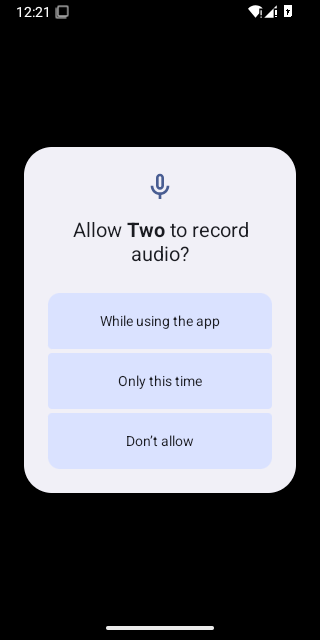
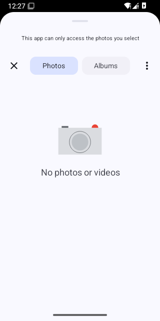
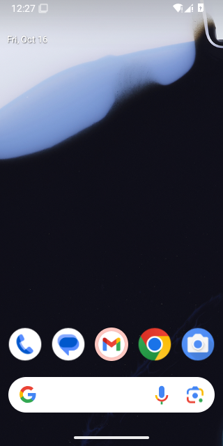
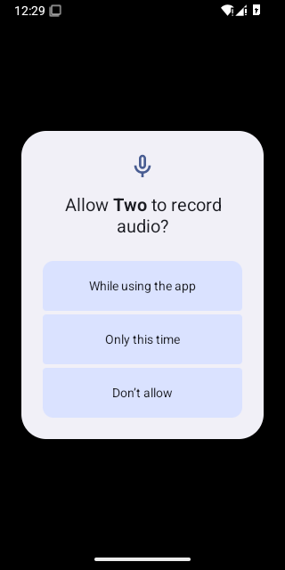

# Calls on Android 15 (API 35)

WebView: com.google.android.webview, 124.0.6367.219

## PASS - First call while Priya is offline, allowing the microphone

- ok  the call screen says Priya is not online - `"END-TO-END ENCRYPTED Y P Partner Not online right now They will see that you called Cancel"`
- ok  the call service runs in the foreground - `{"running":true,"foreground":true}`
- ok  the "Call in progress" notification is up
- ok  the call service has stopped
- ok  the notification has gone
- ok  the app is still open - `{"pidBefore":"","pidAfter":"3655"}`

<details><summary>Steps</summary>

- 41.4s tap Call - `"pressed Call"`
- 45.7s tap "While using the app"
- 50.4s tap Cancel - `"pressed Cancel call"`

</details>

```
{
  "pageErrors": []
}
```

   

Log: [first-call-while-priya-is-offline-allowing-the-mic.log](first-call-while-priya-is-offline-allowing-the-mic.log)

## PASS - Call while Priya is offline rings out

- ok  the call service runs in the foreground
- ok  after 45 seconds it says No answer - `"END-TO-END ENCRYPTED Y P Partner No answer They will see that you called."`
- ok  the call service has stopped
- ok  the app is still open - `{"pidBefore":"3655","pidAfter":"3655"}`

<details><summary>Steps</summary>

- 57.2s tap Call - `"pressed Call"`

</details>

```
{
  "pageErrors": []
}
```

 

Log: [call-while-priya-is-offline-rings-out.log](call-while-priya-is-offline-rings-out.log)

## PASS - Call cancelled straight away, ten times

- ok  no call service left running
- ok  the app is still open - `{"pidBefore":"3655","pidAfter":"3655"}`

<details><summary>Steps</summary>

- 111.7s Call, then Cancel after 0 ms - `true`
- 115.3s Call, then Cancel after 20 ms - `true`
- 119.0s Call, then Cancel after 40 ms - `true`
- 122.6s Call, then Cancel after 60 ms - `true`
- 126.4s Call, then Cancel after 90 ms - `true`
- 130.2s Call, then Cancel after 120 ms - `true`
- 134.0s Call, then Cancel after 180 ms - `true`
- 137.8s Call, then Cancel after 250 ms - `true`
- 141.8s Call, then Cancel after 400 ms - `true`
- 146.1s Call, then Cancel after 700 ms - `true`

</details>

```
{
  "pageErrors": []
}
```

Log: [call-cancelled-straight-away-ten-times.log](call-cancelled-straight-away-ten-times.log)

## FAIL - Call that Priya answers, with the speaker on and off

Stopped: `timed out after 60s waiting for both phones on the relay`

- ok  the app is still open - `{"pidBefore":"3655","pidAfter":"3655"}`

```
{
  "pageErrors": []
}
```


Log: [call-that-priya-answers-with-the-speaker-on-and-of.log](call-that-priya-answers-with-the-speaker-on-and-of.log)

## FAIL - Priya calls and you answer

Stopped: `timed out after 60s waiting for both phones on the relay`

- ok  the app is still open - `{"pidBefore":"3655","pidAfter":"3655"}`

```
{
  "pageErrors": []
}
```


Log: [priya-calls-and-you-answer.log](priya-calls-and-you-answer.log)

## FAIL - Screen turned off in the middle of a call

Stopped: `timed out after 60s waiting for both phones on the relay`

- ok  the app is still open - `{"pidBefore":"3655","pidAfter":"3655"}`

```
{
  "pageErrors": []
}
```


Log: [screen-turned-off-in-the-middle-of-a-call.log](screen-turned-off-in-the-middle-of-a-call.log)

## PASS - Choosing a photo opens the picker

- ok  Android's picker is open - `"topResumedActivity=ActivityRecord{d8e9f34 u0 com.google.android.providers.media.module/com.android.providers.media.photopicker.PhotoPickerGetContentActivity t8}"`
- ok  back in the chat
- ok  the app is still open - `{"pidBefore":"3655","pidAfter":"3655"}`

<details><summary>Steps</summary>

- 360.4s tap Send a photo - `"pressed Send a photo"`

</details>

```
{
  "pageErrors": []
}
```



Log: [choosing-a-photo-opens-the-picker.log](choosing-a-photo-opens-the-picker.log)

## FAIL - Taking a photo opens the camera

- NO  back in the chat - `"topResumedActivity=ActivityRecord{f2e3b78 u0 com.google.android.apps.nexuslauncher/.NexusLauncherActivity t7}"`
- ok  the app is still open - `{"pidBefore":"3655","pidAfter":"3655"}`

<details><summary>Steps</summary>

- 370.8s tap Take a photo - `"pressed Take a photo"`
- 375.8s on screen - `"topResumedActivity=ActivityRecord{f2e3b78 u0 com.google.android.apps.nexuslauncher/.NexusLauncherActivity t7}"`

</details>



Log: [taking-a-photo-opens-the-camera.log](taking-a-photo-opens-the-camera.log)

## FAIL - The page's own process crashing leaves the app open

Stopped: `timed out after 15s waiting for the last call screen to close (Runtime.evaluate timed out)`

- ok  the app is still open - `{"pidBefore":"3655","pidAfter":"3655"}`


Log: [the-page-s-own-process-crashing-leaves-the-app-ope.log](the-page-s-own-process-crashing-leaves-the-app-ope.log)

## PASS - Call when you don't allow the microphone

- ok  the call screen says the microphone is not allowed - `"END-TO-END ENCRYPTED Y P Partner Microphone not allowed Allow microphone access for Two in your phone settings, then try again."`
- ok  no call service started
- ok  the app is still open - `{"pidBefore":"3655","pidAfter":"4912"}`

<details><summary>Steps</summary>

- 504.0s tap Call - `"pressed Call"`
- 507.6s tap Don't allow

</details>

```
{
  "pageErrors": []
}
```

 

Log: [call-when-you-don-t-allow-the-microphone.log](call-when-you-don-t-allow-the-microphone.log)
