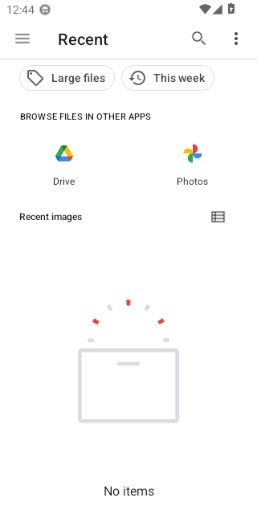

# Calls on Android 13 (API 33)

WebView: com.google.android.webview, 109.0.5414.123

## PASS - First call while Priya is offline, allowing the microphone

- ok  the call screen says Priya is not online - `"END-TO-END ENCRYPTED Y P Partner Not online right now They will see that you called Cancel"`
- ok  the call service runs in the foreground - `{"running":true,"foreground":true}`
- ok  the "Call in progress" notification is up
- ok  the call service has stopped
- ok  the notification has gone
- ok  the app is still open - `{"pidBefore":"","pidAfter":"5304"}`

<details><summary>Steps</summary>

- 43.7s tap Call - `"pressed Call"`
- 46.8s tap "While using the app"
- 51.1s tap Cancel - `"pressed Cancel call"`

</details>

```
{
  "pageErrors": []
}
```

Log: [first-call-while-priya-is-offline-allowing-the-mic.log](first-call-while-priya-is-offline-allowing-the-mic.log)

## PASS - Call while Priya is offline rings out

- ok  the call service runs in the foreground
- ok  after 45 seconds it says No answer - `"END-TO-END ENCRYPTED Y P Partner No answer They will see that you called."`
- ok  the call service has stopped
- ok  the app is still open - `{"pidBefore":"5304","pidAfter":"5304"}`

<details><summary>Steps</summary>

- 57.8s tap Call - `"pressed Call"`

</details>

```
{
  "pageErrors": []
}
```

Log: [call-while-priya-is-offline-rings-out.log](call-while-priya-is-offline-rings-out.log)

## PASS - Call cancelled straight away, ten times

- ok  no call service left running
- ok  the app is still open - `{"pidBefore":"5304","pidAfter":"5304"}`

<details><summary>Steps</summary>

- 110.9s Call, then Cancel after 0 ms - `true`
- 114.8s Call, then Cancel after 20 ms - `true`
- 118.4s Call, then Cancel after 40 ms - `true`
- 122.1s Call, then Cancel after 60 ms - `true`
- 125.8s Call, then Cancel after 90 ms - `true`
- 129.5s Call, then Cancel after 120 ms - `true`
- 133.3s Call, then Cancel after 180 ms - `true`
- 137.2s Call, then Cancel after 250 ms - `true`
- 141.1s Call, then Cancel after 400 ms - `true`
- 145.4s Call, then Cancel after 700 ms - `true`

</details>

```
{
  "pageErrors": []
}
```

Log: [call-cancelled-straight-away-ten-times.log](call-cancelled-straight-away-ten-times.log)

## PASS - Call that Priya answers, with the speaker on and off

- ok  the call connects - `"END-TO-END ENCRYPTED Y P Priya 0:00 Earpiece · 96 kbps Mute End Speaker"`
- ok  the call service runs in the foreground
- ok  still connected after six seconds
- ok  the call service has stopped
- ok  the screen lock at the ear is let go
- ok  the app is still open - `{"pidBefore":"5304","pidAfter":"5304"}`

<details><summary>Steps</summary>

- 164.3s tap Call - `"pressed Call"`
- 164.8s Priya sees - `"END-TO-END ENCRYPTED P D Dinesh online is calling you Decline Accept"`
- 165.0s Priya taps Accept - `"pressed Accept"`
- 167.5s tap Speaker - `"pressed Use speaker"`
- 169.4s tap Speaker again - `"pressed Use earpiece"`
- 172.6s tap End - `"pressed End call"`
- 175.6s Priya sees - `""`

</details>

```
{
  "audioAtEar": [
    "10-16 12:42:39:486 setCommunicationRouteForClient for pid: 5304 device: AudioDeviceAttributes: role:output type:speaker addr: name:sdk_gphone64_x86_64 profiles:[] descriptors:[] from API: setCommunicationDevice() from u/pid:10174/5304",
    "10-16 12:42:39:486 onUpdateCommunicationRoute, preferredCommunicationDevice: AudioDeviceAttributes: role:output type:speaker addr: name:sdk_gphone64_x86_64 profiles:[] descriptors:[] eventSource: setCommunicationDevice() from u/pid:10174/5304",
    "10-16 12:42:43:301 setCommunicationRouteForClient for pid: 5304 device: AudioDeviceAttributes: role:output type:speaker addr: name:sdk_gphone64_x86_64 profiles:[] descriptors:[] from API: setCommunicationDevice() from u/pid:10174/5304",
    "10-16 12:42:43:301 onUpdateCommunicationRoute, preferredCommunicationDevice: AudioDeviceAttributes: role:output type:speaker addr: name:sdk_gphone64_x86_64 profiles:[] descriptors:[] eventSource: setCommunicationDevice() from u/pid:10174/5304",
    "10-16 12:42:47:250 setCommunicationRouteForClient for pid: 5304 device: AudioDeviceAttributes: role:output type:speaker addr: name:sdk_gphone64_x86_64 profiles:[] descriptors:[] from API: setCommunicationDevice() from u/pid:10174/5304",
    "10-16 12:42:47:251 onUpdateCommunicationRoute, preferredCommunicationDevice: AudioDeviceAttributes: role:output type:speaker addr: name:sdk_gphone64_x86_64 profiles:[] descriptors:[] eventSource: setCommunicationDevice() from u/pid:10174/5304",
    "10-16 12:43:06:881 setCommunicationRouteForClient for pid: 5304 device: AudioDeviceAttributes: role:output type:speaker addr: name:sdk_gphone64_x86_64 profiles:[] descriptors:[] from API: setCommunicationDevice() from u/pid:10174/5304",
    "10-16 12:43:06:881 onUpdateCommunicationRoute, preferredCommunicationDevice: AudioDeviceAttributes: role:output type:speaker addr: name:sdk_gphone64_x86_64 profiles:[] descriptors:[] eventSource: setCommunicationDevice() from u/pid:10174/5304"
  ],
  "proximityAtEar": true,
  "audioOnSpeaker": [
    "10-16 12:42:43:301 setCommunicationRouteForClient for pid: 5304 device: AudioDeviceAttributes: role:output type:speaker addr: name:sdk_gphone64_x86_64 profiles:[] descriptors:[] from API: setCommunicationDevice() from u/pid:10174/5304",
    "10-16 12:42:43:301 onUpdateCommunicationRoute, preferredCommunicationDevice: AudioDeviceAttributes: role:output type:speaker addr: name:sdk_gphone64_x86_64 profiles:[] descriptors:[] eventSource: setCommunicationDevice() from u/pid:10174/5304",
    "10-16 12:42:47:250 setCommunicationRouteForClient for pid: 5304 device: AudioDeviceAttributes: role:output type:speaker addr: name:sdk_gphone64_x86_64 profiles:[] descriptors:[] from API: setCommunicationDevice() from u/pid:10174/5304",
    "10-16 12:42:47:251 onUpdateCommunicationRoute, preferredCommunicationDevice: AudioDeviceAttributes: role:output type:speaker addr: name:sdk_gphone64_x86_64 profiles:[] descriptors:[] eventSource: setCommunicationDevice() 
```

Log: [call-that-priya-answers-with-the-speaker-on-and-of.log](call-that-priya-answers-with-the-speaker-on-and-of.log)

## PASS - Priya calls and you answer

- ok  your phone rings - `"END-TO-END ENCRYPTED Y P Priya online is calling you Decline Accept"`
- ok  the call service runs in the foreground
- ok  the call service has stopped
- ok  the app is still open - `{"pidBefore":"5304","pidAfter":"5304"}`

<details><summary>Steps</summary>

- 182.1s Priya taps Call - `"pressed Call"`
- 182.7s tap Accept - `"pressed Accept"`
- 187.6s Priya taps End - `"pressed End call"`
- 190.6s you see - `""`

</details>

```
{
  "pageErrors": []
}
```

Log: [priya-calls-and-you-answer.log](priya-calls-and-you-answer.log)

## PASS - Screen turned off in the middle of a call

- ok  the app is still running with the screen off
- ok  the call is still on (Priya sees a timer)
- ok  the call service still runs in the foreground
- ok  the call service has stopped
- ok  the app is still open - `{"pidBefore":"5304","pidAfter":"5304"}`

<details><summary>Steps</summary>

- 195.4s tap Call - `"pressed Call"`
- 196.4s press the power button
- 209.0s tap End - `"pressed End call"`

</details>

```
{
  "pageErrors": []
}
```

Log: [screen-turned-off-in-the-middle-of-a-call.log](screen-turned-off-in-the-middle-of-a-call.log)

## PASS - Choosing a photo opens the picker

- ok  Android's picker is open - `"topResumedActivity=ActivityRecord{68a8425 u0 com.google.android.documentsui/com.android.documentsui.picker.PickActivity} t9}"`
- ok  back in the chat
- ok  the app is still open - `{"pidBefore":"5304","pidAfter":"5304"}`

<details><summary>Steps</summary>

- 215.3s tap Send a photo - `"pressed Send a photo"`

</details>

```
{
  "pageErrors": []
}
```



Log: [choosing-a-photo-opens-the-picker.log](choosing-a-photo-opens-the-picker.log)

## PASS - Taking a photo opens the camera

- ok  back in the chat - `"topResumedActivity=ActivityRecord{1e9e6ed u0 app.two.android/.MainActivity} t9}"`
- ok  the app is still open - `{"pidBefore":"5304","pidAfter":"5304"}`

<details><summary>Steps</summary>

- 225.3s tap Take a photo - `"clicked the camera input"`
- 230.3s on screen - `"topResumedActivity=ActivityRecord{aef3e70 u0 com.android.camera2/com.android.camera.CaptureActivity} t9}"`

</details>

```
{
  "pageErrors": []
}
```


Log: [taking-a-photo-opens-the-camera.log](taking-a-photo-opens-the-camera.log)

## PASS - The page's own process crashing leaves the app open

- ok  the app process is still running
- ok  Settings shows a note about it
- ok  the app is still open - `{"pidBefore":"5304","pidAfter":"5304"}`

<details><summary>Steps</summary>

- 236.4s crash the page process
- 245.3s open Settings - `"ok"`

</details>

```
{
  "pageErrors": []
}
```

Log: [the-page-s-own-process-crashing-leaves-the-app-ope.log](the-page-s-own-process-crashing-leaves-the-app-ope.log)

## PASS - Call when you don't allow the microphone

- ok  the call screen says the microphone is not allowed - `"END-TO-END ENCRYPTED Y P Priya Microphone not allowed Allow microphone access for Two in your phone settings, then try again."`
- ok  no call service started
- ok  the app is still open - `{"pidBefore":"5304","pidAfter":"8242"}`

<details><summary>Steps</summary>

- 258.7s tap Call - `"pressed Call"`
- 261.9s tap Don't allow

</details>

```
{
  "pageErrors": []
}
```

Log: [call-when-you-don-t-allow-the-microphone.log](call-when-you-don-t-allow-the-microphone.log)
